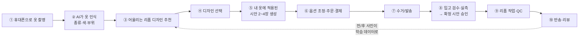
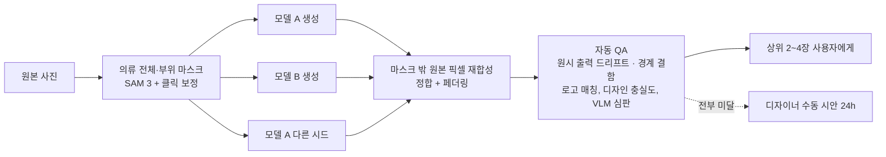
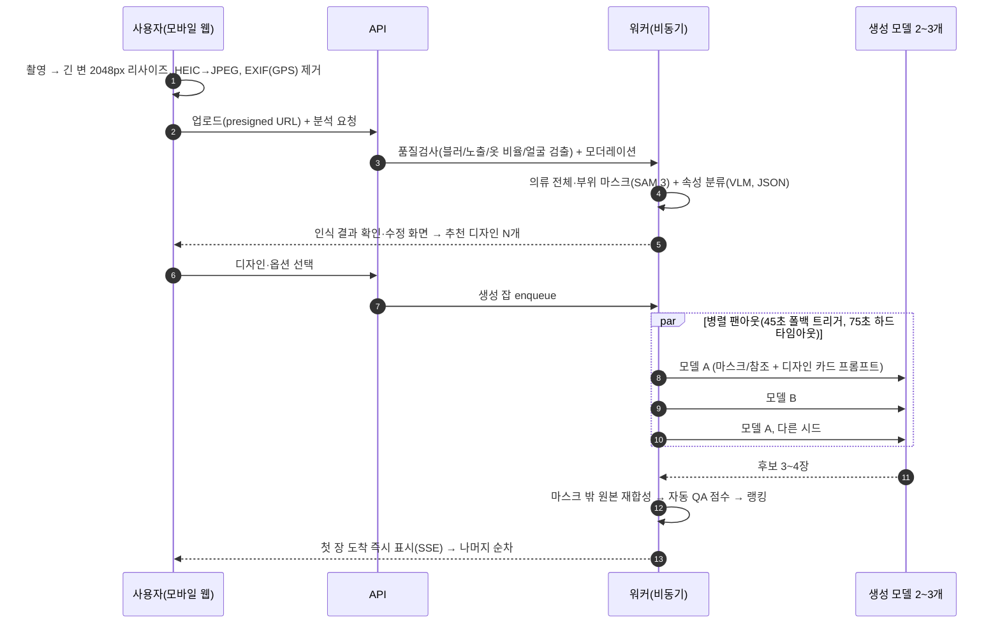
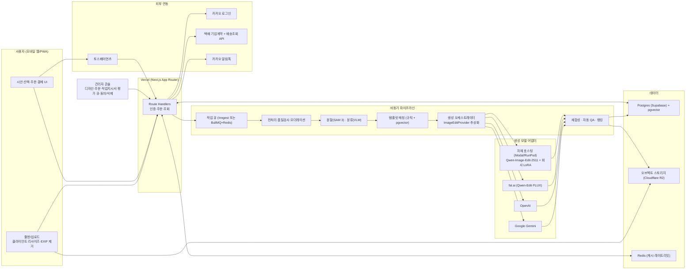
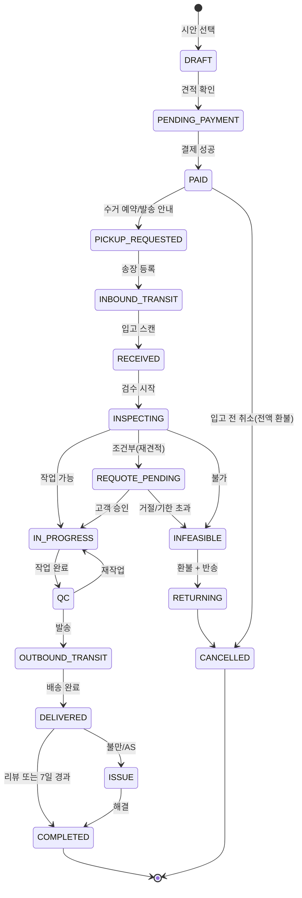
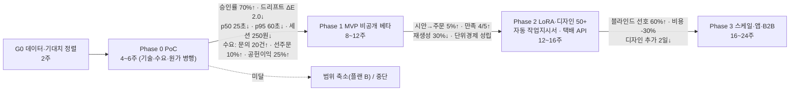

# 리폼 편의점 — AI 리폼 미리보기 서비스 기획서 (v0.2 초안, 사실 검증·보완 리서치 반영)

| 항목 | 내용 |
|---|---|
| 문서 목적 | 클라이언트(리폼 편의점)의 "사진 한 장으로 내 옷의 리폼 시안을 보여주는" 서비스가 실제로 구현 가능한지 판정하고, 구축 전 기획을 확정하기 위한 기초 문서 |
| 작성 기준일 | 2026-10-22 (조사 기준 2026-10-21) |
| 조사 방식 | 7개 축(생성 기술·인식/분할·디자인 학습·시장/법률·UX·아키텍처/비용·레드팀) 병렬 리서치 → 핵심 사실 주장 20건 적대적 검증(확인 18·정정 2) → 비평가 누락 점검 → 보완 리서치 4건(수요·단위경제·벤더 데이터 정책·경쟁/명칭). 상세 보고서는 `research/` 폴더 |
| 문서 상태 | v0.2 초안(20건 사실 검증과 보완 리서치 4건 반영). 클라이언트 확인 질문(§11)에 대한 답변과 PoC 결과에 따라 v1.0으로 확정 |

---

## 0. 한 장 요약 (Executive Summary)

**결론: 구현 가능하다. 단, 세 가지 전제를 설계에 박아 넣어야 한다.**

1. **"옷의 원형을 그대로 두고 리폼 부분만 바꾼다"는 것은 AI 모델이 보장해 주지 않는다. 파이프라인이 보장해야 한다.** 2026년 현재 어떤 상용·오픈 이미지 편집 모델도 "지정한 영역 밖은 절대 안 바뀐다"를 약속하지 않는다(OpenAI 공식 문서도 마스크가 "정확히 지켜지지 않을 수 있다"고 명시). 따라서 `옷 부위 분할(마스크) → 여러 장 병렬 생성 → 마스크 밖은 원본 픽셀로 되돌리기 → 자동 품질 검사로 최상 1~3장 선택` 구조(이하 **Guarded Edit**)로 만들어야 한다. 모델 선택보다 이 구조가 품질을 좌우한다.
2. **"우리 디자인을 학습시킨다"는 세 단계로 정의해야 한다.** L1 **디자인 카드**(학습 없음: 레퍼런스 사진 + 작업 규칙 + 프롬프트 템플릿) → L2 **LoRA 소규모 학습**(디자인당 리폼 전/후 사진 20~40쌍, 오픈 모델) → L3 전용 모델. 상용 API(Google·OpenAI 등)는 파인튜닝을 제공하지 않으므로, 초기에는 L1으로 시작하고 **리폼 전/후 사진을 매 주문마다 표준 촬영**해 L2용 데이터를 쌓는 것이 핵심이다. 병목은 모델도 비용도 아니고 **전/후 쌍 데이터**다.
3. **1차 출시 범위는 결과가 결정적인 "표면 변경형" 리폼(자수·와펜·패치·프린트)으로 한정한다.** 염색·워싱은 외주 단가·불량률을 확인한 뒤 추가하고, 기장 크롭·소매 제거·패치워크·실루엣 변경 같은 "구조 변경형"은 AI 표현 난이도가 높아 스태프 검수 후 확정 시안을 보내는 반자동 트랙으로 분리한다. 그리고 **모든 주문은 입고 검수 후 실물 사진 위에 시안을 겹친 "확정 시안"을 고객이 승인**하는 단계를 거친다. 이것이 환불·분쟁의 기준점이다.

**숫자로 보는 사업성(추정치, 근거는 본문)**

| 항목 | 수치 |
|---|---|
| 시안 1건 생성 원가(상용 API, 후보 3장 병렬) | 약 $0.10~0.15 (150~200원) |
| 인식·분할 원가(1건) | 약 $0.002~0.015 |
| PoC 생성 비용(옷 10벌 × 디자인 5개 × 모델 3~4개 × 3샘플) | 약 $20~40 |
| 월 1,000건 시안 운영비(생성비) | 약 22만 원 |
| 월 1만 건 시안 운영비(생성비) | 약 110~220만 원 |
| MVP(PoC + 비공개 베타) 구축비 | 내재화 1.0~1.5억 / 외주 1.2~2.5억 |
| 1년차 총비용 | 내재화 3.0~5.0억 / 외주 3.5~7.0억 |
| 국내 의복 수리업 공식 매출(KOSIS 서비스업조사, 2024) | 약 2,868억 원(사업체 13,485개·종사자 15,334명, 2020년 대비 매출 −12.6%). 가죽·가방·신발 수리 포함 3,703억 원. 언론의 '협회 추산 2조 원'은 출처·산식 없는 미검증 수치 |
| 1년차 SOM(가정 기반 추정) | 연 4,000~1만 건, 2.4~7억 원(월 350~850건) |
| 건당 원가 구조(공개 시세 추정) | 왕복 물류·장인 공임·QC가 70~85%. AI 시안은 주문당 약 4,400원(전환 5%) |
| 메뉴판 하한가(공헌이익 25% 통과선, 배송비 별도·수거 고객 발송) | 자수 포인트 2.5만 · 패치 3만 · 실루엣 4.5만 원 |
| 손익분기(장인 1명, 객단가 5만 원) | 월 129~220건 |

**사업성 핵심**: 공개 시세 기준으로 건당 원가의 70~85%는 왕복 물류·장인 공임·QC이고 AI 비용은 변수가 아니다. 처음 가정한 저가 메뉴(자수 1.5만 원 등)는 공헌이익이 음수이므로 수거는 고객 발송·반송비만 포함, QC 10분 이내, 하한가 상향이라는 세 가지 레버가 필요하다(§8.2). 수요 측면에서는 공식 통계상 유료 수선 매출이 2020년 대비 12.6% 줄어든 반면 중고·리폼 콘텐츠 소비는 크다. 즉 "시장이 크다"가 아니라 "관심은 있으나 유료 전환이 안 된다"가 출발점이고, 내 옷에 적용된 미리보기가 그 전환 장치라는 것이 이 서비스의 핵심 가설이다(§2.1).

**법률 핵심**: 2026년 2월 26일 대법원이 루이비통 리폼 사건을 파기환송하며 "소유자의 개인 사용 목적 리폼은 원칙적으로 상표 사용이 아니다"라고 판시했다. 단, "업체가 디자인을 주도하고 반복 생산하며 로고 부속품을 조달하고 브랜드명을 광고하는" 경우는 예외가 될 수 있는데, **이는 AI 템플릿 서비스의 모습과 정확히 겹친다.** 파기환송심 선고(2026년 11월 12일 예정)를 지켜보고, 1차는 로고와 무관한 비명품 캐주얼 디자인으로 시작한다.

**다음 행동**: ① 클라이언트 질문지(§11) 답변 수령 → ② 4~6주 Phase 0: 기술 PoC + 수요 테스트(SNS·선주문·가격 민감도 조사) + 파일럿 15건 원가 실측 병행 → ③ Go/No-Go → ④ MVP 착수.

---

## 1. 서비스 개요

### 1.1 한 줄 정의
> "내 옷 사진 한 장으로, 리폼 편의점 디자이너의 리폼 템플릿이 **내 옷 그대로** 적용된 모습을 미리 보고, 집 앞에서 보내고 받는 디자인 리폼 원스톱 서비스."

### 1.2 서비스 흐름



### 1.3 누구에게 어떤 가치인가

| 대상 | 가치 |
|---|---|
| 고객 | 리폼은 "해보기 전엔 결과를 모른다"는 불안이 가장 큰 진입 장벽. 내 옷에 적용된 시안을 30초 안에 보면 **결정이 쉬워지고**, 가격(수만 원)에 대한 가치 체감이 생긴다 |
| 리폼 편의점 | 상담·시안 제작 인건비 절감, 디자인 템플릿의 **반복 판매**, 모든 주문이 전/후 데이터가 되어 시안 품질이 계속 좋아지는 플라이휠 |
| 시장 | 국내에 "전 브랜드 의류 + 디자인 템플릿 + AI 원형보존 시안 + 수거·반송"을 **결합한** 서비스는 2026-10 기준 확인되지 않음(§2). 단, 각 요소(사진 견적·수거 플랫폼, 리디자인 이미지 생성)는 국내외에 따로 존재하므로 공백은 일시적일 수 있다 |

### 1.4 범위 정의

| 구분 | 1차(MVP) | 2차 | 제외/보류 |
|---|---|---|---|
| 리폼 유형 | 자수·와펜·패치, 프린트 (결과가 결정적인 표면 변경형) | 단색 염색/워싱(외주 단가·불량률 확인 후), 기장 크롭, 소매 제거, 디스트레스, 부자재 교체(구조 변경형, 스태프 검수 트랙) | 실루엣 변경·패치워크(사람 착장 컷 필요, 두 벌 촬영 필요) |
| 촬영 방식 | 옷만 평면(flat-lay) 촬영, 앞면 1장 필수(뒷면·신용카드·케어라벨은 선택) | 옷걸이 촬영 | 착용샷(얼굴·신체 포함 → 개인정보·난이도 급증) |
| 의류 | 로고와 무관한 비명품 캐주얼(티셔츠·맨투맨·후디·셔츠·데님) | 아우터·니트 | 명품·로고 중심 의류(파기환송심 선고 후 결정) |
| 채널 | 모바일 웹(PWA) + 카카오톡 채널(유입·알림) | PWA 설치 유도 | 네이티브 앱(AR 피팅 필요 시) |

---

## 2. 시장·경쟁·포지셔닝

### 2.1 시장 (근거는 `research/D_market_legal.md` §1, `research/H1_demand_market_evidence.md`)
- **공식 통계(KOSIS 서비스업조사, KSIC 95391 의복 및 기타 가정용 직물제품 수리업)**: 2024년 매출 **2,868억 원, 사업체 13,485개, 종사자 15,334명**. 2020년 대비 매출 −12.6%, 사업체 −11.5%. 가죽·가방·신발 수리(835억 원)를 더하면 **3,703억 원**. 사업체당 연매출 약 2,100만 원의 1인 영세 점포 구조.
- 언론에 인용되는 "협회 추산 2조 원, 업체 2.3만, 종사자 19.3만"(2022.2 인터뷰)은 출처·산식이 없고 공식 매출의 약 7배다. 투자자·클라이언트 제출용 근거로는 쓰지 않는다.
- **수요 신호**: 13~59세 중고 구매 경험 78%(20대 68%), 중고 긍정 인식 75.3%, 리커머스 43조 원 전망, 유튜브 최대 리폼 채널 구독자 225만, 가구 의류·신발 지출 비중 3.9%로 역대 최저. 국내 명품 시장 21.1조 원(유로모니터)은 리폼 대상 자산 풀. → **관심·순환 소비는 커졌지만 유료 수선 매출은 줄었다.** 병목은 접근성·신뢰·디자인 제안이며, "내 옷에 적용된 시안"이 관심을 주문으로 바꾸는 장치라는 것이 이 서비스의 핵심 가설이다.
- **지불의사(WTP)**: 2024~26년 국내 공개 조사는 없다. 간접 신호는 숨고 명품 수선·리폼 평균 8만 원(3만~45만, 누적 견적 24,471건), 일반 수선 1만~2.5만 원, 리폼 고객 20~30대 38.5%·재이용 79.4%(2021 설문). 세그먼트 가설: **S1 빈티지·Y2K 20대 1.5만~5만 원**(신뢰도 낮음), **S2 애착·고가 의류 30~40대 8만~30만 원**(신뢰도 중).
- **TAM→SAM→SOM(가정 명시)**: TAM 약 3,703억 원(미등록 30% 포함 시 4,800억) → SAM 약 240억 원(20~40대 40% × 디자인 리폼 30% × 비대면 수용 70%, 모두 가정) → **1년차 SOM 2.4~7억 원(연 4,000~1만 건, 월 350~850건)**.
- **착수 전 2~3주 저비용 조사**: 네이버 데이터랩 6개 키워드('옷 리폼', '리폼 맡기기', '옷 수선', '청바지 리폼', '명품 리폼', '리폼 가게') 2023.1~2026.10 월별·연령·성별 CSV, Google Trends, **오픈서베이 300~500명 Van Westendorp 가격 민감도 조사(미리보기 이미지 유무 A/B)**, 숨고 누적 견적 요청 월별 추적. (이번 조사에서는 데이터랩·Trends·인스타그램·크몽이 도구 차단으로 미수집)
- 트렌드: Y2K·빈티지 리폼(20대, 틱톡), 브랜드 커스터마이징(아디다스 Made For You), 유니클로×재니들 수선 워크숍(2026.10), 백화점 리커머스(롯데 그린리워드·현대 바이백). 프랑스 수선 보너스(2년 170만 건)는 국내 수선 지원 정책의 기회·리스크 항목.

### 2.2 경쟁 지도

| 축 | 국내 플레이어 | 우리와의 차이 |
|---|---|---|
| 기능 수선 비대면 | 모두의수선(바지 기장 8,000·청바지 13,000·아우터 총기장 3만~3.5만, 우체국 수거), 바지단(배송료 6,000원·2.5만 원 이상 반송 무료, 당일 수선 목표), 런드리24(바지 기장 6,000원~, **리폼 불가**), 런드리고·세탁특공대(수선 항목만) | 기장·허리 등 기능 수선. 디자인 리폼·AI 시안 없음 |
| 명품 수선·리폼 매칭 | 패피스(사진 1분 견적→30분 내 최대 3견적→방문수거, 누적 거래 50억+, 2026.7 시리즈A 브릿지, 일반 의류 리폼은 비대상, '자동 견적' 계획 언급), 럭셔리앤올(역경매 견적), 숨고(평균 8만 원, 가방 중심), 청년장인 | 견적 매칭 플랫폼. 직접 생산·디자인 템플릿·AI 시안 없음. 패피스가 자동 견적을 붙이면 가장 가까운 경쟁자 |
| 브랜드 자체 수선 | 리유니클로 스튜디오(자수 리메이크 6,900원~, 온라인 밑단 2,000원), 파타고니아 퀄리티랩(**전 브랜드 무상 수선**, 코엑스 예약제, 대기 약 1개월, 누적 2,400건) | 자사 제품 한정이거나 기능 수선 무상. 디자인 리폼 없음 |
| 업사이클 브랜드 | 래코드(코오롱), 큐클리프 | 자사 재고 해체·재판매. 고객 옷 리폼 아님 |
| 커스텀 제작 | 마플(프린트·자수) | 새 무지 제품에 인쇄. "내 헌 옷" 아님 |
| 해외 참고 | Sojo(영국, B2B 화이트라벨로 전환), The Seam(사진 업로드→48시간 견적, 누적 1만 건+), Save Your Wardrobe·Alternew(수선 물류), **Tingit(리투아니아, 동영상→AI 수선 견적, 2026.2 시드 €1.5M)**, **mew.design(기존 옷 사진→리디자인 컨셉 이미지 생성)** | 수선 물류 플랫폼과 리디자인 이미지 생성이 **각각** 존재. '원형 보존 시안 + 회사 템플릿 + 직접 제작·반송 단일 책임'의 결합만 없음 |
| AI 가상 피팅 | Google Search try-on(무료), 소비자 앱(200크레딧 $9.99), FASHN API($0.04/장) | "입혀보기"이지 "내 옷 리폼 시안"이 아님. 빅테크가 피팅을 무료화했으므로 우리는 **리폼 결과 시안**으로 차별화 |

### 2.3 포지셔닝
- **포지셔닝 문장**: "국내 최초, 내 옷 원형을 보존한 AI 리폼 시안을 보고 주문하는 디자인 리폼 수거·반송 서비스(2026-10 기준)". "국내외 공백"이라는 표현은 과장이므로 쓰지 않는다. 각 요소는 따로 존재하고 결합만 없으며, 패피스의 자동 견적 계획·가상피팅 기업의 확장으로 공백은 일시적일 수 있다. **차별화의 근거는 "시안-실물 일치 보증"(확정 시안 승인 + 재작업·환불 정책)**에 둔다.
- '편의점' 네이밍은 **고정가 메뉴판**(단위경제 기준 하한가: 자수 포인트 2.5만 원~, 패치 3만 원~, 기장 2만 원~, 실루엣 4.5만 원~, 복합 6만 원~, §8)과 **편의점 택배 접수**(수거를 고객이 편의점택배로 발송)라는 두 가지 연상으로 활용할 수 있다.
- **명칭 리스크(2026-10-22 직접 조회, `research/H4`)**:
  - KIPRIS에 '리폼편의점'·'리폼 편의점'·'REFORM CONVENIENCE' 출원·등록 **0건** → 출원 가능. 단 '리폼'과 '편의점'은 각각 성질표시라 **식별력 거절 리스크**가 있다(37류에서 '리폼·리폼마트·REFORM STATION' 등 거절 다수). '세탁편의점 크린토피아'(37류), '디자인 편의점 손수#'(40·42류), '요편의점'(42류)처럼 **식별력 요소·로고를 결합**하면 등록 선례가 있다.
  - **제주에 동일 명칭 '리폼편의점'(대표 김태연)이 2026년 제주시새활용센터 새활용 예비창업팀으로 공개 활동 중**(6월 새활용토크 발표, 10월 제주동물예술제 체험 운영). 상표 출원은 없음. 선사용·혼동 리스크 → **양수·공존동의 협의 / 명칭 변경 / 선출원 후 협의** 중 기획 단계에서 결정. (앞서 언급된 KBS 보도·강연옥·박기덕 참여는 재조사에서 확인되지 않음)
  - 도메인 reformcvs.kr/.com/.co.kr, 리폼편의점.kr/.com/.한국 **미등록**, Instagram·TikTok·YouTube @reformcvs **미사용** → 즉시 확보. 네이버 스마트스토어·플레이스·사업자 상호는 도구 차단으로 미확인(담당자 직접 조회).
  - 명칭 유지 시: 2주 내 문자 + 로고 결합 상표를 **37류(의류 수선)·40류(리폼·맞춤 제작)·42류(AI SaaS)·35류(온라인 중개)·09류(앱)**에 출원(우선심사 검토). 변경 시 KIPRIS 0건 확인된 대안: **리폼클럽, 옷고침, 리폼마켓**.
  - 별도로 AI 리폼 시안 관련 특허 선행조사(KIPRIS 특허, G06Q/G06T)를 수행한다(인접 특허 '거점 기반 의류 수선 서비스 장치'(2023, 거절) 확인됨).

---

## 3. 실현 가능성 판정

### 3.1 질문 1: "사진을 찍으면 리폼된 시안이 나온다" — 가능한가?

**판정: 가능. 단, 모델에 맡기지 말고 파이프라인으로 원형을 보장해야 한다.**

2026년 10월 기준 상용 API 후보(한국 가용 확인, 상세 비교표는 `research/A_generation_tech.md` §2~4):

| 모델 | 장당 가격 | 참조 이미지 | 마스크 | 원형 보존 평판 | 비고 |
|---|---|---|---|---|---|
| Google Nano Banana 2.1 (`gemini-nano-banana-2.1`, 2026-10-06 출시) | $0.0336 (1K), Batch 50% 할인 | 최대 14장(객체 10 + 캐릭터 4) | 프롬프트형 | AA 라이브 보드 Identity·Object·Retail 모두 3위(2026-10-22), GEditBench v2 시각적 일관성 상위 | seed 미지원, **가성비 1순위·기본 라우트** |
| OpenAI GPT Image 2.5 (Sunburst/Flare) | 토큰제(출력 $30/1M), 품질별 약 $0.04~0.21 | 다수 | 알파 마스크 지원(단 "형태 비보장" 공식 명시) | **AA 라이브 보드 Identity·Object·Retail 모두 1위(Sunburst)·2위(Flare)**, 텍스트·프린트 최상 | 복잡 프롬프트 최대 2분(공식) → 동기 경로 불가, 고화질 비동기 경로용. ZDR 승인제 |
| ByteDance Seedream 5.0 Pro (BytePlus) | 약 $0.045 + 참조당 $0.003(2차 출처) | 10장 | 자연어 국소편집 | 2026-09 개편 당시 Identity 보드 1위였으나 **2026-10-22 라이브 보드 8위** | 데이터 정책 원문 미확인 → **후보 보류**(PoC에서 비교군으로만) |
| BFL FLUX 3 Image / FLUX.2 pro edit | $0.048 / $0.045 | 10장 / 8장 | 바운딩 박스 | 벤치 미게재 | FLUX.1 Fill은 제거형 inpainting용 |

오픈웨이트(자체 호스팅·LoRA 학습 가능, **상업 이용 가능한 것만**): **FLUX.2 [klein] 4B**(Apache 2.0, 약 13GB VRAM, 1초 미만 추론 주장), **Qwen-Image-Edit-2511**(Apache 2.0, 20B). 라이선스상 제외: FLUX.2 dev/klein 9B/Kontext dev(비상업), Qwen-Image-2.1(연구용), HunyuanImage 3.0(한국 제외 조항, 2차 출처·원문 재확인 필요).

**왜 파이프라인이 필요한가** (근거 §5 `research/A`):
- 벤치마크에서 "지시를 잘 따르는 모델"과 "원본을 잘 보존하는 모델"은 트레이드오프다(GPT Image 1.5는 지시 이행 1위지만 시각적 일관성 최하위권).
- 반복 편집 시 편집하지 않은 영역도 모델 선호 텍스처로 서서히 바뀌는 "드리프트"가 연구로 확인됐고, 일반 화질 지표는 이를 감지하지 못한다.
- 실패 모드: 색조 변화, 로고·프린트 왜곡, 요청하지 않은 객체 추가, 작은 영역 편집 시 늘어짐, 배경 변형, 동일 입력에 다른 결과(seed 미지원).

**Guarded Edit 파이프라인(권장 1안)**



- 원형 보존을 **구조적으로** 보장: 마스크 밖은 생성 결과와 무관하게 원본 픽셀이다.
- 후보 3장 병렬 생성 + 자동 선택으로 품질 편차를 흡수. 상용 기준 요청당 약 $0.10~0.15.
- 모델은 `ImageEditProvider` 추상화 뒤에 두고 2개 이상 벤더를 상시 운영한다. 모델 세대는 분기 단위로 바뀐다(예: Gemini 3.1 Flash Image(Nano Banana 2)가 2026-10-06 deprecated, Gemini 2.5 Flash Image도 종료 예고. 참고로 '2.5 Flash Image 2026-10-02 종료'는 검증 결과 가격 페이지의 미갱신 문구였고 공식 종료 가능일은 2027-03-15).
- 자동 QA는 세 층위로 측정한다. ① 후합성 전 **원시 출력**의 마스크 밖 변화량(모델 품질 신호, 라우팅 학습용), ② 합성 **경계(seam)**의 결함, ③ 마스크 **안쪽**의 디자인 충실도. 후합성 뒤에는 마스크 밖이 원본과 동일하므로 그 자체는 지표가 아니다.

### 3.2 질문 2: "우리 디자인을 학습시켜 어떤 옷에도 적용한다" — 가능한가?

**판정: 가능. 단 "학습"을 3단계로 정의하고, 초기에는 학습 없이 시작한다.**

| 단계 | 방식 | 필요 데이터 | 비용 | 기대 품질 | 시점 |
|---|---|---|---|---|---|
| **L1 디자인 카드** (학습 없음) | 디자인별 레퍼런스 사진 1~3장 + 적용 부위 규칙/마스크 전략 + "바꿀 것/유지할 것/금지" 프롬프트 템플릿 + 호환 의류 조건을 상용 편집 API에 주입 | 디자인당 큐레이션된 after 사진 3~5장, 작업 규칙 문서 | 디자인당 1~3시간 정의 | 자수·패치·프린트·단색 염색은 충분할 가능성 높음 | Phase 0~1 |
| **L2 LoRA 소규모 학습** | 오픈 모델(Qwen-Image-Edit-2509/2511 또는 FLUX.2 klein 4B)에 디자인별·패밀리별 LoRA 학습. fal 관리형 트레이너는 2509만 가용(2511 트레이너는 deprecated), 2511은 ai-toolkit 자체 학습 | **디자인당 전/후 쌍 20~40장 + 홀드아웃 5~10장**(의류 8종 이상, before의 30~50%는 폰 촬영) | 관리형 $4~20/디자인(fal.ai), 자체 GPU 약 $3 | 구조 변경형·워싱·디스트레스 등 L1이 약한 유형 보강 | Phase 2 (데이터 확보 후) |
| **L3 전용 모델** | 대규모 쌍 데이터로 편집 모델 자체 파인튜닝 | 수천 쌍 이상 | 높음 | 완전 자체 스타일 | 장기 검토 |

핵심 근거(`research/C_design_learning.md`):
- 상용 API(Google·OpenAI·BytePlus 등)는 **파인튜닝을 제공하지 않는다**(Vertex Imagen 튜닝은 2025-12-31 종료, Adobe Firefly Custom Models가 상용 중 유일한 예외). 따라서 "학습"은 오픈 모델에서만 가능하고, 상용 API에서는 L1(컨텍스트 주입)이 유일한 경로다.
- 레퍼런스 이미지를 많이 넣을수록 좋아지지 않는다. 2026년 2월 연구(UniRef)에서 Qwen-Image-Edit-2511은 참조 4~6장 입력 시 성능이 급락했고, Nano Banana는 2~3장에서 최고였다. **레퍼런스는 큐레이션된 1~2장 + 텍스트 규칙으로 압축**한다.
- 편집 LoRA는 "before → after 변환"을 배우므로 **after 사진만으로는 학습이 안 된다.** 회사가 가진 after-only 사진은 레퍼런스 세트·추천 인덱스·평가 기준으로 쓰고, before는 편집 모델로 역생성(BACKWARD 방식)해 보강할 수 있다.
- 학습비는 사소하다(디자인 200개 전량 LoRA화해도 $3.6k~10.6k). **병목은 쌍 데이터와 라벨 규율, 그리고 디자이너 검수 시간**이다.
- 디자인을 **"작업 연산(op)" 단위로 구조화**(CROP/PATCH/EMBROIDERY/DYE 등 + 부위 + 치수 + 색)하면, 시안에서 작업지시서를 "역추출"할 필요 없이 **파라미터가 원천이고 이미지는 렌더링**이 된다. 이것이 시안과 실물의 일치를 보장하는 가장 확실한 방법이다.

**플라이휠**: 리폼 편의점은 실제 리폼을 하므로 **모든 주문이 진짜 전/후 쌍**이 된다. 입고(before)·출고(after) 표준 촬영(동일 지그, 무채색 배경, 색온도 고정, 건당 5분)을 1일차부터 작업 공정에 넣으면 디자인당 +20쌍 누적 시 자동으로 L2 학습을 트리거할 수 있다.

### 3.3 리폼 유형별 AI 표현 난이도 (`research/A` §8)

| 리폼 유형 | 난이도 | 이유 | 1차 범위 |
|---|---|---|---|
| 단색 염색/워싱 | 하 | 표면 색만 변경, 구조 불변. 로고·프린트 보존 필요 | ⚠️ AI는 쉬우나 **외주 염색 단가·불량률(샘플 5벌) 확인 후** 추가 |
| 자수·와펜·패치 추가 | 중 | 국소 추가라 마스크 친화적. 실 입체감·정확한 위치가 관건 | ✅ |
| 프린트(실크스크린/DTF) | 중 | 텍스트·로고 정확도. 디자인 PNG를 2D 워핑 합성 후 블렌딩이 효과적 | ✅ |
| 타이다이/블리치 패턴 | 중 | 주름·형태에 맞춰 패턴을 "입혀야" 함 | 2차 |
| 디스트레스/찢기 | 중 | 구멍 아래 추론, 과장 경향 → LoRA 필요 | 2차 |
| 기장 크롭 / 소매 제거(조끼화) | 중상 | 제거 + 새 마감 생성 + 배경 채우기. 보존형 모델과 상충 | 2차(스태프 검수) |
| 지퍼·단추·부자재 교체 | 중 | 소형 금속 부품은 생성 모델 약점 | 2차(2D 합성) |
| 패치워크/하프앤하프 | 상 | 두 옷 결합, 멀티레퍼런스 필수, 정체성 상실 경향 | 보류 |
| 실루엣 변경 | 상 | 옷 단독 사진에선 핏이 안 보임 → 착장 컷(VTON) 영역 | 보류 |

### 3.4 질문 3: "사진에서 옷을 정확히 인식·분할할 수 있나?" (`research/B`)

| 과제 | 판정 | 설계 |
|---|---|---|
| 종류·색·패턴 인식 | **가능.** 멀티모달 LLM 제로샷 + JSON 스키마가 가장 빠르고 싸다(1건 $0.0004~0.008). 18개 속성 macro-F1 53~64%, 가시 속성은 약 71% | Gemini Flash 계열 + Claude Haiku/Sonnet 폴백, 결과를 사용자가 탭해서 수정 |
| 소재·상태(얼룩/손상) | **부분적.** 소재 F1 0.36~0.52로 가장 어려움 | AI 추정 + **사용자 필수 선택**(케어라벨 촬영 옵션) + 입고 검수 3중 구조 |
| 옷 전체 마스크 | **매우 안정.** SAM 2/3 | SAM 3(SAM License, 상업 금지 조항 없음) |
| 부위(소매·칼라·포켓) 마스크 | **불안정.** 공개 모델 부위 mAP 0.204(본체 0.589), 평면 촬영에서 성능 저하 | 자동 "제안" + 브라우저에서 사용자 클릭 보정 UI 필수 |
| "어디를 몇 cm 자를지" | 참고 치수 가능(신용카드 기준, 오차 ±1~2cm) | 사진 단계는 참고 치수, **재단 치수는 입고 후 실측으로 확정**(고객 동의 플로우) |

### 3.5 종합 판정표

| 클라이언트 기대 | 판정 | 조건 |
|---|---|---|
| 사진 찍으면 시안이 나온다 | ✅ 가능 | Guarded Edit, 평면 촬영 가이드, 후보 3장 + 자동 선택, 실패 시 수동 시안 |
| 원형은 그대로, 리폼 부분만 바뀐다 | ✅ 가능 | 마스크 밖 원본 재합성으로 **구조적** 보장. 마스크 안쪽 품질은 모델·디자인 유형에 따라 편차 |
| 우리 디자인을 학습시킨다 | ⚠️ 조건부 | L1으로 시작, 전/후 쌍 20~40장/디자인 확보 후 L2. 상용 API는 학습 불가 |
| 어떤 옷에도 일관 적용 | ⚠️ 조건부 | 디자인별 "적용 가능 조건" 메타데이터로 추천을 필터링. 안 맞는 옷엔 "적용 불가 + 이유" 표시가 정답 |
| 시안대로 실물이 나온다 | ⚠️ 조건부 | 파라미터 우선 작업지시서 + 입고 검수 시 실물 위 시안 오버레이 재확인 + 확정 시안 승인 단계 |
| 완전 자동화 | ⚠️ 단계적 | 결정적 작업(패치·자수·프린트)부터 자동, 나머지는 반자동 |

### 3.6 리서치 보고서 간 상충 항목과 이 기획서의 결정

7개 보고서가 독립적으로 작성되어 몇 가지 항목에서 서로 다른 전제를 썼다(전체 목록은 `research/00_검증_결과.md` 비평 절). 이 기획서는 아래와 같이 정한다. 모두 PoC·파일럿 결과로 바뀔 수 있는 **초기 결정**이다.

| 항목 | 보고서 간 차이 | 이 기획서의 결정 | 근거 |
|---|---|---|---|
| 1차 출시 리폼 유형 | A·D는 염색 포함, G는 결정적 작업(패치·자수)만 | **자수·와펜·패치·프린트(결정적 표면 변경형)**. 염색·워싱은 외주 단가·불량률 확인 후 추가, 기장·실루엣은 2차 반자동 트랙 | 결과가 결정적일수록 시안-실물 일치가 보장되고(G), 염색은 원가·불량률 근거가 없음(H2) |
| 즉시 미리보기의 자동화 수준 | A·E·F는 생성형 2~4안 즉시, G는 오버레이(B3) + 주문 후 반자동 | **가격대별 하이브리드**: 2만 원 이하 상품은 오버레이 1장 + 생성형 1장, 고가·복합은 생성형 3장. 완전 자동은 PoC 통과 유형부터 | 저가 상품은 시안 비용이 공헌이익을 잠식(§8.2) |
| 확정 시안(사람 검수) 단계 | A는 구조 변경형만, E는 조건부 재견적만, G는 전 주문 | **전 주문**: 입고 검수 후 실물 사진 위 시안 오버레이로 '확정 시안'을 고객이 승인 → 환불·분쟁 기준 | 시안-실물 불일치가 1순위 실패 원인(G), '광고와 다른 이행' 철회 리스크(D) |
| PoC 설계 | 기간 2~10주, 표본·지표·임계치가 5가지 | **§9.1 Phase 0 하나로 통일**: 옷 10~20장 × 디자인 5개 × 모델 3(+1) × 3샘플, 4~6주, 게이트는 §9.1 표 | — |
| 지연 목표 | p95 30초 / 45초 / 90초로 상이 | **첫 장 p50 ≤25초 / p90 ≤45초 / p95 ≤60초, 하드 타임아웃 75초**(30초 = 알림 전환, 45초 = 폴백). 고화질(GPT Image 2.5 xhigh/max, Nano Banana Pro 2K/4K)은 비동기 경로(최대 3분) | GPT Image 2.5는 복잡 프롬프트 시 최대 2분(공식) → 동기 경로에 넣을 수 없음(H3) |
| 실패율 정의 | 실패율 <10% / <5% / 재생성 ≤30% | **기술 실패율(오류·타임아웃) <5%**와 **QC 미달 재생성률 ≤30%**를 분리 | 같은 현상을 다른 단위로 세던 문제 해소 |
| 로드맵 선후 | G는 수요→기술→운영 게이트 후 약 18주 뒤 착수, F는 PoC 직후 착수 | **G0(2주) → Phase 0 기술·수요·원가 실측 병행(4~6주) → Go/No-Go → MVP**. 수요(V1·V2)와 기술(T1) 모두 실패 시 중단 검토 | 기획 장기화(G)와 근거 없는 착수 사이의 절충 |
| 세그멘테이션 스택 | A·F는 SegFormer(착용 사진용) + SAM 3, B는 SAM 3 + 클릭 보정 | **SAM 3 + 브라우저 클릭 보정 + Gemini 세그멘테이션 폴백**. SegFormer는 착용 사진 입력 시에만 | 기본 촬영이 평면이라 착용 파서는 성능 저하(B) |
| 소재 판정 | B는 VLM 추정→확인, E는 사용자 필수 선택 | **VLM 추정값을 미리 채우고 사용자가 확인·선택(필수)**, 입고 검수에서 최종 확정 | — |
| 촬영 요구 | 1장 / 앞뒤 2장 + 신용카드 / 3컷 | **앞면 1장 필수(평면, 단색 배경, 장변 1,500~2,000px)**, 뒷면·신용카드(치수 참고)·케어라벨은 선택 | 전환율 보호. 치수는 입고 실측으로 확정 |
| LoRA 채택 기준·트레이너 | 개선 10%p 미만 중단 vs +15%p 채택; 2511 vs 2509 | **A+C 대비 승인율 +10%p 이상이면 채택**. 관리형 학습은 fal Qwen-Image-Edit-2509 트레이너, 2511은 ai-toolkit 자체 학습, 선택은 Phase 1에서 | C 검증 결과(2511 트레이너 deprecated) |
| 사진 보관·가입·얼굴 | 30일 vs 90일; 가입 없이 vs 로그인 후; 반려 vs 블러 | **미주문 30일, 주문 건 반송 후 90일**; **첫 1벌은 가입 없이, 이후 카카오 로그인**(무료 시안 한도는 로그인 기준); **얼굴·사람 검출 시 반려**(착용샷은 2차) | 분쟁 대비 90일, 전환율 보호, 개인정보 최소화 |
| 시안 비용 단위 | 장/요청/시안/벌 혼용 | **"세션" = 디자인 1개 × 후보 3장 ≈ 200원**(상용 API 기준). "1벌당 디자인 3개 무료" = 세션 3회 | 단위경제 계산 통일(§8.2) |
| 모델 라우팅 | A는 Seedream 5.0 Pro를 아이덴티티 담당으로 | **Nano Banana 2.1 기본(3장 병렬) + GPT Image 2.5(텍스트·프린트, 고화질 비동기)**. Seedream은 BytePlus 데이터 정책 원문 확인 전 보류 | 2026-10-22 라이브 보드에서 Seedream 8위, 정책 미확인(검증·H3) |

---

## 4. 기술 설계

### 4.1 전체 처리 파이프라인



### 4.2 단계별 기술 선택 (1안 = API 중심, 2안 = 자체 호스팅)

| 단계 | 1안 (Phase 0~1, API 중심) | 2안 (Phase 2~, 자체 호스팅) | 비고 |
|---|---|---|---|
| 촬영 품질 검사 | 브라우저 온디바이스: Laplacian variance(흐림), 휘도 히스토그램(노출), edge density(배경 복잡도), 의류 점유율 0.4~0.9, 기울기 > 8° 경고, 얼굴 검출 시 반려 | 동일 | 재촬영을 즉시 유도해 서버 비용·실패율 절감 |
| 인식 | Gemini 3.x Flash 계열(responseSchema, temperature 0) ↔ Claude Haiku/Sonnet 5.5 폴백 | Qwen3-VL(Apache 2.0) 자체 호스팅 | 1건 $0.0004~0.008 |
| 분할 | SAM 3(자체 GPU 또는 호스팅) + Gemini 네이티브 segmentation 폴백; 서버 임베딩 1회 + 브라우저 디코더로 클릭 보정 | RF-DETR-Seg(Apache 2.0)를 Fashionpedia(CC BY 4.0) + 자체 평면 사진 1~3천 장으로 파인튜닝 | 부위 마스크는 "제안 + 사용자 보정"이 기본 |
| 치수(참고) | 신용카드(85.60×53.98mm) 기준 스케일 추정, ±1~2cm | ArUco 마커 인쇄 가이드 | 재단 치수는 입고 후 실측 |
| 템플릿 매칭 | 규칙 엔진(카테고리·소매길이·소재군·필수 부위·치수·상태로 하드 필터) → 점수(속성 일치 0.45 + 이미지 임베딩 유사도 0.30 + 비즈니스 0.15 + 개인화 0.10) | 동일 + 디자이너 평가 데이터로 가중치 학습 | 벡터 저장은 Postgres + pgvector로 충분 |
| 생성 | **기본 라우트**: Nano Banana 2.1 1K(thinking 최소) × 3장 병렬 → 실패 시 Nano Banana 2 Lite 재시도 → 75초 컷. **고품질·텍스트/프린트**: GPT Image 2.5 Sunburst/Flare(ZDR 승인 후, 비동기 고화질 경로). Seedream 5.0 Pro는 BytePlus 데이터 정책 원문 확인 전 보류. 리폼 유형별 라우팅 테이블은 PoC 결과로 확정 | Qwen-Image-Edit-2509/2511 또는 FLUX.2 klein 4B + ControlNet + 디자인별 LoRA, 서버리스 GPU(Modal/fal/RunPod) | 상용 API는 폴백으로 유지. Gemini 무료 티어·fal 'Pending Enterprise Ready' 모델·RunPod Community Cloud는 제외 |
| 후합성 | 마스크 밖 원본 픽셀 복원, 정합(원본 크기 고정), 경계 페더링 | 동일 | 원형 보존의 구조적 보장 |
| 자동 QA | 3층위: ① 후합성 전 원시 출력의 마스크 밖 드리프트(ΔE2000 < 2.0, LPIPS < 0.05, 모델 품질 신호·라우팅 학습용), ② 합성 경계(seam) 결함 검출, ③ 마스크 안쪽 디자인 충실도(CLIP-I/DINO/DreamSim), 로고 SIFT 매칭, VLM 루브릭 심판 | 동일 + 홀드아웃 지표 | 후합성 후 마스크 밖은 원본과 동일하므로 그 자체는 지표가 아님. 전부 미달 시 수동 시안 큐 |
| 재현성 | Gemini/GPT는 seed 미지원 → (이미지 해시 × 디자인 × 모델 버전) 캐시 | seed 고정 가능 | 같은 옷+디자인은 항상 같은 시안 |
| 지연 목표 | 첫 장 p50 ≤25초 / p90 ≤45초 / p95 ≤60초, 하드 타임아웃 75초(30초 = 알림 전환, 45초 = 폴백 트리거). 고화질은 비동기 경로(최대 3분) | 동일 | PoC에서 서울 기준 모델별 100회 이상 실측. 공식 지연 수치는 어느 벤더도 비공개 |

### 4.3 디자인 카드(템플릿) 데이터 모델 (요지, 전체 JSON 스키마는 `research/C` §4)

```
design_id (= LoRA 트리거 워드), family_id, version, status
applicability: { garment_categories, materials, excluded_materials, conditions, required_parts }
operations[]: { type ∈ CROP|PATCH|EMBROIDERY|PRINT|DYE|BLEACH|REMOVE_PART|DISTRESS|HARDWARE…,
                target_part, geometry{anchor, offset_cm, size_cm, rotation}, params{color_lab, stitch…},
                asset_ref, labor_minutes, difficulty, mask_strategy, mask_prompt }
assets: { items(패치·도안·스와치, 실물 치수, SKU), reference_images(front/back/detail, 큐레이션 여부),
          training_pairs(before/after/caption/origin/qc/split) }
rendering: { strategy ∈ A_reference_prompt|B_lora|C_structured|hybrid, prompt_template, negative,
             preservation_clause, preferred_models[], lora{weights, base, rank…}, compositing{paste_back, feather_px} }
pricing: { base_price_krw, modifiers[], lead_time_days, difficulty }
quality: { holdout_metrics(마스크 밖 LPIPS/PSNR, DreamSim, CLIP, VLM), designer_approval_rate }
```

- `operations`가 **진실의 원천**이다. 시안은 이를 렌더링한 것이고, 작업지시서는 이를 사용자 옷의 실측 치수로 환산한 것이다.
- 디자인 등록 파이프라인: 등록 → 적용 조건 설정 → 레퍼런스 업로드 → (L1 즉시 / L2 학습) → **사내 샘플 의류 세트에 자동 생성 → 디자이너 승인(≥ 80%) → 공개** → 디자인별 만족도·전환·실패율·불가율·실물 일치도 모니터링 → 버전 관리.

### 4.4 시안 → 작업지시서
- **파라미터 우선**: 작업지시서 = 디자인 카드 op 리스트 + 사용자 옷 실측 치수 + 사용자 선택 옵션(색·위치·크기) + 레퍼런스 이미지 + 주의사항 + 체크리스트. 크기는 사진 단계에서 "추정값"으로 표시하고 입고 실측으로 확정.
- 역추출이 필요한 경우(L1/L2 결과가 op와 다를 때): SAM 3 변경 마스크 + 의류 좌표계 cm 환산 + VLM 구조화 diff(추가/제거/변경)를 디자인 카드 op와 대조 검증.
- 입고 검수 화면에서 **실물 사진 위에 시안 레이어 오버레이**로 위치·크기를 재확인 → 가능/조건부(재견적)/불가 판정 → 고객 승인.

### 4.5 시스템 아키텍처 (`research/F` §2)



| 영역 | 선택 | 근거 |
|---|---|---|
| 프론트 | Next.js App Router, 모바일 웹 + PWA 매니페스트 | 설치 마찰 없음, 한 코드베이스. 카메라는 `input capture` 기본 + getUserMedia 점진적 향상 |
| 백엔드/큐 | Next.js Route Handlers + Python 이미지 워커, Inngest(무료 5만 실행/월) 또는 BullMQ | 생성은 수십 초 비동기 작업 |
| 데이터 | Supabase Postgres + pgvector(Pro $25/월), Cloudflare R2($0.015/GB·월, 이그레스 무료), Vercel Pro $20/월 | 소규모 월 고정비 $70~100 |
| 결제 | 토스페이먼츠 결제위젯(카드 3.4%, 가입비 22만 원·연 11만 원, VAT 별도) → 멀티 PG 필요 시 포트원 | 심사 리드타임 흡수 위해 Phase 1 착수 즉시 가입 |
| 알림 | 카카오 알림톡(건당 약 13원, 템플릿 심사·비즈니스 채널 필수) | iOS Web Push는 설치된 PWA에서만 동작하므로 알림톡/SMS가 주 채널 |
| 배송 | **수거는 고객이 편의점택배·반값택배로 발송**(송장 입력) + **반송은 택배사 기업계약**(MVP는 콘솔 수동 예약) → 배송조회 API(Delivery Tracker) → 월 100/300/1,000건 구간별 CJ·한진·롯데·우체국 견적(2차) | 계약 편도 약 3,300원(업계 평균 단가 2,260원 + 소형 할증), 편의점택배 1,800~5,900원 고객 부담. 왕복 회사 부담 시 6,600원으로 저가 상품 공헌이익이 사라짐(§8.2) |
| 인증 | 카카오 로그인(OIDC). 이름/전화/배송지는 비즈앱 추가 기능 신청 3~5영업일 | 즉시 신청 |

### 4.6 모델·데이터 라이선스 가드레일

| 사용 가능(상업) | 사용 불가 또는 계약 필요 |
|---|---|
| Qwen-Image-Edit-2509/2511(Apache 2.0), FLUX.2 [klein] 4B(Apache 2.0), SAM 2.1(Apache 2.0), SAM 3(SAM License), Grounded-SAM-2(Apache), Fashionpedia 데이터셋(CC BY 4.0), RF-DETR-Seg(Apache), ai-toolkit(MIT), FASHN VTON v1.5(Apache), Leffa(MIT, 데이터셋 조건) | FLUX.2 dev / klein 9B / FLUX.1 Kontext dev / Fill dev(비상업, LoRA 파생물도 비상업), Qwen-Image-2.1(연구용), HunyuanImage 3.0(한국 제외 조항, 원문 재확인), DeepFashion2(라이선스 미명시, 동일 연구실 DeepFashion은 비상업), Ultralytics YOLO(AGPL → Enterprise 필요), RMBG-2.0·Sapiens(CC BY-NC), 학술 VTON(CatVTON/IDM-VTON/OOTD, CC BY-NC-SA), Midjourney(공식 API 없음) |

- 상용 API(Google·OpenAI·BytePlus·fal)는 각 이용약관·데이터 보관/학습 정책(DPA)을 계약 전 법무 검토. Google 생성형 AI 금지 정책은 타인 IP 침해·동의 없는 생체정보 사용을 금지하므로 **로고 변형 시안·얼굴 포함 사진은 API 차단 사유**가 될 수 있다.

### 4.7 보안·개인정보 설계 (`research/H3`)

**옷 사진은 개인정보인가**: 얼굴·신체·배경·EXIF가 없는 옷 단독 사진은 개인정보가 아닐 가능성이 높지만(개인정보위 해석례는 미열람), 회사 DB에서 계정·주문과 결합되는 순간 개인정보로 취급해야 한다. 따라서 **서비스 전체에 개인정보 보호법 의무를 적용**하고, 벤더 전송분은 식별자를 제거하되 보수적으로 **"국외 처리위탁"으로 처리방침에 공개**한다(법 제28조의8 제1항 제3호 가목: 계약 이행을 위한 처리위탁 + 처리방침 공개). 자체 AI 학습 활용만 **별도 선택 동의**로 분리한다(제22조 제5항: 거부해도 불이익 없음). '[필수] 국외이전 동의' 체크박스를 중복으로 둘지는 법무 의견에 따른다.

**벤더 데이터 정책 매트릭스(2026-10-22 공식 문서 확인)**

| 벤더 | 입력 학습 사용 | 보관(남용 모니터링 로그) | ZDR/비저장 | 한국·아시아 리전 | DPA |
|---|---|---|---|---|---|
| Gemini API 유료 | 안 함(무료 티어는 학습·사람 검토 → 사용 금지) | 55일 | 없음 | 선택 없음 | 자동 적용 |
| Vertex AI | 허가 없이 안 함 | 플래그 시만 ≤90일 | 로깅 OFF + disableCache로 구성 | Asia Pacific 그룹 있으나 Nano Banana 2.1은 global 전용 → 모델별 확인 | Cloud DPA |
| OpenAI Images | 기본 미학습 | 30일 | **ZDR 승인제(가능)** | 한국·일본·싱가포르는 저장만, 처리 불가 | 페이지 접근 불가(미확인) |
| BytePlus ModelArk(Seedream) | **미확인** | 미확인 | 미확인 | 리전 선택 가능(명칭 없음) | 존재, 본문 미확인 |
| fal.ai | Client Content 학습 금지(제3자 모델은 제3자로 전달) | 90일 기본 | `X-Fal-Store-IO:0`로 비저장 | 선택 없음 | SCC 포함 |
| Anthropic API | 금지, 이미지는 요청 후 즉시 삭제 | 30일 이내 삭제 | ZDR 가능(일부 계열 제외) | us/global | 있음 |
| Modal / RunPod | 목적 제한 | ≤7일 / 미기재 | 종료 시 삭제 / 요청 시 삭제 | 일본 리전 있음, 한국 없음 | 있음 |

콘텐츠 정책은 전 벤더가 IP·상표 침해 일반 금지만 두고 의류·로고 특정 조항은 없다. 고객 자기 옷의 로고가 입력에 있는 것은 문제없으나 **로고 신규 합성은 피한다.**

**운영 체크리스트(벤더 호출 전 파이프라인 필수)**
- 촬영 가이드로 옷만 찍게 하고 **얼굴·사람 검출 시 반려**. 클라이언트에서 EXIF(GPS) 제거, 요청 ID는 계정 식별자 없는 랜덤 값.
- Vertex 요청-응답 로깅 OFF·disableCache, fal `X-Fal-Store-IO:0`, OpenAI·Anthropic ZDR 신청(승인 전까지는 30일 보관을 고지), Modal 로그에 고객 데이터 미기록.
- 처리방침에 수령자·국가·시기·방법·항목·목적·보유기간(Google 55일, Vertex ≤90일, OpenAI 30일/ZDR, fal 비저장, Anthropic 30일, Modal 7일)을 표로 공개. 각 벤더 DPA 체결과 보호조치 협의 기록(시행령 제29조의10) 보존.
- 회사 보관: 미주문 30일, 주문 건 반송 후 90일, 거래기록은 이미지 없이 법정 기간. 셀프서비스 삭제 요청 72시간 내 처리(벤더 포함). 단기 서명 URL, 저장 암호화, 관리자 RBAC·2FA.
- 가능하면 Vertex AI asia-northeast3(서울) 지정으로 '대한민국 내 처리' 범위를 넓히되, Nano Banana 2.1의 서울 처리 보장 여부는 Google 계정팀과 확정.

---

## 5. 디자인 학습 전략 (클라이언트와 합의할 핵심)

### 5.1 접근 비교 (`research/C` §1)

| 접근 | 원형 보존 | 디자인당 초기 비용 | 50→200개 확장성 | 작업지시서 일관성 | 적합 리폼 |
|---|---|---|---|---|---|
| A 무학습 멀티레퍼런스 편집 | 프롬프트 의존, 참조 4장 이상에서 급락 | 0 | 선형 | 역추출 필요 | 자수·레터링, 초기 전수 |
| B LoRA 학습 | 학습 데이터가 가르친 만큼 | 쌍 20~40 + 학습 $4~20 | 학습 파이프라인 반복 | 역추출 필요 | 구조 변경(소매 분리·칼라 제거), 워싱·디스트레스 |
| C 작업 연산 분해 + 마스크 + 인페인트 | **구조적 보장**(마스크 밖 원본) | op 정의 1~3시간 | 선형 | **파라미터가 원천 → 불필요** | 염색, 패치/와펜, 크롭·기장, 부자재 |

**권장: C를 뼈대로, A를 초기 렌더러로, B는 데이터가 쌓인 뒤 플래그십 디자인 10~30개에만.**

### 5.2 단계별 실행안

| 단계 | 기간 | 할 일 | 판단 기준 |
|---|---|---|---|
| Phase 0 | 0~6주 | 디자인 20개를 op로 분해(디자인 카드 작성). 동일 옷 사진 30장에 A × C-lite(SAM 3 마스크 + 마스크 외 원본 합성) 적용 → 디자이너 블라인드 평가 + 자동 보존 지표 | 디자인별 "A/C로 충분" vs "B 필요" 분류 |
| Phase 1 | 2~4개월 | B 후보 10개 디자인에 스튜디오 쌍 20~40장(의류 8종 이상, before의 30~50%는 폰 촬영) + 홀드아웃 5~10 + BACKWARD 합성 보강 → Qwen-Image-Edit-2509 LoRA(fal $4/1k스텝 또는 ai-toolkit + RunPod). 실주문 플라이휠 가동 | A+C 대비 승인율 개선 **10%p 미만이면 해당 디자인 LoRA 중단** |
| Phase 2 | 6개월~ | 전수 A+C, 플래그십 20~30개 LoRA, 패밀리 통합 LoRA는 패밀리당 ≤ 10개(개념 간섭 한계 보고 15개), 합성:실제 = 3:7, 블루/그린 모델 교체 | 디자인당 +20쌍 누적 또는 승인율 70% 미만 시 재학습 |

### 5.3 데이터 수집 규격
- **촬영**: 평면 90° 동일 지그, 무채색 배경, 확산광·색온도 고정 + 컬러체커, 원본 3,000px 이상, 앞/뒤(학습) + 디테일(레퍼런스/에셋).
- **라벨**: `[동사] [변환 설명] [트리거=디자인ID]` 패턴을 전 쌍 동일하게 + 보존 문구 고정("원단 색·질감·로고·핏·배경은 그대로"). 캡션 불일치가 약한 LoRA의 1위 원인.
- **증강**: 쌍 양쪽 동일 변환만(플립은 비대칭·텍스트 디자인 제외), 동일 크롭, 배경 치환(SAM 3).
- **after만 있는 기존 사진 활용**: 레퍼런스 세트 큐레이션, BACKWARD 합성 before(디자이너 검수), 패치·워싱 에셋 생성용 스타일 LoRA, 추천 인덱스, 평가 기준 이미지.

### 5.4 품질 KPI
- **1등 지표: 원형 보존 점수** = 후합성 전 원시 출력의 편집 마스크 밖 LPIPS/PSNR/SSIM(모델이 얼마나 원본을 건드렸는지) + 합성 경계 결함률. 후합성 후 마스크 밖은 정의상 원본과 같으므로 원시 출력에서 잰다.
- **2등 지표: 디자이너 3분할(레퍼런스 | before | 결과) 승인율** ≥ 80%에서 배포.
- 보조(반려 게이트): DINOv3 구조 유사도, 리폼 부위 크롭의 DreamSim 디자인 충실도, CLIP 지시 추종, VLM 루브릭, 염색 ΔE2000, 자수 OCR.
- 모든 생성물에 모델·LoRA·프롬프트·시드·마스크 메타데이터 저장. 월 1회 평가자 캘리브레이션.

### 5.5 클라이언트에게 요청할 데이터 체크리스트
- [ ] 디자인 전체 목록(이름, 사진, 출시 시기, 판매량/인기 순위)
- [ ] 디자인별 **작업 절차서**(작업 순서, 부자재 SKU, 소요 시간, 난이도)
- [ ] 적용 가능 의류 카테고리·소재·제외 조건(예: 니트 불가, 앞면 대형 프린트 불가)
- [ ] 가격표·리드타임·옵션(색상 선택, 패치 위치 선택 가능 여부)
- [ ] 패치·자수 도안·프린트 원본 파일(벡터/고해상도), 실물 치수(cm), 원단 스와치
- [ ] 기존 리폼 결과물(after) 사진 전부(원본 해상도, 촬영 조건 메모)
- [ ] 과거 주문 중 **before 사진이 남아 있는 건**(고객 전송 사진·입고 사진) — 가장 가치 높음
- [ ] 고객 사진 사용 동의 범위(학습 사용 가능 여부)
- [ ] 스튜디오 촬영 가능 여부, 디자인당 8종 이상 의류에 적용 샘플 제작 가능 여부
- [ ] 입고/출고 표준 촬영을 작업 공정에 넣을 수 있는지(작업자 1명 · 5분/건)
- [ ] 흔한 고객 의류 카테고리 상위 10개와 색상 분포
- [ ] 시안 승인 권한자(디자이너) 지정과 주당 가용 시간
- [ ] "원형 유지"의 허용 범위 정의(실루엣 변화 불가? 색 보정 불가? 배경 변경 가능?)

---

## 6. 서비스 UX (`research/E`)

### 6.1 진입 채널
| 채널 | 판단 |
|---|---|
| 모바일 웹(+PWA 매니페스트) | **MVP 핵심 플로우.** 설치 마찰 없음. 촬영은 `<input type="file" accept="image/*" capture="environment">` 기본(iOS Safari 6+, Android Chrome 지원) + 실시간 가이드 프레임(getUserMedia, HTTPS 필수)은 지원 환경에서만 점진적 향상 |
| 카카오톡 채널 | **유입·알림(알림톡) 채널로 병행.** 챗봇만으로는 시안 비교·옵션 UI 불가. 인앱 브라우저에서 getUserMedia가 보장되지 않으므로 **카카오톡·인스타그램 인앱 실기기 테스트 필수** + "외부 브라우저로 열기" 배너 + 세션 토큰 이어가기 |
| 네이티브 앱 | AR 착용 피팅·온디바이스 추론이 필요할 때 3단계 이후 |

### 6.2 고객 화면 흐름 (상세 표·마이크로카피는 `research/E` §3)

| ID | 화면 | 핵심 |
|---|---|---|
| C00 | 랜딩 | 실물 before/after 히어로, 단일 CTA "내 옷 찍어보기", 첫 1벌은 가입 없이 시작(이후 카카오 로그인, 무료 시안 한도는 로그인 기준) |
| C01 | 촬영 가이드 | 평면 촬영 3컷 가이드(펼쳐서/밝은 곳/전체가 프레임 안에), 좋은 예·나쁜 예 |
| C02 | 촬영/업로드 | input capture + 앨범, 클라이언트 리사이즈, 진행률 |
| C03 | 품질 체크 | 흐림/어두움/잘림/복수 의류 판정, "다시 찍기" 권고형 |
| C04 | 인식 확인·수정 | 카테고리·색·부위 탭 수정, **소재는 사용자 필수 선택** |
| C05/06 | 추천 목록·상세 | "이 옷에 어울려요" 탭, 적용 불가 디자인은 비활성 + 이유, 실물 사례 갤러리 우선 |
| C07 | 생성 대기 | 단계형 진행("옷 분석 중 → 디자인 맞추는 중 → 마무리 중") + 예상 시간, 먼저 끝난 안부터 표시, 30초 초과 시 알림 받기, 실패 시 수동 시안(24h) 경로 |
| C08 | 시안 비교·조정 | 2~4안(저가 상품은 오버레이 1 + 생성 1), before/after 슬라이더, **"바뀐 부분" 하이라이트**, 색상 팔레트·위치 후보·크기 S/M/L(디자인별 허용 범위 내), 👍/👎 수집, 상시 "AI 예시" 배지, 저장·공유(반출) 시 "AI 생성" 1회 안내 + 워터마크·메타데이터(AI 기본법) |
| C09/10 | 견적·결제 | 정찰제(기본가 + 옵션 + 반송비; 수거는 고객 발송), "실물 검수 전까지 전액 환불" 명시, 주문제작 청약철회 제한 고지 + 전자 동의, AI 시안 고지 동의, 접수 가액 상한·가액 기재 안내 |
| C11 | 발송 접수 | 기본: 고객 직접 발송(편의점택배·반값택배 안내, 송장번호 입력) / 옵션: 택배 방문 수거 예약(유료), 포장 가이드(세탁 후 발송, 주문번호 동봉) |
| C12/12-A | 추적·확정 시안 승인 | 타임라인 + 단계별 사진. **모든 주문**: 입고 검수 후 실물 사진 위 시안 오버레이 '확정 시안'을 고객이 승인(환불·분쟁 기준). 조건부면 재견적과 함께 승인/조정/취소 |
| C13 | 수령·리뷰 | "시안과 비슷했나요?" 5점 + 실물 사진, 공개 동의 시 사례로 순환 |

### 6.3 관리자·작업자·디자이너
- **작업자**: 주문 보드(칸반) → 작업지시서(PDF/태블릿) → 입고 검수(실물 촬영 + 시안 오버레이 + 판정) → 작업 기록(전/중/후 사진, 자재 코드) → 완료 QC(시안 vs 완성 나란히 비교, 셀프 일치도) → 발송.
- **관리자**: 재견적 작성·발송, 이슈/AS, 환불, 운영 대시보드(KPI, 작업자별 처리량, 디자인별 불가 판정률·재견적률).
- **디자이너**: 디자인 등록 → 제약 룰(소재/부위/크기 min·max/팔레트) → 레퍼런스 업로드 → 샘플 세트 자동 생성 검수·승인 → 공개 → 품질 대시보드 → 버전 관리.

### 6.4 주문 상태 전이



### 6.5 신뢰 장치
- 시안에 상시 "AI 예시" 배지 + 첫 표시 바텀시트 + 결제 동의. 실물 사례와 AI 이미지의 라벨 구분.
- 장인 프로필(전문 분야·사례·건수), 작업 과정 사진 공개, 디자인별 "시안-실물 일치도" 공개.
- "실물 검수 전까지 전액 환불", 확정 시안 승인 단계를 분쟁 기준으로.

### 6.6 MVP 범위

| 영역 | MVP(반드시) | 2단계 | 3단계 |
|---|---|---|---|
| 진입 | 모바일 웹, 카카오톡 채널 유입, QR | PWA 설치 유도 | 네이티브 앱 |
| 촬영 | input capture + 앨범, 가이드, 품질 자동 판정(권고형) | 실시간 가이드 프레임 | 착용샷·AR |
| 인식 | 카테고리·대표색·부위 + 사용자 수정, 소재 사용자 선택 | 부위 자동 분할 고도화 | 다중 의류 |
| 디자인 | 카탈로그 10~20개(기법 2~3종), 제약 룰, 실물 사례 | 50+, 시즌 컬렉션 | 커스텀 요청 |
| 시안 | 2~4안, 슬라이더·하이라이트, 색/위치 후보/크기 S·M·L, 재생성 한도, 수동 시안 경로 | 자유 드래그, 다부위 조합 | 영상/360 |
| 결제·물류 | 정찰제(반송비 포함), PG, 고지·동의, 고객 직접 발송(편의점택배) 기본 + 방문 수거 옵션 | 쿠폰·멤버십, 택배 API 자동화 | 구독·B2B |
| 추적 | 타임라인 + 알림톡, 재견적 승인 | 채팅 상담 | — |
| 관리자 | 주문 보드, 작업지시서 PDF, 입고 검수, 재견적, QC·발송, 환불, 디자인 등록·승인 | 배정 자동화, 학습 잡 UI | B2B 화이트라벨 |
| 데이터 | 이벤트 로깅, 시안 만족도, 일치도 평가 | A/B 테스트 | 피드백 루프 자동화 |

### 6.7 KPI (목표치는 초기 가설, 2~3개월 데이터로 재설정)
촬영→시안 완료율 70%+ · 시안 첫 장 P50 ≤ 25초 / P90 ≤ 45초 / P95 ≤ 60초 · 기술 실패율(오류·타임아웃) < 5% · QC 미달 재생성률 ≤ 30% · 시안 만족도 👍 70%+ · 시안→주문 전환 5~10% · 재견적 발생 < 20%, 승인 70%+ · 불가 판정 < 5% · 시안-실물 일치 평균 4.0+/5, 3점 이하 < 10% · 90일 재주문 15%+.

---

## 7. 법률·리스크

### 7.1 핵심: 루이비통 리폼 상표권 사건 (`research/D` §3)

| 일자 | 결과 |
|---|---|
| 2023.10.12 1심 서울중앙지법(2022가합513476) | 침해 인정, 제조 금지 + 1,500만 원 |
| 2024.10.28 2심 특허법원(2023나11283) | 항소 기각(재생품 표시 부재 → 출처 오인 가능) |
| **2026.2.26 대법원 2부(2024다311181)** | **파기환송.** "소유자의 개인 사용 목적·비유통 리폼은 상표의 사용이 아니다." 예외('특별한 사정') 5요소: 요청 경위, 최종 의사결정 주체, 대가 성격, 재료 출처·비중, 소유관계. 증명책임은 상표권자. 유통 목적을 알았으면 공동책임 |
| 2026.9.10 파기환송심 공판(특허법원; 사건번호는 공식 출처 미확인) | LV 측 최후 변론: 재활용 라벨은 위조, 원제품에 없던 부속품 별도 조달, 인기 모델 유사 제품 반복 제작, 홈페이지에 리폼 가능 모델 게시 → "리폼보다 제작에 가깝다, 위조품 제조 취지" 주장(한국경제 단독 보도) |
| **2026.11.12 선고 예정** | 미선고(단일 매체 보도, 연기 여부 미확인) → 반드시 모니터링, 선고 후 2주 내 약관·템플릿 정책 재검토 |

**시사점**: 고객 소유 의류를 고객 의뢰로 가공해 반환하는 구조는 원칙적으로 적법해졌다. 그러나 **"업체가 디자인·형태를 주도, 동일 디자인 반복, 로고 부속품 조달, 브랜드명 광고"는 '특별한 사정' 요소와 정확히 겹치며, AI 템플릿 서비스는 바로 그 모습이다.** 따라서:

1. **최종 선택은 고객이 한다**는 증거 구조: 템플릿 선택·옵션·시안 승인·작업지시 로그를 타임스탬프와 함께 보존.
2. **로고 재배치·확대·복제 템플릿 금지.** 로고 라벨·부속품은 고객 제공분만, 업체 조달 재료는 무지·자사 라벨로 한정하고 재료 출처를 작업 명세서에 기록. 시안 생성 시 로고 영역은 보호 마스크로 제외.
3. 시안은 고객 계정 내 **비공개 기본값**, 광고·SNS에 특정 브랜드명·로고 미사용, Before/After에 'AI 시안'과 '실제 작업' 라벨 구분.
4. 약관에 **개인 사용 목적 확약·재판매/위탁판매/플랫폼 등록 금지·위반 시 책임** 조항. 결과물 내측에 '리폼 편의점 Reformed' 자사 라벨과 "원제조사와 무관한 가공품" 보증서.
5. **Phase 1은 로고와 무관한 비명품 캐주얼 디자인**으로 시작. 명품·로고 트랙은 11.12 선고 후 별도 결정.

### 7.2 기타 법률 체크리스트

**필수(출시 전)**
- [ ] 통신판매업 신고 및 사업자정보 표시
- [ ] 이용약관: 개인 사용 확약, 재판매 금지, 시안 이미지 권리 귀속, 청약철회 제한 고지
- [ ] **전자상거래법 제17조**: 주문제작 청약철회 제한은 **사전 고지 + 전자문서 동의**가 있어야 유효. 주문 확정 화면 체크박스, 작업 착수 전 취소 가능 단계 명시. 광고와 다른 이행은 3개월/30일 철회 가능 → **AI 시안과 실물 차이가 환불 사유가 될 수 있음**. 환급 3영업일
- [ ] **AI 기본법(2026.1.22 시행)**: 생성형 AI 사용 사전 고지(미이행 시 과태료 최대 3천만 원 직접 부과), 시안 반출 시 워터마크/메타데이터. **메타데이터만으로는 부족**: 다운로드 등 반출 시 'AI 생성' 사실을 문구로 1회 이상 안내(시행령 제23조 제2항; 서비스 화면 안에서만 보이는 시안은 UI 안내로 충분). 얼굴 포함 시 가시적 표시. 표시 의무 위반은 시정명령 후 불이행 시 과태료. 계도기간 1년 이상(연장 검토 중)
- [ ] 개인정보 처리방침 생성형 AI 부록(입력 사진 저장·학습 활용·거부 절차·이의제기, 2026.4 지침) + 학습 활용 **별도 옵트인** + **국외 처리위탁 공개**(제28조의8 제1항 제3호 가목, 수령자·국가·보유기간 표, §4.7)
- [ ] AI 시안-실물 차이 고지 문구(시안 화면 상시 + 주문 확정 동의): "AI가 생성한 예상 시안이며 실제 결과는 원단·색·자수 밀도에 따라 다를 수 있습니다"
- [ ] 전자 인수증(품명·구입가·구입일·기존 하자 사진), 분실·훼손 배상은 소비자분쟁해결기준 세탁업 배상비율표 준용(수선 전용 기준 없음)
- [ ] 상표 리스크 정책(7.1), 고객 의사결정 로그 보존 정책
- [ ] '리폼편의점' 상표: KIPRIS 0건 확인(2026-10-22). 성질표시 식별력 리스크 → **로고 결합형으로 37·40·42·35·09류 출원**(우선심사 검토). 제주 동명 예비창업팀과 양수·공존동의 협의 또는 명칭 변경(리폼클럽·옷고침·리폼마켓) 결정. 도메인·SNS 핸들 즉시 확보, 네이버 스마트스토어·플레이스 상호 직접 확인

**권장**
- [ ] 템플릿 원본 도안의 저작권 등록·디자인권 출원(AI 생성 시안 자체는 저작권 보호가 약함, 2025.6 안내서)
- [ ] 고가 의류 배상책임보험, 출고 전 실물 사진 승인 단계, 재작업 허용오차(위치·색상·크기) 공개
- [ ] 추천·보증 심사지침(2026.6.1) 준수(AI 가상인물 표시, 후기 광고 이해관계 표시)
- [ ] 리커머스 파트너와 '리폼품 재판매' 정책 사전 협의(파트너가 유통하면 공동책임 쟁점)

### 7.3 프리모템: 12개월 뒤 실패했다면 왜인가 (`research/G`, 전체 18개 중 핵심)

| # | 실패 원인 | 조기 신호 | 기획 단계 검증 | 완화 |
|---|---|---|---|---|
| F1 | AI 시안 ≠ 실물 → 환불·분쟁 | 만족도 < 4.0, 재작업 > 10% | 파일럿 15건(포토샵 시안 → 실제 리폼 → 블라인드 비교) | 결정적 작업(패치·자수)만 자동, 전 주문 입고 검수 후 확정 시안 승인 |
| F2 | 내 옷에 안 어울림(추천 저품질) | 선택률 < 20%, 상위 3개 디자인이 80% | 디자인×의류 호환 매트릭스, 20명 카드소팅 | 룰 기반 추천 우선, 적용 불가 + 이유 표시 |
| F3 | 생성 품질 들쭉날쭉 | 재생성 > 50%, QC 합격 < 70% | 100장 벤치마크 모델 3종 블라인드 | Guarded Edit, 자동 QC, 수동 폴백 |
| F4 | 단가 대비 수요 부족 | 시안→주문 < 3% | 가격 명시 Before/After 게시 + 예약금 선주문 | 타깃을 "이유"(애착·빈티지·단체복)로 재정의, 입문 메뉴 |
| F5 | 브랜드 상표권 | 경고장, API 차단 | 변호사 자문, 11.12 선고 | 로고 템플릿 금지, 로고 영역 마스크 제외 |
| F6 | 왕복 물류 비용·시간·분실 | 리드타임 > 14일, 분실 1건 | 20건 실측, 택배 견적·보험 | 입고 사진 기록, 가액 신고, 편의점 접수 |
| F7 | 장인 병목·품질 편차 | 백로그 > 2주 | 디자인별 표준 작업시간·월 생산능력 | SOP, 주문 상한·예약제, 외주 네트워크 |
| F8 | 모델 API 종속·정책 변경 | deprecation 공지(실제 사례: Gemini 3.1 Flash Image(Nano Banana 2) 2026-10-06 deprecated, 2.5 Flash Image 종료 예고) | 벤더 2개 벤치마크 | 추상화 계층, 회귀 벤치마크, 폴백 |
| F9 | 데이터 부족으로 학습 불가 | 디자인당 쌍 < 20, before 없음 | 데이터 인벤토리 + 디자인 1개 LoRA 실험 | L1부터 시작, 운영 중 축적 |
| F10 | 촬영 품질 편차 | 인식 실패 > 15% | 10명 자유 촬영 분포 | 가이드·자동 품질검사·평면 촬영 통일 |
| F11 | "학습시키면 되죠?" 기대 괴리 | 반복 발언 | 클라이언트 옷 3벌 라이브 데모 워크숍 | 학습 3단계(L1/L2/L3)를 계약서에 명시 |
| F12 | 디자인 수 부족 | 목록 이탈, 재방문 < 10% | 보유 수·확장 계획 | 파라메트릭 변형(색·위치·크기), 시즌 한정 |
| F13 | 기획 장기화·PoC 부재 | 리뷰 3회 후 미결론 | **Phase 0 4~6주 타임박스(기술·수요·원가 병행)** | Go/No-Go 날짜 고정 |
| F15 | 단위경제(QC 인건비) | 공헌이익 < 객단가 25% | 건당 원가표 | 반자동 범위 조정, 정찰제 |

### 7.4 플랜 B (완전 자동 생성이 기대에 못 미칠 때)

| 안 | 내용 | 적용 조건 |
|---|---|---|
| A 완전 자동 | Guarded Edit 그대로 | PoC 디자이너 승인률 ≥ 70%(해당 리폼 유형) |
| **B1 반자동** | AI가 인식·마스크까지, 디자이너가 템플릿 위치·크기만 조정 후 생성 | 승인률 50~70% |
| B2 수동 시안 | 디자이너 포토샵 시안 24시간 회신 | 승인률 < 50% |
| **B3 오버레이 미리보기** | 패치·자수 PNG를 원본 위에 2D 합성(호모그래피 + 그림자). 원형 100% 보존, 비용 ≈ 0, 즉시 | 패치·와펜·프린트 유형 |
| B4 사례 카탈로그 | 유사 옷의 기존 전/후 실물 사례 제시 | 생성 실패·적용 불가 |

**권장 하이브리드**: 즉시 미리보기는 B3(오버레이) + 생성형(A)을 병행 표시하고, 주문 후 B1 확정 시안(장인 검토 포함). 완전 자동은 벤치마크를 통과한 디자인 유형부터 단계적으로 켠다.

---

## 8. 비즈니스 모델·단위경제

### 8.1 가격 정책(안)
| 항목 | 제안 | 근거 |
|---|---|---|
| 리폼 메뉴 | '편의점'다운 **고정가 메뉴판** 2축: S1 빈티지·Y2K 20대(1.5만~5만 원), S2 애착·고가 의류 30~40대(8만~30만 원). 하한가는 단위경제상 **자수 포인트 2.5만~, 패치 3만~, 기장 단독 2만~, 실루엣 4.5만~(배송비 별도)**, 복합·고가는 견적형(6만~) | 국내 디자인 리폼 6~25만 원, 명품 평균 8만 원(숨고, 3만~45만), 기능 수선 6천~2.5만 원. 처음 가정한 1.5만/2만/3만 하한가는 공헌이익이 음수(§8.2). 소비자 기대치(밑단 3천 원)와의 간극을 **AI 시안의 가치 체감**으로 메워야 전환이 난다 |
| 시안 | 1벌당 **디자인 3개까지 무료**(세션 3회). 가격대별 차등: 2만 원 이하 상품은 오버레이 1장 + 생성형 1장, 고가·복합은 생성형 3장. 추가는 크레딧(1~2천 원, 주문 시 환급), 저해상 미리보기 → 주문 후 고해상 확정 시안, 일일 한도 | 세션 원가 약 200원. 전환 3%·재생성 30%면 주문당 9,330원으로 저가 상품에 치명적(§8.2). 소비자는 '미리보기 무료'를 기대(Google try-on 무료) |
| 배송 | **수거는 고객 발송(편의점·반값택배 1,800~5,900원 고객 부담) + 반송비만 상품가 포함**(계약 편도 약 3,300원). 월 50건 미만 초기는 편의점택배, 이후 4사 구간별 견적 | 왕복 회사 부담 시 건당 6,600원으로 저가 상품 공헌이익이 사라짐(§8.2). 단순변심 반품비는 소비자, 하자·시안 상이는 사업자 부담(전자상거래법 제18조). 택배 분실 배상은 운송장 가액 미기재 시 50만 원 한도 → 접수 가액 상한·가액 기재 룰 |
| 멤버십(2단계) | '리폼 패스'(연 3~5만 원: 수거비 무료 + 시안 무제한 + 기능 수선 할인) | — |
| B2B(2단계) | 리커머스·편집숍·브랜드 대상 AI 시안 엔진 화이트라벨, 손상 재고 복구 | Sojo가 소비자 앱에서 B2B로 무게를 옮긴 궤적, 패피스 B2B |

### 8.2 단위경제 (`research/H2`, 공개 시세 기반 추정 — 파일럿 15건 실측으로 교체 필요)

**결론: AI는 변수가 아니다.** 시안 3장 세션은 약 200원이지만, 건당 원가의 70~85%는 **왕복 물류(4,000~10,000원)·장인 공임(4,500~25,000원)·QC(5,000~14,000원)**다.

**대표 상품 3개 건당 원가 분해(중간 가정, 배송비 포함가, 시안 비용 제외)**

| 항목 | 자수 포인트 1.5만 | 패치 2만 | 실루엣 3만 |
|---|---|---|---|
| 장인 공임(20/15/45분, 분당 340원) | 6,800 | 5,100 | 15,300 |
| 자재 | 300 | 2,500 | 300 |
| 왕복 물류(계약 택배) | 6,600 | 6,600 | 6,600 |
| 포장 | 800 | 800 | 800 |
| PG 3.4% + 알림톡 | 610 | 780 | 1,120 |
| QC(장인 10분 + 디자이너 5분) | 7,000 | 7,000 | 7,000 |
| CS | 2,000 | 2,000 | 2,000 |
| 재작업 5%·환불 3% 충당 | 1,300 | 1,500 | 2,200 |
| **변동비 합계** | **25,410** | **26,280** | **35,320** |
| **공헌이익** | **−10,410 (−69%)** | **−6,280 (−31%)** | **−5,320 (−18%)** |
| 공헌이익 ≥ 25% 통과 하한가(역산) | 35,700 | 36,500 | 48,700 |

→ 처음 가정한 메뉴판 하한가(자수 1.5만·패치 2만·실루엣 3만)는 **세 상품 모두 불합격**이다. 다음 세 가지 레버를 적용하면 통과한다.

| 레버 | 효과 |
|---|---|
| 수거는 고객이 편의점·반값택배로 발송(고객 부담), 반송비만 상품가에 포함 | 건당 −3,300원(단일 최대 레버) |
| QC를 장인 셀프체크 + 입고/출고 표준 촬영 + 시안-실물 자동 대조로 10분 이내 | 건당 −4,000원 |
| 하한가 상향: **자수 2.5만 · 패치 3만 · 실루엣 4.5만(배송비 별도)**, 기장 단독 2만 | 공헌이익 30% / 39% / 38% |

**시안 비용(세션당 220원, 재생성 30% 시 280원)**

| 시안→주문 전환율 | 주문당 시안 비용 | 재생성 30% 포함 |
|---|---|---|
| 3% | 7,330원 | 9,330원(자수 1.5만의 62%) |
| 5% | 4,400원 | 5,600원 |
| 10% | 2,200원 | 2,800원 |

→ 2만 원 이하 상품은 오버레이 1장 + 생성형 1장, 고가·복합만 생성형 3장(§3.6).

**손익분기(장인 1명, 월 146시간, 가동률 70%)**

| 객단가 | BEP(고정비 425만 원, 린) | BEP(고정비 720만 원) | 처리능력 대비 |
|---|---|---|---|
| 3만 원 | 289건 | 490건 | 99% / 초과 → **1인 체제 불가** |
| 5만 원 | 129건 | 220건 | 44% / 75% |
| 7만 원 | 84건 | 142건 | 29% / 49% |

→ 평균 객단가 5만 원 이상을 전제로 월 130~220건이 1년차 손익분기 목표(H1의 SOM 월 350~850건과 같은 자릿수). 3만 원대 메뉴는 복합·견적형(6만 원~)으로 끌어올리는 업셀 동선이 필요하다.

**실측으로만 확정 가능한 항목**: 장인 작업시간·고용형태(월급/객공/외주), 자수 침수 단가·펀칭비(템플릿화하면 디자인당 1회), 염색 외주 단가·불량률, 택배 구간별 계약 단가, 수탁물 배상 특약 보험료, 전환율·재생성률, 판매가 VAT 포함 여부(포함가면 공헌이익이 1,364~2,727원 더 낮다).

---

## 9. 로드맵·팀·비용

### 9.1 단계별 로드맵과 Go/No-Go



| 단계 | 기간 | 목표·산출물 | Go/No-Go 기준 |
|---|---|---|---|
| **G0 정렬** | 2주 | 질문지(§11) 답변, 디자인 인벤토리, 클라이언트 옷 3벌 라이브 데모 워크숍, 성공 기준 숫자 합의, "학습" 3단계 계약 명시, 원가 실측 기록 체계(작업시간·QC·재작업률), 네이버 데이터랩·검색광고 CSV 수령 | 데이터 인벤토리 완료, 성공 기준 서명 |
| **Phase 0 PoC** | 4~6주(기술·수요·원가 병행) | **기술**: 옷 10~20장 × 디자인 5개(염색·자수/와펜·프린트·크롭/조끼·패치워크) × 모델 3(+klein 4B 기준선) × 3샘플, 파이프라인 변형 A(원샷)/B(후합성)/C(인페인팅). 생성비 약 $20~40. 디자이너 3인 블라인드 평가 + 자동 지표. 산출물: 모델×유형 라우팅 테이블, 실패 사례집. **수요**: SNS Before/After 10개 게시(가격 명시) + 대기리스트 + 1만 원 예약금 선주문; 오픈서베이 300~500명 Van Westendorp 가격 민감도(미리보기 유무 A/B). **원가**: Wizard-of-Oz 포토샵 시안 → 실제 리폼 파일럿 15건에서 작업시간·QC·재작업률·물류 실측, 염색 외주 2곳 견적 + 샘플 5벌 불량률 | 기술: 디자이너 승인률 ≥ 70%(5개 중 3개 디자인), 후합성 전 원시 출력 드리프트 ΔE2000 < 2.0·LPIPS < 0.05, 합성 경계 결함 < 5%, 첫 장 p50 ≤ 25초 and p95 ≤ 60초(서울 기준 모델별 100회 이상), 기술 실패율 < 5%, 세션당 ≤ 250원. 수요: 게시물당 문의 ≥ 20건, 대기→선주문 ≥ 10%, 수용 가격대 ≥ §8.2 하한가. 원가: 파일럿 만족도 ≥ 4.0·재작업 ≤ 10%, 실측 기준 공헌이익 ≥ 25% |
| **Phase 1 MVP** | 8~12주 | 핵심 플로우(촬영→시안→주문→수거→추적), 디자인 10~20개, 콘솔 v1(주문 보드·작업지시서·입고 검수·재견적·QC), 알림톡·PG·택배 계약, 입고/출고 표준 촬영 공정, 이벤트 로깅 | 시안→주문 ≥ 5%, 만족 ≥ 4/5, 재생성 ≤ 30%, 시안-실물 일치 ≥ 70%, 공헌이익 ≥ 25% |
| **Phase 2 확장** | 12~16주 | 플래그십 10~30개 LoRA(Qwen-Image-Edit, 서버리스 GPU), 디자인 50+, 자동 작업지시서 고도화, 택배 API, 멤버십, 2단계 리폼 유형(크롭·소매 제거) 반자동 트랙 | LoRA 블라인드 선호 ≥ 60%(A+C 대비), 생성비 -30%, 디자인 추가 ≤ 2일 |
| **Phase 3 스케일** | 16~24주 | 앱(필요 시), B2B 화이트라벨, 전용 GPU 검토(월 5만 시안 이상), 보안 점검 | 첫 장 p95 ≤ 60초 유지, 생성비/매출 목표, 보안 점검 통과 |

### 9.2 팀 구성
| 역할 | 투입 | 내재화/외주 |
|---|---|---|
| PM/기획 | 0.5~1 | 내재화 |
| UX 디자이너 | 0.5 | 외주 가능 |
| 프론트엔드 | 1 | 외주 가능(앱 셸) |
| 백엔드 | 1 | 외주 가능(결제/배송/알림/콘솔 CRUD) |
| ML/프롬프트 엔지니어 | 1 | **내재화 권장**(핵심 IP: 템플릿 체계·프롬프트·평가 데이터·LoRA·라우팅) |
| 리폼 디자이너·장인(클라이언트) | 1~2 | PoC 평가 최소 3인 × 2~3일, 운영 중 주당 리뷰 시간 확보 |

외주 시 코드/인프라 소유권·런북·인수인계 기간을 계약에 명시.

### 9.3 비용 추정 (`research/F` §6, KOSA 2026 SW기술자 평균임금 기준, 환율 1,400원)

| 항목 | 추정 |
|---|---|
| PoC(Phase 0) | 생성비 $20~40 + 인건비 4~6주(소규모 팀) + 파일럿 15건 리폼 실비 + 가격 민감도 설문(300~500명) 비용 |
| MVP(Phase 0 + 1) | 내재화 1.0~1.5억 원 / 에이전시 외주 1.2~2.5억 원 |
| 1년차 합계(Phase 0~2) | 내재화 3.0~5.0억 원 / 외주 3.5~7.0억 원 |
| MVP 팀 월 직접비(참고) | 약 3,090만 원(IT PM 1,009만, 응용SW개발자 775만, UI/UX 516만 기준) |

**월 운영비(생성비만, 시안당 3.5장, 폐기율 20% 별도)**

| 시나리오 | (a) 상용 API 표준 $0.045/장 | (b) 서버리스 GPU + Qwen LoRA | (c) 전용 H100 |
|---|---|---|---|
| 월 1천 시안 | $158(≈22만 원) | $115(≈16만 원) | $800~2,400 |
| 월 1만 시안 | $1,575(≈221만 원) | $806(≈113만 원) | $2,400~3,100 |
| 월 10만 시안 | $15,750(≈2,205만 원) | $6,624(≈927만 원) | $11,800~14,400 |

생성비 제외 월 인프라: 1천 시안 ≈ $70~100, 1만 ≈ $250~550, 10만 ≈ $1,100~2,500 + PG 3.4%. **월 1만 시안 이하에서는 자체 호스팅의 이유가 비용이 아니라 디자인 학습·통제력이다**(ML 인건비가 절감액보다 크다).

---

## 10. 검증 계획 (가설 → 최저비용 실험)

| 가설 | 검증 방법 | 성공 기준 |
|---|---|---|
| V1 내 옷 시안을 보면 리폼 의향이 생긴다 | SNS Before/After 10개 게시(가격 명시), DM·대기리스트 | 게시물당 ≥ 20건 문의, 가격 공개 후 유지 |
| V2 가격을 알아도 주문한다 | 가격·리드타임 명시 후 1만 원 예약금 선주문 | 대기→선주문 ≥ 10% |
| V3 시안-실물 차이를 수용한다 | Wizard-of-Oz: 포토샵 시안 → 실제 리폼 15건 | 만족도 ≥ 4.0, 재작업 ≤ 10% |
| V4 가격 민감도(WTP) | 오픈서베이 300~500명 Van Westendorp, 미리보기 이미지 유무 A/B | 수용 가격대가 §8.2 하한가(자수 2.5만 등) 이상, 미리보기군의 WTP 상승 |
| T1 사진 1장으로 원형 보존 생성 | PoC 450~600장, 모델 3(+1)종 디자이너 블라인드 | 승인률 ≥ 70%, 원시 출력 드리프트 ΔE2000 < 2.0, 경계 결함 < 5%, p50 ≤ 25초·p95 ≤ 60초 |
| T2 학습 없이 레퍼런스로 일관 적용 | 디자인 3 × 옷 10 | 디자인 식별률 ≥ 90% |
| T3 LoRA가 레퍼런스보다 낫다 | 디자인당 20~40쌍 LoRA vs A+C 블라인드 A/B | 승인율 +10%p 이상이면 채택(§3.6) |
| T4 인식·분할 정확도 | 300벌 데이터 | 카테고리 ≥ 95%, 가시 속성 ≥ 85%, 소재군 ≥ 70%, 전체 IoU ≥ 0.95, 소매 ≥ 0.80, 추천 top-3 적중 ≥ 70% |
| R1 건당 공헌이익 | 파일럿 15건 실측(작업시간·QC·재작업률·물류)으로 §8.2 중간값 교체 | 객단가의 25% 이상, 객단가 5만 원 기준 BEP 월 130~220건 달성 가능 |
| O1 리드타임 | 파일럿 20건 | p90 ≤ 14일 |

**PoC 테스트 프로토콜 요약**: 옷 10~20장(상의 4·하의 2·아우터 2·데님 1·니트 1, 로고/프린트 있는 것 3장 이상, 평면 5 + 옷걸이 5, 단색 배경·2K 이상·동일 조명) × 디자인 5개 × 모델 3(+1) × 3샘플 = 450~600장. 지표: 원시 출력의 마스크 밖 드리프트 ΔE2000·LPIPS, 합성 경계 결함률, 로고 SIFT 매칭, CLIP-I/DINO 충실도, 첫 장 지연 p50·p95(서울), 디자이너·일반인 5점 + 쌍대 비교 Elo. 합격선은 **사전에 고정**한다(§9.1 Phase 0 게이트).

---

## 11. 클라이언트 확인 질문 (요약, 전체는 `01_클라이언트_확인_질문지.md`)

| 영역 | 핵심 질문 |
|---|---|
| 디자인 자산 | 보유 디자인 수와 유형별 개수? **before/after 사진 쌍** 보유량? 적용 가능 의류·소재·위치 제약 문서화 가능? 타 브랜드 로고·캐릭터 포함 디자인 있는지? |
| 리폼 유형·작업 | 가장 많이 하는 리폼 Top 5와 표준 작업시간? 결정적(패치·자수) vs 비결정적(염색·핏) 구분? 받지 않는 옷? |
| 생산능력 | 장인 수, 월 처리 건수(현재/최대), 외주 가능? 하루 50건 몰리면? 재작업·불량률? |
| 가격·수익 | 단가표·원가 구조? 목표 객단가·월 주문·손익분기? 배송비 부담 주체? |
| 고객 | 타깃·기존 고객 데이터(사진 포함)·사용 동의? 리폼을 맡기는 "이유" Top 3? |
| 브랜드·법무 | 명품·로고 의류 취급 여부와 비중? 로고 변형 경험·경고 이력? 제주 동명 '리폼편의점'(예비창업팀)과 협의(양수·공존동의)할지, 명칭을 바꿀지(리폼클럽·옷고침·리폼마켓)? 상표 출원 예산(5개 류·로고 결합·우선심사)? 리커머스 유통 계획? |
| 예산·일정·기대 | 총 예산·월 운영 예산? 목표 출시 시점? **"학습"에 기대하는 결과를 한 문장으로?** 자동화 100%가 아니어도 되는가? 수동 시안 24시간 허용? |
| 물류·운영 | 접수·반송 운영 주체? 입고 검수·사진 기록 절차? 분실·파손 보상 정책? |
| 정책 | 촬영 부담 상한(평면 앞/뒤 + 신용카드 + 케어라벨까지?) 착용샷 허용? 고객 사진 해외 API 전송 허용? 학습 활용 의도? "원형 유지" 허용 범위? |
| 원가·운영 실측(보완 리서치 후 추가) | 판매가는 VAT 포함가인가? 장인 고용형태(월급/객공/외주)와 실제 공임? 자수·와펜은 사내 자수기인가 외주인가(침수 단가·펀칭비)? 염색 외주처·불량률? 접수 가액 상한(50만 원)? 네이버 데이터랩·검색광고 CSV를 직접 받아 줄 수 있는가? 1년차 주력 세그먼트는 S1(20대 빈티지·저단가) vs S2(30~40대 애착·고가)? BytePlus(Seedream) 사용 의지, OpenAI·Anthropic ZDR 신청 주체, Vertex(서울) vs Gemini API? |

---

## 12. 다음 단계

1. **이번 주**: 이 문서 검토 → 질문지(§11, 별도 파일) 클라이언트 전달 → 명칭 결정(제주 '리폼편의점' 협의 vs 변경) → 결정 즉시 로고 결합 상표 출원(37·40·42·35·09류)과 도메인(reformcvs.kr 등)·SNS 핸들 확보, 네이버 스마트스토어·플레이스 상호 확인.
2. **G0(2주)**: 답변 수령, 디자인 인벤토리·사진 자산 수집, 클라이언트 옷 3벌로 **라이브 데모 워크숍**(기대치 정렬), 성공 기준 숫자 합의.
3. **Phase 0(4~6주)**: 기술 PoC(모델 3종 × 디자인 5개 × 옷 10~20장, 서울 기준 지연 실측) + 수요 테스트(SNS 게시·선주문·Van Westendorp 가격 조사) + 원가 실측(Wizard-of-Oz 파일럿 15건, 염색 외주 2곳 견적·샘플 5벌) 병행. 각 벤더 DPA·ZDR 신청, 처리방침 국외 처리위탁 표 초안, 파기환송심(11.12) 모니터링.
4. **Go/No-Go 회의**: 라우팅 테이블·실패 사례집·수요 데이터로 1차 범위(디자인 유형·의류 범위·자동/반자동 비율) 확정 → MVP 착수.

---

## 부록

### A. 리서치 보고서 목록 (`research/`)
| 파일 | 내용 |
|---|---|
| `A_generation_tech.md` | 상용·오픈 편집 모델 전수 조사, 벤치마크, VTON 적합성, 파이프라인 옵션, 리폼 유형별 난이도, 실패 모드, PoC 프로토콜 |
| `B_recognition_segmentation.md` | VLM 인식 벤치마크·가격, SAM 3·파싱 모델·라이선스, 랜드마크·치수, 촬영 가이드·품질 검사, 템플릿 매칭 설계 |
| `C_design_learning.md` | 접근 A/B/C 비교, LoRA 지원·라이선스 매트릭스, 데이터 요건·촬영 규격·라벨링, 학습 비용, 디자인 JSON 스키마, 품질 평가, 운영 프로세스, 사례 |
| `D_market_legal.md` | 시장 규모·트렌드·플레이어, 해외 사례, 루이비통 사건 타임라인·논리, AI 기본법·개인정보·전자상거래법·표시광고, 단가·배송·시안 정책 벤치마크, 법률 체크리스트 |
| `E_ux_product.md` | 채널 비교, 고객·관리자·디자이너 화면 목록과 마이크로카피, 엣지케이스, 카메라 기술 제약, MVP 범위, KPI, IA·엔티티·상태 전이, 사용자 스토리 |
| `F_architecture_cost_roadmap.md` | 아키텍처·시퀀스 다이어그램, 모델 단가, 월 비용 시나리오, 로드맵·게이트, 팀·비용, 리스크, 보안/개인정보 |
| `G_redteam_premortem.md` | 실패 원인 18개(신호·검증·완화), 클라이언트 질문 27개, 가설-검증 표, 플랜 B, Go/No-Go 게이트 |
| `H1_demand_market_evidence.md` | KOSIS 공식 통계, 수요 신호, WTP, TAM/SAM/SOM, 세그먼트, 착수 전 1차 조사 설계 |
| `H2_unit_economics_cost_benchmarks.md` | 건당 원가 항목별 공개 단가, 대표 상품 원가 분해, 시안 비용, 손익분기, 택배 배상 한도 |
| `H3_vendor_data_policy_latency_matrix.md` | 벤더 데이터 정책·리전·DPA·RPM·장애 이력, 개인정보 보호법 국외 이전 근거, 지연 목표 통일, 라우팅 제외 목록 |
| `H4_domestic_competitors_and_brand_name_check.md` | 국내 경쟁 실태 재확인, '리폼편의점' 상표·도메인·SNS 선점 확인 |
| `00_검증_결과.md` | 핵심 사실 주장 20건의 적대적 검증 결과(확인 18·정정 2) + 비평가의 모순·누락 지적 |

### B. 조사 한계
- KIPRIS 상표·도메인·SNS 핸들은 직접 조회 완료(0건/미등록/미사용). 네이버 스마트스토어·플레이스·사업자 상호, 런드리고·세탁특공대·명동수선의 현행 수선가는 도구 차단으로 미확인 → 담당자 직접 조회·미스터리 쇼핑.
- 모델 가격·기능은 분기 단위로 바뀐다. PoC 착수 시 재확인.
- 시장 규모는 KOSIS 2024 공식 수치로 교체했다. 네이버 데이터랩·Google Trends·인스타그램·크몽·당근은 도구 차단으로 미수집 → 클라이언트가 직접 CSV 수령(H1에 절차 기재).
- 단위경제(§8.2)는 공개 시세 기반 추정이며 파일럿 15건 실측으로 교체해야 한다. 자수 침수 단가·염색 외주 단가·택배 계약 단가·수탁물 보험료는 미확인.
- BytePlus(Seedream) 데이터 정책 원문, OpenAI DPA, 이미지 모델별 RPM 한도, 벤더별 실측 지연은 미확인 → PoC 실측으로 대체.
- 택배 기업계약 단가, 수거 예약 API, 카카오톡 외부 브라우저 열기 스킴, 수선업 지자체 신고 요건은 미확인.
- 일부 보고서(E·F·G)는 조사 중 공유 웹검색 한도가 소진되어 1차 출처 직접 열람으로만 확인했다. 확인 못 한 항목은 각 보고서에 [미확인]으로 표기돼 있다.

### C. 용어
- **Guarded Edit**: 마스크 → 병렬 생성 → 마스크 밖 원본 재합성 → 자동 QA 선택으로 원형 보존을 구조적으로 보장하는 파이프라인(이 문서의 명칭).
- **디자인 카드**: 학습 없이 디자인을 적용하기 위한 템플릿(레퍼런스 사진 + 작업 연산 + 적용 조건 + 프롬프트 규칙).
- **LoRA**: 대형 모델 전체를 다시 학습하지 않고 소량 가중치만 추가 학습하는 방식. 디자인당 20~40쌍으로 가능.
- **VTON(Virtual Try-On)**: 사람 사진에 옷을 입혀 보는 기술. 이 서비스의 핵심(옷 자체 변형)과는 다르며 2차 연출용.
- **SAM 3**: Meta의 분할 모델. 텍스트("왼쪽 소매")로 영역 마스크를 만든다.
