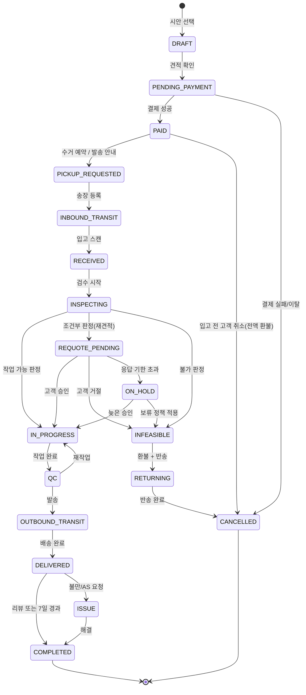
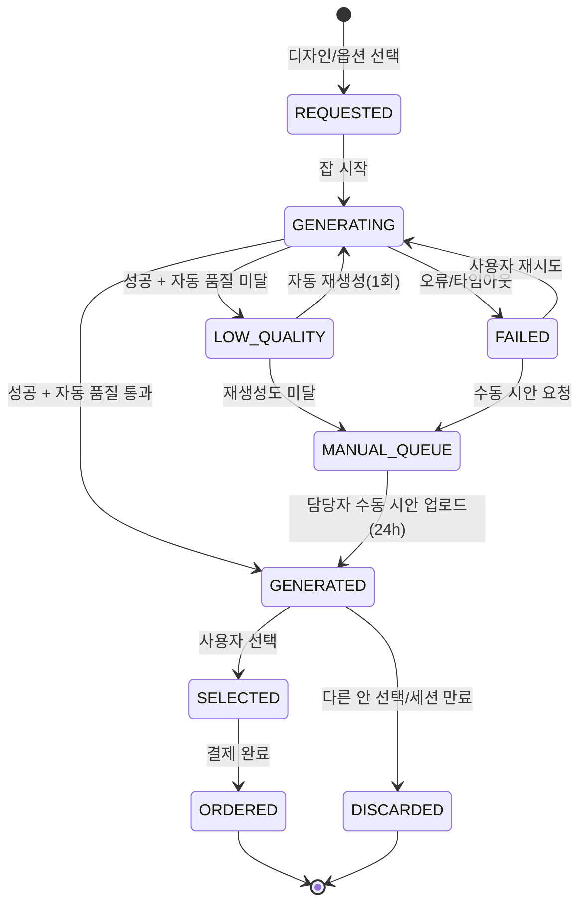
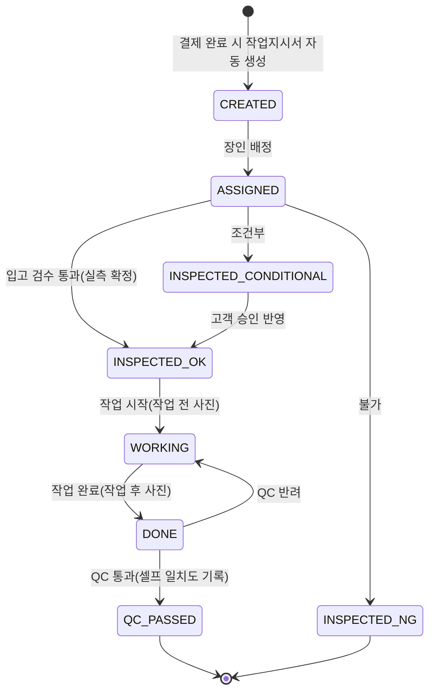
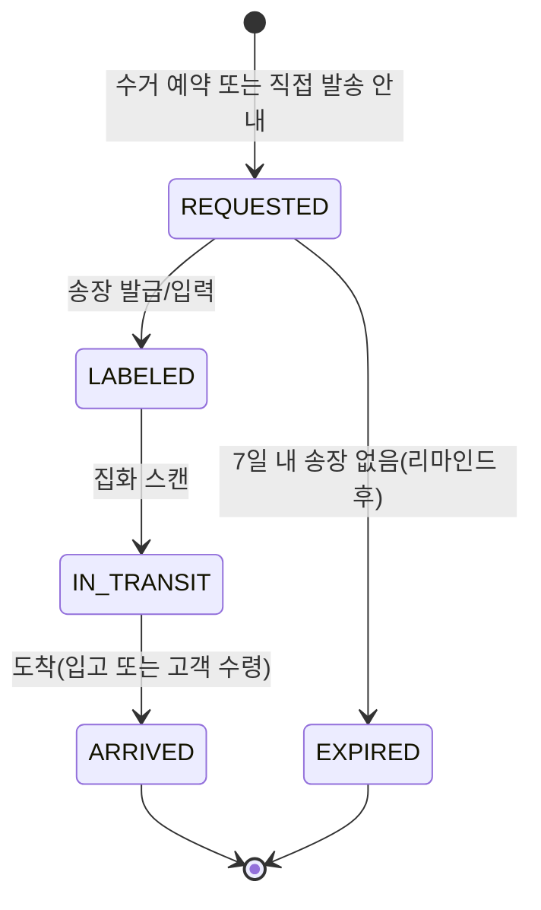

# 리폼 편의점 — 서비스 UX 플로우 & 프로덕트 요구사항 정의 (E_ux_product)

- 작성일: 2026-10-21
- 담당 차원: 서비스 UX 플로우 / 프로덕트 요구사항 (PRD 초안 수준)
- 상태: 기획 단계 초안. 클라이언트 확인이 필요한 항목은 "[확인 필요]"로, 웹에서 검증하지 못한 사실은 "[미확인]"으로 표기.

## 0. 조사 방법과 한계

- 이번 실행에서는 워크플로 전체가 공유하는 웹 검색(WebSearch) 예산이 이미 소진되어 검색 엔진 질의를 수행할 수 없었다. 대신 1차 출처(MDN, caniuse, firt.dev, WebKit Bugzilla, web.dev, NN/g, Google 공식 블로그, SOJO·The Seam 공식 사이트, Nike 공식 사이트)를 URL로 직접 가져와(WebFetch) 사실을 확인했다.
- 직접 가져오기에 실패했거나 페이지가 렌더링되지 않은 항목(Google Doppl 앱 상세, 국내 전자상거래법·AI 기본법 조문, GS25 반값택배 요금, 카카오톡 인앱 브라우저 외부 열기 스킴, 국내 수선·리폼 앱 사례)은 기억에 의존해 단정하지 않고 [미확인]으로 표기했다. 후속 실행에서 검색으로 보강할 것을 권한다.
- 모든 수치 목표(KPI 목표치)는 벤치마크가 아니라 "초기 가설"이다.

## 1. 서비스 전제와 설계 원칙

### 1.1 서비스 한 줄 정의
"내 옷을 찍으면, 우리 디자인으로 리폼된 모습을 미리 보고, 그대로 주문하면 장인이 리폼해서 돌려주는 서비스."

### 1.2 UX 설계 원칙 (이 문서 전체를 관통)

| 원칙 | 설명 | 근거/벤치마크 |
|---|---|---|
| P1. 30초 안에 "내 옷이 변한 모습"을 보여준다 | 가입·주소 입력 등 마찰을 시안 이후로 미룬다. 첫 세션의 목표는 "와, 이게 내 옷이네"라는 순간이다. | SOJO는 "5분 온라인 예약"을, The Seam은 "2분 소요, 사진 업로드"를 첫 단계로 내세운다 ([SOJO](https://sojo.uk/), [The Seam](https://theseam.uk/)) |
| P2. 시안은 "예시"이며 실물과 다를 수 있음을 처음부터 끝까지 고지 | 신뢰를 지키는 유일한 방법은 과장하지 않는 것. 시안 화면·결제·수령 단계에 반복 고지 | 섹션 9 참고 |
| P3. 원형 보존이 핵심 가치이므로 "바뀌지 않는 부분"을 시각적으로 명시 | 비교 슬라이더(before/after), 변경 부위 하이라이트 | 섹션 3.8 |
| P4. 실패를 설계한다 | 인식 실패·생성 실패·적용 불가·품질 미달은 예외가 아니라 정상 경로의 일부. 모든 실패에 "다음 행동"을 준다 | 섹션 3.14 |
| P5. 사람이 개입할 수 있는 구멍을 남긴다 | AI가 못 하면 "담당자가 24시간 내 수동 시안"으로 넘기는 경로를 MVP에 포함 | The Seam의 "48시간 내 견적" 모델 |
| P6. 실물 도착 후 재확인이 시안-실물 불일치를 흡수한다 | 실물 사진 위에 시안을 다시 올려 확인하고, 차이가 크면 고객 승인 후 작업 | 섹션 4 |

## 2. 진입 채널 비교: 모바일 웹/PWA vs 네이티브 앱 vs 카카오톡 채널

| 항목 | 모바일 웹 (+PWA 선택) | 네이티브 앱 (iOS/Android) | 카카오톡 채널 / 챗봇 |
|---|---|---|---|
| 설치 마찰 | 없음. 링크·QR·광고에서 바로 진입 | 스토어 설치 필요. 초기 서비스엔 가장 큰 이탈 요인 | 친구 추가만 하면 됨 |
| 카메라 | `<input type="file" accept="image/*" capture="environment">`로 네이티브 카메라/갤러리 호출 가능(iOS Safari 6+, Android Chrome 지원, [caniuse](https://caniuse.com/html-media-capture)). 실시간 가이드 오버레이는 `getUserMedia` 필요(HTTPS 필수, [MDN](https://developer.mozilla.org/en-US/docs/Web/API/MediaDevices/getUserMedia)) | 완전한 카메라 제어, 실시간 오버레이/AR, 백그라운드 업로드 | 챗봇 자체는 사진을 "받을" 수는 있으나 인식 결과 수정·시안 비교·옵션 조정 같은 UI를 제공할 수 없음. 결국 웹으로 연결해야 함 |
| 설치 유도(프롬프트) | Android Chrome: 조건 충족 시 `beforeinstallprompt` 발생 ([web.dev](https://web.dev/articles/install-criteria)). iOS: 설치 프롬프트·배너·`beforeinstallprompt` 모두 미지원, 사용자가 공유 메뉴로 직접 추가 ([firt.dev](https://firt.dev/notes/pwa-ios/)) | 스토어 | 해당 없음 |
| 푸시 알림 | iOS는 16.4부터 "설치된 PWA"에서만 Web Push 가능 ([firt.dev](https://firt.dev/notes/pwa-ios/)). 미설치 상태에선 불가 → 알림톡/SMS로 대체 | 가능 | 알림톡(유료 메시지)·채널 메시지로 진행 상태 통지에 최적 |
| 인앱 브라우저 리스크 | 카카오톡·인스타그램 내 WebView에서 `getUserMedia`가 막힐 수 있음(섹션 6). `input capture` 폴백이 필수 | 없음 | 채널에서 링크를 누르면 인앱 브라우저로 열리므로 폴백 설계가 특히 중요 |
| 개발·운영 비용 | 가장 낮음. 한 코드베이스 | 높음(2 플랫폼 + 심사) | 낮음(채널 개설·알림톡 템플릿 심사) |
| 권고 | **MVP 핵심 플로우를 여기에 구축** | AR·실시간 피팅·온디바이스 추론이 필요해질 때 2단계 이후 검토 | **획득(유입)·알림(상태 추적) 채널로 병행** |

**권고 조합**: 모바일 웹(반응형, HTTPS, PWA 매니페스트 포함) + 카카오톡 채널(유입·알림톡) 조합으로 시작. 네이티브 앱은 섹션 6.5의 "앱이 꼭 필요한 경우"에 해당할 때만.

## 3. 사용자 여정 화면 설계

### 3.1 화면 목록 표 (고객)

| ID | 화면 | 목적 | 핵심 요소 | 마이크로카피 예시 | 주요 엣지케이스 |
|---|---|---|---|---|---|
| C00 | 랜딩 / 진입 | 가치 제안 + 즉시 촬영 유도 | 히어로(실제 before/after 3~5개), "내 옷 찍어보기" 주 CTA, 소요시간·가격대 요약, 장인/작업 사례 링크 | "옷 사진 한 장이면, 리폼된 모습을 30초 안에 보여드려요." / 보조: "회원가입 없이 시작할 수 있어요." | 인앱 브라우저 감지 시 안내 배너(섹션 6.3) |
| C01 | 촬영 가이드 | 인식·생성 품질을 좌우하는 사진 확보 | 3컷 가이드 일러스트(평평하게 펼쳐서/밝은 곳/옷 전체가 프레임 안에), 좋은 예·나쁜 예, 평면(flat-lay) 기본 + 착용샷 선택(2단계) | "옷을 바닥이나 침대에 펼쳐 놓고, 위에서 전체가 보이게 찍어주세요." / "뒷면도 리폼하고 싶다면 뒷면 사진을 하나 더 찍어주세요." | 가이드 건너뛰기 허용(재방문자), 사진 여러 장 업로드 |
| C02 | 촬영 / 업로드 | 사진 획득 | 기본: `input capture` 버튼("카메라로 찍기") + "앨범에서 선택"; 지원 환경에선 실시간 가이드 프레임(getUserMedia), 업로드 진행률, 클라이언트 리사이즈(긴 변 2048px 권장) | "조금만 기다려 주세요. 사진을 올리고 있어요." | 권한 거부, HEIC/대용량, EXIF 회전, 네트워크 끊김 → 재시도 버튼, 로컬에 임시 보관 |
| C03 | 사진 품질 체크 | 품질 미달을 생성 전에 걸러냄 | 자동 판정(흐림/어두움/잘림/옷이 너무 작음/여러 벌) + 결과 카드, "다시 찍기" / "그래도 진행" | "사진이 조금 어두워요. 창가나 밝은 곳에서 다시 찍으면 시안이 훨씬 정확해져요." | 판정 신뢰도 낮으면 통과시키되 시안 화면에 품질 경고 유지 |
| C04 | 인식 결과 확인·수정 | AI 인식을 사용자가 확정 | 카테고리(후드티/셔츠/청바지…), 색상 칩, 소재(사용자 선택: 면/데님/니트/가죽/패딩/기타), 인식된 부위 표시(가슴/등/소매/밑단/주머니), 각 항목 탭하여 수정 | "이 옷이 맞나요? 틀린 부분은 눌러서 고쳐주세요." / 소재: "소재를 알려주시면 적용 가능한 디자인을 더 정확히 추천할 수 있어요." | 인식 실패 → 수동 선택 UI(카테고리 그리드), 여러 벌 감지 → "한 벌만 선택", 옷이 아님 → 안내 |
| C05 | 추천 디자인 목록 | 이 옷에 맞는 디자인 탐색 | 추천 탭("이 옷에 어울려요") / 전체 탭, 디자인 카드(실물 사례 썸네일, 기법 태그: 자수/패치/프린트/염색/절개, 가격대, 소요일), 필터(부위/기법/가격), "적용 불가" 디자인은 비활성 + 이유 | "면 소재 후드티에 잘 맞는 디자인 12개를 골랐어요." / 비활성: "패딩 소재에는 자수를 놓기 어려워 이 디자인은 적용할 수 없어요." | 추천 0개 → 전체 목록 + "담당자에게 문의" |
| C06 | 디자인 상세 | 선택 전 확신 | 디자인 설명, 실물 before/after 갤러리(실제 작업물), 적용 가능 부위, 옵션 범위(색상/크기/위치), 가격·소요일, "내 옷에 적용해 보기" CTA | "이 디자인은 가슴·등·소매에 적용할 수 있어요." | 옵션 없는 디자인은 바로 생성 |
| C07 | 시안 생성 대기 | 수 초~수십 초 대기 | 단계형 진행 표시("옷 분석 중 → 디자인 맞추는 중 → 마무리 중"), 예상 시간, 대기 중 콘텐츠(장인 소개·작업 사례), 백그라운드 전환 허용(완료 시 알림), 취소 | "약 20초 정도 걸려요. 기다리는 동안 실제 작업 사례를 구경해 보세요." | 30초 초과 → "조금 더 걸리고 있어요" + 알림 받기(연락처 입력 선택), 실패 → C07-E |
| C07-E | 생성 실패 | 실패를 다음 행동으로 전환 | 사유(가능한 범위에서), 선택지: 다시 생성 / 다른 디자인 / 담당자 수동 시안 요청(24시간 내) | "이번엔 시안을 만들지 못했어요. 다시 시도하거나, 담당자가 직접 시안을 만들어 보내드릴 수 있어요." | 연속 2회 실패 시 자동으로 수동 시안 경로 제안 |
| C08 | 시안 비교 / 옵션 조정 | 복수 안 비교와 미세 조정 | 2~4안 캐러셀 또는 그리드, 원본과의 비교 슬라이더(before/after), "바뀐 부분" 하이라이트 토글, 옵션: 색상 팔레트(디자인별 허용 범위), 위치 후보(미리 정의된 3~5곳, 2단계: 드래그), 크기 S/M/L(cm 환산 표시), 옵션 변경 시 재생성(대기 UX 재사용), 안별 엄지척/엄지아래(만족도 수집), 저장·공유 | 고지: "이 이미지는 AI가 만든 예시예요. 실제 작업물은 소재·실·염료 특성에 따라 조금 다를 수 있어요." / "원래 옷의 형태·색은 그대로 두고, 표시된 부분만 바뀌어요." | 옵션 조합이 적용 불가 → 즉시 비활성화 + 이유, 재생성 한도(예: 세션당 10회) 안내 |
| C09 | 견적·소요기간 | 가격·기간 투명화 | 항목별 가격(디자인 기본가 + 옵션 + 왕복 배송비), 예상 작업 기간(영업일), 실물 검수 후 변동 가능성 고지, 주문 제작 특성상 취소·환불 조건 | "검수 후 작업 범위가 달라지면 결제 전에 다시 알려드리고, 동의하신 뒤에만 진행해요." | 견적 산출 불가(수동) → "담당자 확인 후 견적 안내" |
| C10 | 주문·결제 | 전환 | 로그인/간편가입(카카오·전화번호), 수령 정보, 의류 상태 자기 신고(얼룩/손상/세탁 여부), 요청사항, 동의 체크(AI 시안 고지, 주문제작 환불 조건, 개인정보·사진 이용), 결제(PG) | "결제는 지금 하지만, 실물 검수에서 작업이 어려우면 전액 환불해 드려요." | 결제 실패, 세션 만료 시 시안 보존(링크 재진입) |
| C11 | 수거/배송 접수 | 옷을 보내는 방법 선택 | 옵션: (a) 택배 방문 수거 예약, (b) 고객 직접 발송(편의점 택배 안내 + 송장번호 입력), (c) 매장 방문 접수[확인 필요], 포장 가이드(세탁 후 발송, 비닐 포장), 라벨/주문번호 인쇄 또는 손글씨 안내 | "옷은 세탁 후 보내주세요. 주문번호를 종이에 적어 함께 넣어주시면 더 빨라요." | 수거 지역 제한, 송장 미입력 7일 경과 → 리마인드 |
| C12 | 진행 상태 추적 | 불안 해소 | 타임라인: 접수 → 옷 도착 → 검수 완료 → 작업 중 → 검수(QC) → 발송 → 배송 완료. 각 단계 사진(도착 사진, 작업 전/중/후), 예상 완료일, 담당 장인, 문의 버튼, 알림톡 연동 | "옷이 잘 도착했어요. 내일 검수 후 작업 일정을 알려드릴게요." | 재견적 발생 → C12-A 승인 화면으로 분기 |
| C12-A | 재견적 승인 | 실물 검수 결과 고객 결정 | 실물 사진 + 시안 오버레이 비교, 차이 설명, 변경된 견적/기간, 선택: 승인 / 조정 상담 / 취소(반송·환불) , 응답 기한 | "실제 옷의 원단 두께 때문에 자수 크기를 10% 줄여야 해요. 이대로 진행할까요?" | 기한 내 미응답 → 리마인드 2회 후 보류 정책 적용[확인 필요] |
| C13 | 수령·리뷰 | 만족도·일치도 수집 | 배송 완료 알림 → 리뷰 요청: "시안과 비슷했나요?"(5점), 사진 업로드(실물), 공개 동의 시 사례 갤러리에 노출, 재주문 CTA("다른 옷도 리폼하기") | "시안과 실물, 얼마나 비슷했나요? 더 정확한 시안을 만드는 데 큰 도움이 돼요." | 불만족 → 상담 연결, AS 정책 |

### 3.2 각 단계 상세

#### 진입(C00)
- 첫 화면의 주 CTA는 하나("내 옷 찍어보기"). 가입·로그인은 결제 직전까지 요구하지 않는다(세션 토큰으로 시안 보존).
- 실제 작업 사례 before/after를 히어로에 둔다(AI 이미지가 아닌 실물 사진, 라벨 명시). 신뢰 장치(섹션 9).
- QR/오프라인 매장·전단에서 들어오는 경로를 가정하고 짧은 URL을 유지.

#### 촬영 가이드(C01)
- 기본 촬영 모드는 **평면(flat-lay)**: 옷을 펼쳐 위에서 찍는다. 원형 보존형 시안 생성은 옷의 윤곽·부위 분할이 안정적인 평면 사진에서 가장 성공률이 높다(기술 파트의 판단과 정합성 확인 필요).
- 착용샷(입은 상태)은 2단계 기능으로 두고, MVP에서는 "입은 사진은 시안 정확도가 낮아질 수 있어요"로 안내하되 차단하지 않는다.
- 가이드는 3컷 일러스트 + 좋은 예/나쁜 예 2쌍. 재방문자는 자동 건너뛰기.

#### 촬영/업로드(C02)
- 기본 입력은 `<input type="file" accept="image/*" capture="environment">`. 모바일 OS는 "기존 파일 선택 또는 새로 촬영" UI를 제공하며, 데스크톱에서는 일반 파일 선택기가 뜬다([MDN capture](https://developer.mozilla.org/en-US/docs/Web/HTML/Reference/Attributes/capture)).
- 실시간 가이드 프레임(옷 윤곽 가이드 오버레이)은 `getUserMedia`가 동작하는 환경(Safari/Chrome 본 브라우저, 설치된 PWA)에서만 점진적으로 켠다. 후면 카메라는 `facingMode: { exact: "environment" }`로 요청([MDN getUserMedia](https://developer.mozilla.org/en-US/docs/Web/API/MediaDevices/getUserMedia)).
- 클라이언트에서 긴 변 2048px로 리사이즈 후 업로드(업로드 시간·서버 비용 절감). 원본 해상도가 필요하면 서버 정책에 따라 조정[확인 필요: 생성 모델 입력 해상도].
- EXIF 회전: ``는 CSS `image-orientation: from-image`가 기본이라 똑바로 보이지만(2020년 4월 이후 전 브라우저 지원, [MDN](https://developer.mozilla.org/en-US/docs/Web/CSS/image-orientation)), canvas 처리·서버 처리에서는 EXIF를 별도로 정규화해야 한다. 서버에서 orientation을 적용해 저장하는 것을 표준으로.
- HEIC: iOS에서 HEIC가 그대로 올라올 가능성이 있으므로 서버 변환 파이프라인을 둔다[미확인: 브라우저별 자동 JPEG 변환 조건].

#### 사진 품질 체크(C03)
- 판정 항목: 흐림(라플라시안 분산 등), 밝기, 옷이 프레임 밖으로 잘림, 옷 면적 비율(너무 작음), 복수 의류, 옷이 아님.
- 판정은 "권고"로: 다시 찍기를 권하되 "그래도 진행"을 허용. 단, 진행 시 시안 화면과 작업지시서에 "저품질 사진" 플래그를 전달.

#### 인식 결과 확인·수정(C04)
- 인식은 "제안"이고 확정은 사용자가 한다. 카테고리·색상·소재·부위 모두 탭 한 번으로 수정 가능.
- 소재는 사진만으로 인식 정확도가 낮으므로 **사용자 선택 필수 항목**으로 두는 것을 권고(적용 가능 디자인 필터와 작업지시서의 핵심 입력).
- 사이즈/실측: MVP에서는 라벨 사이즈(S/M/L/프리)와 선택적 실측(가슴 단면 cm) 입력. 시안의 크기 옵션은 이 값과 사진 내 비율로 cm 환산.

#### 추천 디자인 목록(C05) / 디자인 상세(C06)
- 추천 로직 입력: 카테고리, 소재, 색상(대비), 인식된 부위, 디자인 제약(섹션 5). 적용 불가 디자인은 숨기지 말고 비활성 + 이유를 보여준다(투명성, 학습된 기대치 형성).
- 디자인 카드는 "실물 사례 사진"을 우선 노출하고 AI 생성 예시는 보조로.

#### 시안 생성 대기(C07)
- NN/g 기준: 1초 이상이면 진행 표시, 2~9초 루프형, 10초 이상이면 진행률/단계 표시와 예상 시간([NN/g](https://www.nngroup.com/articles/progress-indicators/)). 생성이 10초를 넘길 가능성이 높으므로 **단계형 진행 표시 + 예상 시간**을 기본으로.
- 복수 안(2~4안)을 병렬 생성하고 먼저 끝난 안부터 보여준다(체감 대기 단축).
- 30초 초과 시 "알림 받기"(연락처 입력, 선택)를 제시하고 백그라운드 완료를 허용.

#### 시안 비교/옵션 조정(C08)
- before/after 슬라이더와 "바뀐 부분만 보기" 토글로 원형 보존을 체감시킨다(P3).
- 옵션은 디자인별 허용 범위 내에서만: 색상(팔레트), 위치(미리 정의된 후보), 크기(S/M/L, cm 병기). 자유 드래그·자유 색상은 2단계.
- 옵션 변경은 재생성이므로 횟수 제한과 비용을 고려해 "세션당 N회" 가이드.
- 안별 엄지척/아래로 시안 만족도를 수집(KPI).

#### 견적·소요기간(C09) / 주문·결제(C10)
- 정찰제(디자인 기본가 + 옵션가 + 배송비)를 권고. 복잡 케이스만 수동 견적.
- 결제 시 동의 항목: AI 시안 고지, 주문제작 특성상 취소·환불 조건, 사진·데이터 이용(서비스 제공 목적 / 모델 개선 목적 분리 동의).
- 국내 전자상거래법상 "소비자의 주문에 따라 개별적으로 생산되는 재화"는 청약철회 제한 대상이 될 수 있으나 사전 고지·동의 요건이 있다고 알려져 있다[미확인: 이번 실행에서 조문 원문 확인 실패 — 법무 파트 검증 필요]. UX에서는 어떤 경우든 "실물 검수 단계까지는 전액 환불"을 명시하는 것이 전환과 신뢰에 유리.

#### 수거/배송 접수(C11)
- 세 가지 경로를 설계하되 MVP는 2개로 시작: 택배 방문 수거 예약(택배사 API 또는 수동 예약) + 고객 직접 발송(편의점 택배 안내·송장 입력). "리폼 편의점"이라는 이름과 편의점 택배 접수의 결합은 브랜드적으로도 자연스럽다[확인 필요: 편의점 택배 제휴·요금, 이번 실행에서 GS25 반값택배 요금 페이지 확인 실패 — 미확인].
- 포장 가이드와 주문번호 동봉 안내로 입고 매칭 오류를 줄인다.

#### 진행 상태 추적(C12)
- 상태 변경마다 알림톡/SMS + 웹 타임라인. 사진 증빙(도착·작업 전/중/후)을 고객에게도 보여준다.
- 재견적 발생 시 C12-A로 분기. 응답 기한(예: 48시간)과 미응답 정책[확인 필요].

#### 수령·리뷰(C13)
- "시안과 비슷했나요?" 5점 평가 + 실물 사진 업로드. 공개 동의 시 사례 갤러리에 노출(신뢰 장치 강화 루프).
- 재주문 CTA와 "내 옷장"(이전 의류 사진 재사용) 제안.

### 3.3 엣지케이스 처리 매트릭스

| 상황 | 감지 방법 | 사용자에게 보이는 것 | 다음 행동 | 운영 측 처리 |
|---|---|---|---|---|
| 인식 실패(카테고리 미확정) | 분류 신뢰도 임계치 미만 | "어떤 옷인지 정확히 알기 어려워요. 직접 골라주세요." | 카테고리 그리드 수동 선택 → 계속 진행 | 실패 샘플 로깅(라벨링 큐) |
| 옷이 아닌 사진 | 분류 결과 '비의류' | "옷 사진이 아닌 것 같아요." | 다시 찍기 / 그래도 진행(수동 선택) | — |
| 여러 벌 감지 | 인스턴스 수 ≥ 2 | "옷이 여러 벌 보여요. 한 벌만 골라주세요." | 바운딩박스 탭 선택 | — |
| 사진 품질 미달 | 흐림/밝기/잘림/면적 | 품질 카드 + 개선 팁 | 다시 찍기(권장) / 그래도 진행 | 저품질 플래그를 시안·작업지시서에 전달 |
| 적용 불가 의류(소재/구조) | 디자인 제약 매칭 | 비활성 카드 + 이유 | 다른 디자인 추천 / 담당자 문의 | 불가 사유 통계(디자인 제약 개선) |
| 시안 생성 실패 | 생성 작업 오류/타임아웃 | C07-E | 재시도 / 다른 디자인 / 수동 시안 요청 | 실패율 모니터링, 수동 시안 큐(24시간 SLA) |
| 시안 품질 저하(자동 검수 미통과) | 원형 보존 점수·아티팩트 점수 임계치[확인 필요: 기술 파트] | 해당 안 제외 후 나머지 안 표시 또는 재생성 | — | 품질 로그 |
| 옵션 조합 불가 | 제약 룰 | 옵션 비활성 + 이유 | 다른 옵션 | — |
| 결제 후 실물 검수 불가 | 작업자 판정 | C12-A: "작업이 어려워요" + 사유 + 전액 환불·반송 | 반송 주소 확인 | 환불·반송 처리 |
| 실물이 사진과 다름(색·손상) | 입고 검수 | C12-A 재견적 | 승인/취소 | 작업 보류 |
| 네트워크 끊김/세션 만료 | 클라이언트 | "저장해 두었어요" + 재진입 링크 | 링크로 복귀 | 임시 세션 보존(예: 7일) |
| 인앱 브라우저에서 카메라 불가 | UA 감지 + 기능 감지 | "카메라를 열 수 없으면 앨범에서 선택하거나 Safari/Chrome에서 열어주세요." | 앨범 선택 / 외부 브라우저 열기 | 섹션 6.3 |

## 4. 관리자 / 작업자(리폼 장인) 측 플로우

### 4.1 화면 목록 (관리자·작업자)

| ID | 화면 | 사용자 | 핵심 요소 |
|---|---|---|---|
| A01 | 주문 보드(칸반/리스트) | 관리자 | 상태별 컬럼(결제완료/수거중/입고/검수/승인대기/작업중/QC/발송/완료/이슈), 기한 경고, 담당자 배정 |
| A02 | 주문 상세 | 관리자·작업자 | 고객 정보, 의류 정보(사진·카테고리·소재·사이즈), 선택 시안(모든 안+선택 안), 옵션 값, 결제·견적 이력, 커뮤니케이션 로그 |
| A03 | 작업지시서(자동 생성) | 작업자 | 아래 4.2 스펙. PDF 출력·태블릿 보기 |
| A04 | 입고 검수 | 작업자 | 실물 사진 촬영(앞/뒤/부위 클로즈업), 시안 오버레이 재확인(실물 사진 위에 디자인 레이어를 올려 위치·크기 재확인), 판정: 작업 가능 / 조건부(재견적) / 불가, 사유 코드, 차이 메모 |
| A05 | 재견적 작성 | 관리자 | 변경 항목(크기/위치/기법/가격/기간), 고객에게 보낼 비교 이미지 자동 구성, 승인 요청 발송, 응답 기한 |
| A06 | 작업 기록 | 작업자 | 단계별 사진(작업 전/중/후 최소 3장), 사용 자재(실 색상 코드, 패치 번호), 작업 시간, 체크리스트 |
| A07 | 완료 QC·발송 | 관리자 | 완료 사진 vs 시안 나란히 비교, 셀프 일치도 점수(1~5), 고객 공개용 사진 선택, 송장 입력·발송 알림 |
| A08 | 이슈/AS 관리 | 관리자 | 불만·재작업 요청, 환불, 반송 |
| A09 | 운영 대시보드 | 관리자 | KPI(섹션 7.2), 작업자별 처리량·리드타임, 디자인별 불가 판정률·재견적률 |

### 4.2 작업지시서 자동 생성 스펙 (시안 → 작업지시서)

| 섹션 | 필드 | 출처 |
|---|---|---|
| 식별 | 주문번호, 작업번호, 고객명(마스킹), 접수일, 납기(예상 완료일), 담당 장인 | 주문 |
| 의류 | 카테고리, 색상(대표색 + HEX), 소재(고객 신고), 라벨 사이즈, 실측(있을 때), 고객 신고 상태(얼룩/손상/세탁), 원본 사진(앞/뒤) | C04·C10 |
| 디자인 | 디자인 ID·버전, 기법(자수/패치/프린트/염색/절개/부자재), 디자인 원본 파일(벡터/래스터), 실 색상·자재 코드 매핑 | 디자인 DB |
| 적용 사양 | 부위명(가슴 좌/우, 등 중앙, 소매 좌/우, 밑단 등), 위치 좌표(원본 사진 기준 정규화 좌표 + 부위 기준 상대 위치 "목 아래 12cm, 중심선 기준 좌측 6cm" 형식), 크기(가로×세로 cm, 사진 비율 기반 추정값 + 실측 보정 여부 표시), 색상(옵션 값), 방향/기울기 | C08 옵션 + 변환 로직 |
| 레퍼런스 이미지 | 선택 시안(확대 크롭 포함), 원본과의 비교 이미지, "바뀐 부분" 마스크, 디자인 원본, 유사 과거 작업 사진 | 시안 생성 결과 |
| 주의사항 | 소재별 주의(니트 늘어남, 패딩 바느질 구멍, 데님 두께), 저품질 사진 플래그, 고객 요청사항, 인식 신뢰도 낮았던 항목 | 규칙 테이블 + 플래그 |
| 체크리스트 | 입고 검수 완료, 시안 오버레이 재확인, 자재 확보, 작업 전/중/후 사진, QC 셀프 점수 | 운영 |

- 크기는 반드시 "사진 비율 기반 추정값"임을 표시하고, 입고 검수에서 실측 후 확정값으로 덮어쓴다.
- 위치는 좌표만이 아니라 사람이 읽는 기준점 문장으로 병기(장인이 줄자로 재현 가능해야 함).

### 4.3 입고 후 검수 → 불가 판정 → 재견적 → 고객 승인 흐름

1. 입고: 송장/주문번호 매칭(스캔), 실물 사진 촬영(앞/뒤/적용 부위 클로즈업). 고객에게 "도착" 알림 + 사진.
2. 검수: 실물 사진 위에 시안의 디자인 레이어를 올려 위치·크기·색 대비 재확인(A04). 자동 비교 보조: 원본 사진과 실물 사진의 색 차이, 치수 비율 차이 표시[확인 필요: 기술 파트 구현 범위].
3. 판정:
   - 작업 가능 → 작업지시서 확정(추정값 → 실측값) → 작업 시작.
   - 조건부 → 재견적(A05): 변경 내용·비교 이미지·가격/기간 변동 → 고객 승인(C12-A). 기한 내 미응답 시 리마인드 2회 → 보류 정책.
   - 불가 → 사유 + 전액 환불 + 반송(반송비 정책 [확인 필요]).
4. 작업: 단계 사진 기록(A06). 고객 타임라인에 선택적으로 노출.
5. QC·발송(A07): 완료 사진 vs 시안 나란히 비교, 셀프 일치도 점수, 발송.

### 4.4 시안과 실물의 차이를 줄이는 운영 장치

| 장치 | 효과 |
|---|---|
| 디자인별 "실현 가능 범위"를 데이터로 관리(최소/최대 크기, 허용 색상, 부위) | 생성 단계에서 불가능한 시안이 나오지 않게 |
| 실물 사진 위 시안 오버레이 재확인(입고 검수) | 사진-실물 차이(색·크기)를 작업 전에 흡수 |
| 추정 치수 → 실측 치수 확정 절차 | 크기 오차 제거 |
| 자재 색상 매핑 테이블(시안 색 HEX → 실/염료 코드) | 색 차이 최소화, 고객에게 "실제 실 색상 샘플" 노출 가능 |
| 완료 사진 vs 시안 셀프 일치도 점수 + 고객 일치도 평가 | 디자인·작업자별 불일치 패턴 추적, 생성 모델 피드백 |
| 저품질 사진·저신뢰 인식 플래그 전달 | 장인이 더 꼼꼼히 검수 |
| 재견적 시 비교 이미지 자동 구성 | 고객 이해·승인율 향상 |

## 5. 디자이너 측 플로우

| 단계 | 화면/기능 | 세부 |
|---|---|---|
| D01 신규 디자인 등록 | 디자인 메타 | 이름, 설명, 기법, 카테고리 태그, 기본가·옵션가, 표준 소요일, 상태(초안/검수중/공개/중단), 버전 |
| D02 적용 가능 조건 설정 | 제약 룰 편집기 | 적용 가능 의류 카테고리, 소재 허용/금지, 색상 대비 조건(예: 어두운 바탕에만), 적용 부위 목록과 부위별 기본 위치, 크기 min/max(cm), 허용 색상 팔레트, 조합 금지 룰 |
| D03 레퍼런스 업로드 | 자산 업로드 | 디자인 원본(벡터/고해상도), 실물 작업 사진(여러 옷·여러 부위·여러 조명, 권장 N장 이상[확인 필요: 기술 파트의 학습 데이터 요구량]), 각 사진에 부위·크기·색상 라벨 입력, 저작권·초상권 확인 체크 |
| D04 템플릿화/학습 요청 | 학습 잡 | 학습 요청 → 상태(대기/학습중/완료/실패) → 샘플 의류 세트(사내 표준 20~30벌 사진)에 자동 생성 |
| D05 생성 결과 검수·승인 | 검수 그리드 | 샘플별 생성 결과를 원본과 비교, 승인/반려(사유 태그: 원형 훼손, 색 왜곡, 위치 오류, 아티팩트), 반려 시 제약 조정 또는 레퍼런스 보강 → 재학습 |
| D06 공개 | 카탈로그 반영 | 승인 완료 시 고객 카탈로그 노출, 실물 사례 사진 선택 |
| D07 품질 모니터링 | 디자인 대시보드 | 디자인별: 시안 만족도, 시안→주문 전환율, 생성 실패율, 자동 검수 탈락률, 입고 불가 판정률, 재견적률, 실물 일치도 평균, 고객 리뷰. 임계치 미달 시 알림 → 제약 조정/재학습/비공개 |
| D08 버전 관리 | 이력 | 제약·레퍼런스·모델 버전 변경 이력, 주문은 당시 버전에 고정 |

## 6. 모바일 웹 카메라 기술 제약과 권장 사항

### 6.1 두 가지 카메라 접근 방식

| 방식 | 동작 | 장점 | 제약 | 권장 용도 |
|---|---|---|---|---|
| HTML Media Capture: `<input type="file" accept="image/*" capture="environment">` | OS가 "파일 선택 또는 새로 촬영" UI 제공, `environment`는 후면 카메라 선호 ([MDN](https://developer.mozilla.org/en-US/docs/Web/HTML/Reference/Attributes/capture)) | iOS Safari 6+·Android Chrome·Samsung Internet 지원([caniuse](https://caniuse.com/html-media-capture)), 인앱 브라우저(WebView)에서도 대체로 동작(호스트 앱의 파일 선택 구현에 의존), 권한 처리 단순 | 실시간 프레임 오버레이 불가, 촬영 UI를 통제할 수 없음 | **MVP 기본 경로** |
| `navigator.mediaDevices.getUserMedia` | 실시간 비디오 스트림 → 캔버스 캡처 | 가이드 오버레이·자동 품질 판정·연속 촬영 가능 | HTTPS 필수(비보안 컨텍스트에선 `navigator.mediaDevices`가 `undefined`), 권한 거부·장치 없음·하드웨어 점유 등 오류 처리 필요([MDN](https://developer.mozilla.org/en-US/docs/Web/API/MediaDevices/getUserMedia)); 인앱 브라우저에서 호스트 앱이 권한을 넘겨주지 않으면 실패 | 지원 환경에서 점진적 향상 |

### 6.2 환경별 지원 현황

| 환경 | input capture | getUserMedia | 비고 |
|---|---|---|---|
| iOS Safari | 지원(6+) | 지원(11+; caniuse 기준 11~27.x 지원) | 설치된 PWA(홈 화면)에서는 iOS 13.4에서 "다시 동작"한 이력(caniuse 관련 링크 제목) — 구버전 iOS 주의 |
| Android Chrome | 지원 | 지원 | 설치 프롬프트 조건: HTTPS, 매니페스트(name/short_name, 192·512px 아이콘, start_url, display), 사용자 상호작용 1회 + 30초 체류([web.dev](https://web.dev/articles/install-criteria)) |
| Samsung Internet | 지원(4+) | 지원(6.2+) | — |
| iOS 인앱 브라우저(카카오톡·인스타그램 등, WKWebView 기반) | 대체로 동작(호스트 앱 구현 의존) | WebKit 버그 208667은 2021-01-05 "WKWebView 앱에서 getUserMedia 접근 가능"으로 종료(iOS 14.3 베타에서 동작 보고)되었으나, 스레드 내 iOS 15에서도 실패 보고가 있고 호스트 앱이 권한 위임을 구현해야 함([WebKit Bugzilla](https://bugs.webkit.org/show_bug.cgi?id=208667)) | 앱별 실기기 테스트 필수. 인스타그램 인앱 브라우저의 getUserMedia 차단은 널리 보고되나 이번 실행에서 1차 출처 미확인 [미확인] |
| Android 인앱 브라우저(WebView) | 대체로 동작(호스트 앱의 `onShowFileChooser` 구현 의존) | 호스트 앱이 `WebChromeClient.onPermissionRequest`에서 카메라를 허용해야 동작, 기본은 거부로 알려짐 [미확인: 공식 문서 원문 확인 실패] | 카카오톡 Android는 Chrome Custom Tabs/외부 브라우저로 열리는 경우도 있어 실기기 확인 필요 [미확인] |
| 데스크톱 | 파일 선택기 | 웹캠 | 평면 촬영 시나리오와 맞지 않음. "휴대폰으로 열기" QR 제공 |

### 6.3 인앱 브라우저 대응 전략 (중요)

1. **기능 감지 우선**: `navigator.mediaDevices?.getUserMedia` 존재 여부와 실제 호출 성공 여부로 분기. UA 문자열(KAKAOTALK, Instagram, FBAN/FBAV, NAVER, Line)은 보조 신호로만.
2. **기본 경로는 항상 input capture**: 어떤 환경에서도 "카메라로 찍기/앨범에서 선택"이 동작하게 한다.
3. **외부 브라우저 열기 안내**: 인앱 브라우저로 감지되면 상단 배너로 "Safari/Chrome에서 열면 촬영 가이드가 더 편해요" + 복사 가능한 링크. 카카오톡은 `kakaotalk://web/openExternal?url=` 형태의 외부 브라우저 열기 스킴이 널리 쓰이나 이번 실행에서 공식 문서 확인 실패 [미확인], Android는 `intent://` 스킴 사용 가능 [미확인] → 구현 전 실기기 검증.
4. **세션 이어가기**: 외부 브라우저로 넘어가도 진행 상태가 유지되도록 URL에 세션 토큰을 담는다.
5. **테스트 매트릭스**: iOS Safari / iOS 카카오톡 / iOS 인스타그램 / Android Chrome / Android 카카오톡 / Android 삼성 인터넷 / Android 인스타그램 / 설치된 PWA(iOS·Android) — 각각 촬영·앨범·권한 거부·HEIC·회전·대용량 케이스.

### 6.4 PWA

- iOS: 설치 프롬프트·배너·`beforeinstallprompt` 모두 미지원. 설치는 사용자가 직접(공유 메뉴). firt.dev(2026-10-13 갱신)에 따르면 iOS 26.0부터 모든 웹사이트가 웹 앱으로 설치 가능하고, Web Push는 16.4부터 설치된 PWA에서만 동작하며, 저장소는 브라우저와 분리된다([firt.dev](https://firt.dev/notes/pwa-ios/)).
- Android Chrome: 조건 충족 시 `beforeinstallprompt`로 커스텀 설치 버튼 구현 가능([web.dev](https://web.dev/articles/install-criteria)).
- 권고: PWA 매니페스트와 서비스워커(오프라인 안내·업로드 재시도 큐)는 MVP에 포함하되, "설치 유도"는 재주문 고객에게만(수령·리뷰 이후). 진행 상태 알림은 알림톡/SMS를 주 채널로.

### 6.5 네이티브 앱이 꼭 필요한 경우

| 요구 | 웹으로 가능? | 판단 |
|---|---|---|
| 실시간 AR 착용 미리보기(몸에 옷을 입힌 채 디자인 오버레이) | 제한적(WebXR·WebGL 성능·브라우저 편차) | 앱 권장(2단계 이후) |
| 설치 없이 푸시 알림(iOS) | 불가(iOS는 설치된 PWA만) | 알림톡으로 대체 가능 → 앱 불필요 |
| 백그라운드 대용량 업로드·다중 사진 자동 동기화 | 제한적 | 앱 유리하나 MVP 범위 아님 |
| 온디바이스 추론(즉시 품질 판정·세그멘테이션) | 가능(WebGPU/WASM)이나 편차 큼 | 서버 추론으로 시작 |
| 스토어 노출·브랜드 신뢰 | 해당 | 마케팅 판단[확인 필요] |

결론: MVP는 모바일 웹. 앱은 AR 피팅 또는 B2B 매장 태블릿 운영 앱(작업자용)이 필요할 때 검토.

## 7. MVP 범위와 KPI

### 7.1 MVP 범위 표

| 영역 | MVP(반드시) | 2단계(다음) | 3단계(나중) |
|---|---|---|---|
| 진입 | 모바일 웹(HTTPS, 반응형), 카카오톡 채널 유입, QR | PWA 설치 유도(재주문 고객) | 네이티브 앱 |
| 촬영 | input capture + 앨범, 가이드 3컷, 클라이언트 리사이즈, EXIF/HEIC 서버 정규화, 품질 자동 판정(권고형) | getUserMedia 실시간 가이드 프레임(지원 환경만) | 착용샷 피팅, AR |
| 인식 | 카테고리·대표색·부위 인식 + 사용자 수정, 소재 사용자 선택 | 세부 부위 자동 분할 고도화, 실측 보정 | 다중 의류 동시 |
| 디자인 | 카탈로그 10~20개(기법 2~3종으로 시작) [확인 필요], 제약 룰, 실물 사례 갤러리 | 디자인 50+, 시즌 컬렉션 | 사용자 요청 디자인(커스텀) |
| 시안 | 2~4안 생성, before/after 슬라이더, 바뀐 부분 하이라이트, 옵션: 색상 팔레트·위치 후보·크기 S/M/L, 재생성 한도, 실패 시 수동 시안 경로(24h) | 자유 드래그 위치·크기, 다부위 조합 | 영상/360 미리보기 |
| 견적·결제 | 정찰제, 왕복 배송비, 고지·동의, PG 결제, 간편 가입 | 쿠폰·멤버십 | 구독·B2B |
| 물류 | 택배 수거 예약(수동/반자동) + 고객 직접 발송(송장 입력), 포장 가이드 | 택배사 API 자동화, 편의점 택배 제휴 | 매장 접수·당일 수거 |
| 추적 | 타임라인 + 알림톡/SMS, 재견적 승인 화면 | 사진 자동 노출, 채팅 상담 | — |
| 관리자 | 주문 보드, 주문 상세, 작업지시서 PDF, 입고 검수(오버레이 재확인), 재견적, 작업 기록, QC·발송, 환불 | 작업자 배정 자동화, 자재 재고 | B2B 화이트라벨(SOJO 모델) |
| 디자이너 | 디자인 등록·제약·레퍼런스 업로드·검수 승인(관리자 화면 안에 포함) | 학습 잡 UI, 품질 대시보드 | 셀프서비스 디자이너 포털 |
| 데이터 | 이벤트 로깅(KPI 산출), 시안 만족도, 일치도 평가 | A/B 테스트 | 모델 피드백 루프 자동화 |

### 7.2 KPI 정의

| KPI | 정의(산식) | 측정 지점 | 초기 목표(가설) |
|---|---|---|---|
| 촬영→시안 생성 완료율 | 시안 1개 이상 생성 완료 세션 / 촬영(업로드) 시작 세션 | C02→C08 | 70%+ [가설] |
| 사진 품질 통과율 | 1차 품질 판정 통과 / 업로드 | C03 | 60%+ [가설], 가이드 개선 지표 |
| 인식 수정률 | 사용자가 1개 이상 항목 수정한 세션 / C04 도달 세션 | C04 | 추세 하락 |
| 시안 생성 시간 | 요청→첫 안 표시 P50/P90, 전체 안 완료 P90 | C07 | P50 ≤ 20초, P90 ≤ 45초 [가설] |
| 시안 생성 실패율 | 실패/타임아웃 요청 / 전체 요청 | C07 | < 5% [가설] |
| 시안 만족도 | 엄지척 / (엄지척+엄지아래), 또는 5점 평균 | C08 | 70%+ [가설] |
| 시안→주문 전환율 | 결제 완료 / 시안 본 세션(유니크) | C08→C10 | 5~10% [가설] |
| 재견적 발생률 / 승인율 | 재견적 주문 / 입고 주문, 승인 / 재견적 | A05·C12-A | 발생 < 20%, 승인 70%+ [가설] |
| 작업 불가 판정률 | 불가 / 입고 | A04 | < 5% [가설] |
| 리드타임 | 결제→발송 영업일 P50/P90 | A01 | 디자인별 표준 소요일 준수율 90% [가설] |
| 시안-실물 일치 평가 | 고객 5점 평균, 3점 이하 비율; 작업자 셀프 점수와 상관 | C13·A07 | 평균 4.0+, 3점 이하 < 10% [가설] |
| 리뷰 작성률 | 리뷰 / 배송 완료 | C13 | 30%+ [가설] |
| 재주문율 | 90일 내 2회 이상 주문 고객 / 첫 주문 고객 | — | 15%+ [가설] |
| 인앱 브라우저 이탈률 | 인앱 UA 세션 중 촬영 완료 전 이탈 / 인앱 UA 세션 | C00~C02 | 본 브라우저 대비 격차 축소 |

## 8. 정보구조(IA), 데이터 엔티티, 상태 전이

### 8.1 정보구조

- 고객 웹
  - 홈(랜딩) / 리폼 시작(촬영 가이드 → 촬영 → 품질 → 인식 → 디자인 → 시안 → 견적 → 결제 → 수거)
  - 내 주문(목록 → 상세 타임라인 → 재견적 승인 → 리뷰)
  - 내 옷장(업로드한 의류 재사용)
  - 디자인 카탈로그(전체·기법별·사례)
  - 작업 사례(before/after 실물)·장인 소개
  - 안내(이용 방법·가격·배송·FAQ·AI 시안 고지·환불 정책)
- 관리자 웹: 주문 보드 / 주문 상세 / 작업지시서 / 입고 검수 / 재견적 / 작업 기록 / QC·발송 / 이슈 / 디자인 관리 / 대시보드 / 설정(알림 템플릿·가격·배송 정책)

### 8.2 데이터 엔티티

| 엔티티 | 주요 필드 | 관계 |
|---|---|---|
| User | id, 연락처, 가입 채널, 동의 이력(AI 고지·환불·사진 이용 목적별), 주소록 | 1:N Garment, Order |
| Garment(의류) | id, user_id, 사진들(원본/정규화/마스크), 카테고리, 대표색, 소재(사용자 신고), 라벨 사이즈, 실측, 인식 신뢰도, 품질 판정 결과, 사용자 수정 로그 | 1:N Mockup |
| Design(디자인) | id, 버전, 이름, 기법, 가격·옵션가, 표준 소요일, 제약 룰(JSON), 허용 팔레트, 부위·위치 후보, 크기 min/max, 레퍼런스 자산, 모델/학습 버전, 상태 | 1:N Mockup, DesignAsset |
| Mockup(시안) | id, garment_id, design_id(+버전), 옵션 값(색/위치/크기), 생성 잡 id, 결과 이미지들, 변경 마스크, 자동 품질 점수, 사용자 피드백(👍/👎), 상태 | 1:1 OrderItem(선택 시) |
| Quote(견적) | id, 항목별 금액, 배송비, 소요일, 버전(재견적 시 증가), 승인 상태·시각 | Order 1:N |
| Order | id, user_id, status, 결제 정보, 수령 정보, 의류 상태 신고, 요청사항, 동의 스냅샷 | 1:N OrderItem, Quote, Shipment, WorkOrder |
| OrderItem | order_id, garment_id, mockup_id, 확정 사양 | — |
| WorkOrder(작업) | id, order_item_id, 작업지시서 스냅샷(JSON+PDF), 담당 장인, 검수 결과, 실측 확정값, 작업 사진들, 셀프 일치도, 상태 | 1:N WorkPhoto |
| Inspection(검수) | work_order_id, 실물 사진, 오버레이 재확인 결과, 판정(가능/조건부/불가), 사유 코드, 메모 | — |
| Shipment(배송) | id, order_id, 방향(inbound/outbound), 방식(수거 예약/직접 발송/매장), 택배사, 송장, 상태, 이벤트 로그 | — |
| Review | order_id, 일치도 점수, 만족도, 사진, 공개 동의 | — |
| Notification | 대상, 채널(알림톡/SMS/웹), 템플릿, 상태 | — |
| Event(로그) | 세션 id, user_id(옵션), 이벤트명, 속성, 시각 | KPI 산출 |

### 8.3 상태 전이도

#### 주문(Order)

#### 시안(Mockup)

#### 작업(WorkOrder)

#### 배송(Shipment)

## 9. 신뢰 장치

| 장치 | 위치 | 구체안 |
|---|---|---|
| AI 시안 고지 | C07·C08·C09·C10·C12·C13 | 시안 이미지 모서리에 상시 "AI 예시" 배지, 첫 시안 표시 시 1회 바텀시트("이 이미지는 AI가 만든 예시입니다. 실제 작업물은 소재·실·염료 특성에 따라 다를 수 있어요."), 결제 동의 체크. 국내 AI 기본법의 생성형 AI 결과물 표시·고지 의무가 적용될 수 있음 [미확인: 조문·시행일 확인 실패 — 법무 파트 검증 필요] |
| 실물 사례 노출 | C00·C05·C06·C07(대기 중) | "실제 작업 사진" 라벨을 AI 이미지와 구분해 표기. 리뷰에서 공개 동의한 고객 실물 사진을 사례로 순환 |
| 장인 프로필 | C00·C12 | 이름(또는 닉네임), 전문 분야(자수/데님/니트 등), 경력, 대표 작업 사진, 처리 건수. The Seam은 Maker별 전문 분야를 노출하고 "10,000+ 고객, 4.9점"을 전면에 둔다([The Seam](https://theseam.uk/)) |
| 환불 안전망 | C09·C10 | "실물 검수 단계까지 전액 환불" 명시(주문제작 환불 제한은 그 이후부터) |
| 과정 투명성 | C12 | 도착·작업 전/중/후 사진, 담당 장인, 예상 완료일 |
| 일치도 공개 | C06 | 디자인별 "시안-실물 일치도 평균"을 카드에 표시(데이터가 쌓인 뒤) |
| 사진·데이터 이용 고지 | C02·C10 | 서비스 제공 목적과 모델 개선 목적을 분리 동의, 보관 기간, 삭제 요청 경로 |

## 10. 사용자 스토리

### 고객
- As a 옷장에 안 입는 옷이 있는 사람, I want 사진 한 장으로 리폼된 모습을 바로 보고 싶다, So that 리폼을 맡길지 빠르게 결정할 수 있다.
- As a 처음 방문한 사용자, I want 가입 없이 시안까지 보고 싶다, So that 가치를 확인하기 전에 개인정보를 주지 않아도 된다.
- As a 카카오톡 링크로 들어온 사용자, I want 인앱 브라우저에서도 사진을 올릴 수 있어야 한다, So that 다른 브라우저로 옮기지 않아도 된다.
- As a 사진을 찍는 사용자, I want 어떻게 찍어야 하는지 그림으로 보고 싶다, So that 다시 찍는 수고를 줄인다.
- As a 인식 결과를 보는 사용자, I want 틀린 카테고리·색·소재를 바로 고치고 싶다, So that 엉뚱한 디자인을 추천받지 않는다.
- As a 디자인을 고르는 사용자, I want 왜 어떤 디자인이 내 옷에 안 되는지 알고 싶다, So that 납득하고 다른 디자인을 고른다.
- As a 시안을 기다리는 사용자, I want 얼마나 걸리는지와 지금 무슨 단계인지 알고 싶다, So that 이탈하지 않고 기다린다.
- As a 시안을 보는 사용자, I want 원래 옷과 나란히 비교하고 바뀐 부분만 보고 싶다, So that 내 옷이 망가지지 않는다는 확신을 얻는다.
- As a 시안을 조정하는 사용자, I want 색·위치·크기를 몇 가지 선택지 안에서 바꾸고 싶다, So that 내 취향에 맞춘다.
- As a 결제하는 사용자, I want 총액·기간·환불 조건을 한 화면에서 보고 싶다, So that 나중에 놀라지 않는다.
- As a 옷을 보내는 사용자, I want 수거 예약 또는 편의점 발송 중 편한 방법을 고르고 싶다, So that 내 일정에 맞춘다.
- As a 주문한 사용자, I want 옷이 어디쯤 있고 무슨 작업 중인지 사진으로 보고 싶다, So that 불안하지 않다.
- As a 재견적을 받은 사용자, I want 무엇이 왜 바뀌는지 비교 이미지로 보고 승인/취소를 고르고 싶다, So that 합리적으로 결정한다.
- As a 옷을 받은 사용자, I want 시안과 얼마나 비슷했는지 평가하고 싶다, So that 서비스가 더 정확해진다.

### 작업자(장인)
- As a 장인, I want 부위·치수·색·레퍼런스가 한 장에 정리된 작업지시서를 받고 싶다, So that 시안을 해석하느라 시간을 쓰지 않는다.
- As a 장인, I want 실물 사진 위에 시안을 겹쳐 보고 싶다, So that 위치·크기를 작업 전에 확정한다.
- As a 장인, I want 작업이 어려우면 사유와 대안을 쉽게 등록하고 싶다, So that 고객 승인을 빨리 받는다.
- As a 장인, I want 작업 전/중/후 사진을 휴대폰으로 바로 올리고 싶다, So that 기록이 남고 고객에게 공유된다.

### 관리자
- As a 운영자, I want 주문을 상태별로 한눈에 보고 지연을 경고받고 싶다, So that 납기를 지킨다.
- As a 운영자, I want 재견적·환불·반송을 한 화면에서 처리하고 싶다, So that 이슈 처리가 빠르다.
- As a 운영자, I want 디자인별 불가 판정률과 일치도를 보고 싶다, So that 문제 디자인을 조정한다.

### 디자이너
- As a 디자이너, I want 새 디자인의 적용 조건(소재·부위·크기·색)을 직접 설정하고 싶다, So that 불가능한 시안이 고객에게 나가지 않는다.
- As a 디자이너, I want 레퍼런스 사진을 올리고 샘플 옷에 자동 적용된 결과를 검수하고 싶다, So that 공개 전에 품질을 보장한다.
- As a 디자이너, I want 디자인별 만족도·전환·실패율을 보고 싶다, So that 다음 디자인을 개선한다.

## 11. 벤치마크 요약 (확인된 1차 출처 기준)

| 서비스 | 확인된 플로우/사실 | 시사점 |
|---|---|---|
| The Seam(영국) | "아이템 설명(2분, 사진 업로드) → 48시간 내 견적 → 로컬 메이커 드롭오프 또는 우편 → 수선 후 반송". 메이커를 플랫폼이 매칭, 메이커별 전문 분야 노출, 10,000+ 고객 4.9점([theseam.uk](https://theseam.uk/)) | 사진 기반 사전 견적, 사람 개입 SLA(48h), 메이커 프로필 신뢰 장치 |
| SOJO(영국) | "5분 온라인 예약 → 집에서 핀 꽂기 가이드 → 사내 테일러 작업", 브랜드 화이트라벨·매장 수선 디지털화·손상 재고 복원, 브랜드 서비스는 7일 내 반송([sojo.uk](https://sojo.uk/)) | 빠른 접수, 고객 셀프 가이드, B2B 확장 모델(3단계 후보) |
| Google 가상 피팅(I/O 2025) | "자기 사진을 업로드하면 수십억 의류 리스팅을 입어볼 수 있음", 미국 Search Labs 옵트인([blog.google](https://blog.google/technology/ai/google-io-2025-all-our-announcements/)). Doppl 앱 상세는 이번 실행에서 확인 실패 [미확인] | 사용자 사진 1장 입력이 대중적 UX로 정착. 단 피팅(옷→몸)과 우리 과제(디자인→옷)는 다름 |
| Nike By You | 베이스 제품 선택 → 커스터마이즈 → Personal iD(문구) 추가([nike.com](https://www.nike.com/nike-by-you)) | "베이스 선택 → 옵션 → 개인화 문구" 3단 구조. 우리 서비스의 "내 옷 → 디자인 → 옵션"과 대응 |
| NN/g 진행 표시 가이드 | 1초 이상 진행 표시, 2~9초 루프형, 10초 이상 진행률·예상 시간, 긴 작업엔 중단 옵션([nngroup.com](https://www.nngroup.com/articles/progress-indicators/)) | 시안 생성 대기 UX 기준 |
| 국내 수선·리폼 앱 | 이번 실행에서 확인 불가 [미확인] | 후속 조사 필요: 접수 방식(택배/방문), 견적 방식, 가격대, 리드타임 |

## 12. 미확인 항목과 열린 질문

### 미확인(후속 검색 필요)
- Google Doppl 앱의 정확한 플로우·고지 문구(공식 URL 접근 실패).
- 카카오톡·인스타그램 인앱 브라우저의 getUserMedia 동작(실기기 테스트 및 공식 문서).
- 카카오톡 외부 브라우저 열기 스킴의 공식 문서.
- Android WebView `onPermissionRequest` 기본 동작의 공식 문서 원문.
- iOS에서 HEIC 업로드 시 브라우저 자동 변환 조건.
- 전자상거래법 제17조(주문제작 재화 청약철회 제한·사전 고지 요건) 원문.
- AI 기본법의 생성형 AI 표시·고지 의무 조문과 시행일.
- GS25/CU 편의점 택배 요금·예약 방식.
- 국내 수선·리폼 O2O 서비스 사례와 가격대.
- 가상 피팅·커스텀 주문 서비스의 전환율 벤치마크(KPI 목표치는 모두 가설).

### 클라이언트/기획자가 답해야 할 질문
1. 초기 디자인 자산의 수와 기법 종류(자수/패치/프린트/염색/절개 중 무엇부터?), 각 디자인의 실물 작업 사진이 몇 장이나 있는가?
2. 가격 정책: 디자인별 정찰제인가, 의류·부위별 변동 견적인가? 왕복 배송비 부담 주체는?
3. 수거 방식: 택배사 계약(방문 수거) vs 고객 직접 발송 vs 편의점 택배 제휴 vs 매장 접수 중 무엇을 MVP로?
4. 실물 검수 후 불가 판정 시 반송비·환불 정책, 재견적 미응답 시 보류·반송 정책은?
5. 작업자(장인) 수와 월 처리 가능 건수, 디자인별 표준 소요일은?
6. 착용샷(입은 상태) 지원이 1단계에 꼭 필요한가, 평면 촬영으로 시작해도 되는가?
7. 시안 옵션의 자유도: 미리 정의된 위치 후보로 충분한가, 자유 드래그가 초기부터 필요한가?
8. 카카오톡 채널(알림톡) 운영 의사와 예산, 회원가입 방식(카카오 로그인/전화번호)?
9. 고객 사진을 모델 개선에 활용할 것인가(별도 동의·보관 정책 필요)?
10. B2B(브랜드 화이트라벨, 매장 태블릿) 확장을 로드맵에 둘 것인가?
11. 네이티브 앱·AR 피팅에 대한 기대가 있는가(없다면 MVP는 웹으로 확정)?
12. 브랜드명 "리폼 편의점"과 편의점 택배 접수를 결합한 포지셔닝을 원하는가?

## 출처

- MDN, HTML capture attribute: https://developer.mozilla.org/en-US/docs/Web/HTML/Reference/Attributes/capture
- MDN, MediaDevices.getUserMedia(): https://developer.mozilla.org/en-US/docs/Web/API/MediaDevices/getUserMedia
- MDN, CSS image-orientation: https://developer.mozilla.org/en-US/docs/Web/CSS/image-orientation
- caniuse, getUserMedia/Stream API: https://caniuse.com/stream
- caniuse, HTML Media Capture: https://caniuse.com/html-media-capture
- firt.dev, PWA on iOS/iPadOS compatibility (2026-10-13 갱신): https://firt.dev/notes/pwa-ios/
- WebKit Bugzilla 208667, getUserMedia in WKWebView: https://bugs.webkit.org/show_bug.cgi?id=208667
- web.dev, Chrome install criteria: https://web.dev/articles/install-criteria
- Nielsen Norman Group, Progress Indicators: https://www.nngroup.com/articles/progress-indicators/
- Google, I/O 2025 announcements (virtual try-on): https://blog.google/technology/ai/google-io-2025-all-our-announcements/
- The Seam (UK): https://theseam.uk/
- SOJO (UK): https://sojo.uk/
- Nike By You: https://www.nike.com/nike-by-you
