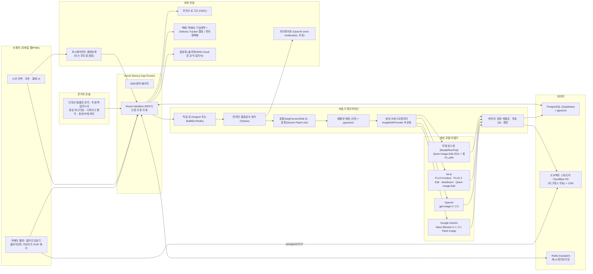
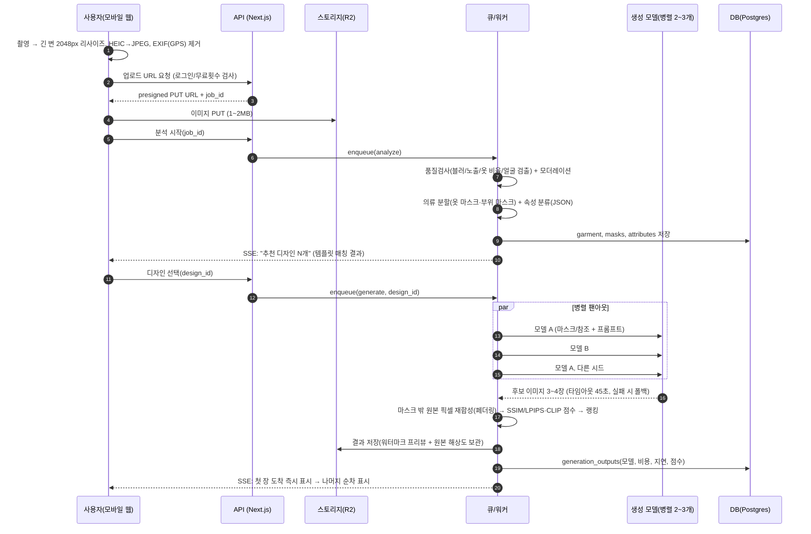
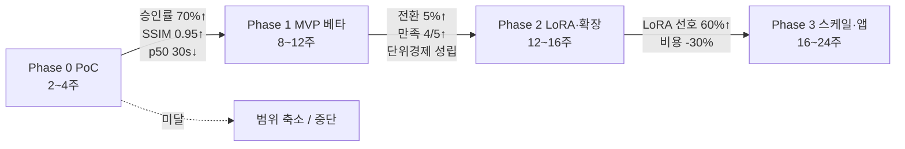

# F. 리폼 편의점 — 시스템 아키텍처 · 비용 · 로드맵 설계

- 작성일: 2026-10-21
- 담당 차원: F_architecture_cost_roadmap (시스템 아키텍처, 운영 비용, 단계별 로드맵, 팀 구성, 리스크, 보안/개인정보)
- 조사 방법 메모: 이번 실행에서는 공유 웹 검색 예산(WebSearch)이 소진되어 검색 엔진 질의는 수행하지 못했고, 대신 **벤더 공식 가격/문서 페이지를 직접 열람(WebFetch)** 하여 확인했다. 아래 수치는 모두 2026-10-21 열람 기준이며, 열람에 실패했거나 공식 페이지에 수치가 없는 항목은 **[미확인]** 으로 표시했다. 환율은 **1 USD = 1,400 KRW로 가정**(실제 환율 미확인)했다.
- 표기 규칙: **[확인]** 공식 페이지에서 직접 확인 / **[추정]** 공개 단가에 가정을 곱해 산출 / **[미확인]** 확인 실패 또는 비공개

---

## 0. 요약 (Executive Summary)

1. **구현 가능성: 가능. 단, "원형 보존"은 모델 프롬프트에만 맡기면 안 되고 파이프라인(분할 마스크 → 편집 → 원본 픽셀 재합성 → 자동 검증)으로 강제해야 한다.** 2026-10 현재 상용 이미지 편집 API(Google Nano Banana 2.1 / Gemini 3.1 Flash Image, OpenAI gpt-image-2 / 2.5, fal.ai 경유 FLUX Kontext·FLUX 2 Edit·Seedream 4.5·Qwen-Image-Edit)는 모두 "참조 이미지 + 지시문" 편집을 지원하고 장당 0.03~0.13 USD 수준이다. [확인]
2. **권장 운영 방식: 단계적 하이브리드.** Phase 0~1은 상용 API 2~3개를 추상화 레이어 뒤에 두고 병렬 생성·선택(다중 생성)으로 품질 편차를 흡수한다. Phase 2에서 Apache 2.0 라이선스인 **Qwen-Image-Edit-2511(20B)** 에 회사 디자인별 LoRA를 학습해 서버리스 GPU(Modal/fal/RunPod)에 올리고, 상용 API는 폴백으로 유지한다. 자체 GPU 서버는 월 5만 시안 이상이 지속되거나 데이터 국내 보관이 강제될 때만 검토한다.
3. **비용 감각(생성 비용만, 시안 1건당 3.5장 가정):** 월 1천 시안 ≈ 15~25만 원, 월 1만 시안 ≈ 150~250만 원, 월 10만 시안 ≈ 1,500~2,500만 원(상용 API 표준 구성 기준). 서버리스 GPU 자체 호스팅으로 전환하면 10만 시안 구간에서 장당 비용을 약 40~60% 절감할 수 있으나, ML 엔지니어 인건비가 그보다 크다. 즉 **1만 시안/월 이하에서는 비용보다 품질·통제력이 자체 호스팅의 이유**다. [추정]
4. **지연시간 목표: 첫 시안 25초, 전체(3~4장) 45초, p95 90초.** 클라이언트 리사이즈, 병렬 팬아웃, 점진적 표시, 상용 API 타임아웃-폴백, 자체 호스팅 시 업무시간 웜 컨테이너 유지로 달성한다. 상용 API의 공식 지연시간 수치는 대부분 비공개라 **PoC에서 실측이 필수**다.
5. **로드맵: Phase 0 PoC(2~4주) → Phase 1 MVP 비공개 베타(8~12주) → Phase 2 학습·확장(12~16주) → Phase 3 스케일·앱(16~24주).** 각 단계 끝에 go/no-go 게이트(예: 디자이너 승인률 70% 이상, p50 지연 30초 이내, 장당 비용 100원 이하)를 둔다.
6. **개발비(한국, 추정): MVP(Phase 0+1) 에이전시 외주 1.2억~2.5억 원 / 소규모 내재화 팀 4~6개월 인건비 1.0억~1.8억 원.** 1년차 총(Phase 0~3) 3.5억~7억 원 범위. KOSA 2026년 적용 SW기술자 평균임금(응용SW개발자 월 7,754,124원 등)을 기준으로 산출했다. [확인된 단가 × 추정 공수]

---

## 1. 아키텍처 제안

### 1.1 설계 원칙

| 원칙 | 내용 | 이유 |
|---|---|---|
| 모바일 웹 우선(PWA) | 앱스토어 심사 없이 카메라 촬영·홈화면 설치·푸시까지 웹으로 처리 | 리폼은 저빈도 서비스라 앱 설치 장벽이 전환율을 깎음. Next.js 공식 PWA 가이드(2026-07-30 갱신)가 manifest·Web Push·iOS 16.4+ 홈화면 푸시를 지원 [확인] https://nextjs.org/docs/app/guides/progressive-web-apps |
| 생성 모델 추상화 | `ImageEditProvider` 인터페이스 뒤에 Google/OpenAI/fal/자체호스팅 어댑터 | 모델 종료·가격 변경이 잦음(예: Gemini 2.5 Flash Image는 2026-10-02 종료 [확인]) |
| 다중 생성 + 선택 | 시안 1건당 2~3개 모델/시드로 3~4장 생성 후 자동 QA·랭킹 → 사용자 선택 | 단일 모델 품질 편차 흡수, 디자이너 평가 데이터 축적 |
| 원형 보존은 파이프라인이 보장 | 분할 마스크로 편집 영역 한정 → 편집 → 마스크 밖은 원본 픽셀 재합성 → SSIM 검증 | "나머지는 그대로"라는 프롬프트만으로는 보장 불가 |
| 비동기 작업 중심 | 업로드 즉시 작업 ID 반환, 상태는 SSE/폴링, 이탈 시 알림톡/웹푸시 | 생성 지연(10~60초)과 외부 API 장애에 UX가 견디도록 |
| 비용 가드레일 내장 | 무료 횟수, 레이트리밋, 캐시, 예산 알람, 모델 라우팅 | 이미지 생성은 트래픽에 비례해 비용이 직접 발생 |

### 1.2 시스템 구성 (Mermaid)



### 1.3 이미지 파이프라인 상세 (업로드 → 저장)



**단계별 구현 메모**

| 단계 | 구현 | 도구/모델 후보 | 비고 |
|---|---|---|---|
| 업로드 | 클라이언트에서 리사이즈·EXIF 제거 후 presigned URL로 직접 업로드 | 브라우저 Canvas/`createImageBitmap`, R2 S3 API | 서버 대역폭·지연 절감. iOS HEIC 변환 필요 |
| 전처리/품질검사 | 블러(Laplacian 분산), 노출, 옷이 프레임의 일정 비율 이상, 단일 의류, 얼굴/신체 검출 시 반려 또는 블러 | OpenCV, 경량 얼굴검출 | 촬영 가이드(바닥에 펼쳐 촬영)로 품질 선제 확보 |
| 모더레이션 | 부적절 이미지 필터 | OpenAI `omni-moderation-latest`: 이미지 입력 지원, **무료** [확인] https://developers.openai.com/api/docs/guides/moderation | 성적/폭력 카테고리는 이미지에도 적용 |
| 분할 | 옷 전체 마스크 + 부위(소매·칼라·밑단·포켓) 마스크 | SegFormer-B2 clothes(18 클래스, 약 27.4M 파라미터, 라이선스 "other"=NVIDIA SegFormer 라이선스 → 상업 사용 조건 검토 필요) [확인] https://huggingface.co/mattmdjaga/segformer_b2_clothes ; SAM 3(848M, 텍스트 프롬프트 분할, "SAM License") [확인] https://github.com/facebookresearch/sam3 | SAM 3는 "sleeve", "collar" 같은 텍스트 프롬프트로 부위 분할 가능 |
| 분류/속성 | 카테고리·소매길이·소재·색·패턴·여밈 등 구조화 JSON | Gemini 2.5 Flash-Lite(입력 $0.10/1M, 출력 $0.40/1M) 또는 3.1 Flash-Lite(입력 $0.25/1M, 출력 $1.50/1M) [확인] https://ai.google.dev/gemini-api/docs/pricing | 호출당 약 0.0003 USD 수준 [추정] |
| 템플릿 매칭 | 디자인별 적용 가능 카테고리 규칙 × 임베딩 유사도(디자인 레퍼런스 vs 옷) × 디자이너 정의 호환표 | pgvector + SigLIP/CLIP 임베딩 | 디자인마다 "적용 부위·필요 조건(소매 있음 등)" 메타데이터 필수 |
| 생성(다중) | 디자인 템플릿(레퍼런스 이미지 n장 + 텍스트 스펙 + 편집 영역 힌트)로 프롬프트 조립 → 2~3개 어댑터 병렬 호출 | 아래 1.4 | 마스크를 받는 API(OpenAI edits)는 마스크 전달, 프롬프트 기반(Gemini/Qwen/Kontext)은 "나머지는 그대로" 지시 + 후처리로 강제 |
| 후처리 | 마스크 밖 영역을 원본 픽셀로 되돌림(페더링 8~16px), 색 보정, 필요 시 업스케일, 프리뷰 워터마크 | OpenCV/Pillow | 원형 보존의 실질적 보증 장치 |
| 자동 QA | 마스크 밖 SSIM ≥ 0.95(원본 동일성), 편집 영역 CLIP 점수(디자인 충실도), 이상치(손가락/글자 등) 검출 | | 기준 미달 후보 폐기 → 재생성 |
| 저장 | 원본·마스크·후보·선택본을 버전과 함께 저장, 비용/지연 로그 | R2 + Postgres | 보관 기간 정책은 7절 |

### 1.4 생성 모델 어댑터 레이어

```text
interface ImageEditProvider {
  id: 'gemini-nb21' | 'gemini-31-flash-image' | 'openai-gpt-image-2' | 'fal-kontext-pro'
     | 'fal-flux2-edit' | 'fal-seedream45' | 'fal-qwen-edit' | 'self-qwen-lora'
  capabilities: { mask: boolean; maxRefs: number; maxOutPx: number; lora: boolean }
  edit(req: { image, mask?, refs[], prompt, negative?, seed?, size, timeoutMs }): Promise<EditResult>
  estimateCost(req): number   // USD
}
라우팅 정책: 디자인 템플릿별 "선호 모델 목록"(디자이너 평가로 학습) → 비용 상한 → 장애 시 서킷브레이커로 다음 모델
```

2026-10-21 기준 주요 편집 모델 비교 [확인]

| 모델 (제공처) | 단가 | 참조 이미지 | 마스크 | 라이선스/상업 사용 | 출처 |
|---|---|---|---|---|---|
| Gemini Nano Banana 2.1 (`gemini-nano-banana-2.1`) | 1K $0.0336, 2K $0.0504, 4K $0.113 (배치 50%) | 최대 14장 | 대화형 마스크(픽셀 마스크 입력 없음) | 상용 API | https://ai.google.dev/gemini-api/docs/pricing , https://ai.google.dev/gemini-api/docs/image-generation |
| Gemini 3.1 Flash Image / Nano Banana 2 (`gemini-3.1-flash-image`) | 0.5K $0.045, 1K $0.067, 2K $0.101, 4K $0.151 | 최대 14장 | 동일 | 상용 API | 동일 |
| Gemini 3 Pro Image / Nano Banana Pro | 1K·2K $0.134, 4K $0.24 | 최대 14장 | 동일 | 상용 API | 동일 |
| Gemini 2.5 Flash Image | $0.039 | — | — | **2026-10-02 서비스 종료** | 동일 |
| OpenAI gpt-image-2 | 1024² low $0.006 / medium $0.053 / high $0.211 (레거시 장당 표) | 다중 입력 가능 | **알파 마스크 지원(edits 엔드포인트)**, 단 "정확한 형태를 완전히 따르지 않을 수 있음" | 상용 API | https://developers.openai.com/api/docs/guides/image-generation , https://developers.openai.com/api/docs/pricing |
| OpenAI gpt-image-2.5 (sunburst/flare) | 토큰제: 이미지 출력 $30/1M, 입력 $8/1M (장당 환산표 없음 → 계산기 확인 필요) | 다중 | 동일 | 상용 API | 동일 |
| OpenAI gpt-image-1.5 / 1 / 1-mini | 1024² medium $0.034 / $0.042 / $0.011 | 다중 | 동일 | 상용 API | 동일 |
| FLUX.1 Kontext [pro] (fal) | $0.04/장 ([max] $0.08) | 1장 중심 | 프롬프트 기반 | fal 경유 상업 사용 포함 | https://fal.ai/models/fal-ai/flux-pro/kontext |
| FLUX 2 Edit (fal) | $0.012/MP(입력+출력) ≈ $0.024/장 | 다중 참조 | 프롬프트 기반 | fal "Commercial use" | https://fal.ai/models/fal-ai/flux-2/edit |
| FLUX 3 Image edit (fal) | $0.048/MP | — | — | fal 가격표에 게시 | https://fal.ai/pricing |
| Seedream 4.5 edit (fal) | $0.04/장 | 최대 10장 | 프롬프트 기반 | fal 파트너 계약 | https://fal.ai/models/fal-ai/bytedance/seedream/v4.5/edit |
| Qwen-Image-Edit-2511 (fal) | $0.03/MP | 다중 | 프롬프트 기반 | **Apache 2.0 (자체 호스팅·LoRA 자유)** | https://fal.ai/models/fal-ai/qwen-image-edit-2511 , https://huggingface.co/Qwen/Qwen-Image-Edit-2511 |
| FLUX.1 Kontext [dev] / FLUX.2 [dev] (오픈 가중치) | 자체 호스팅 시 GPU 비용만 | — | — | **Non-Commercial License → 상업 자체 호스팅은 BFL 별도 라이선스 필요(가격 미확인)** | https://huggingface.co/black-forest-labs/FLUX.1-Kontext-dev , https://huggingface.co/black-forest-labs/FLUX.2-dev |

### 1.5 프론트엔드 선택 근거

| 후보 | 장점 | 단점 | 판단 |
|---|---|---|---|
| **Next.js (App Router) + PWA** | 카메라(`<input capture>`/getUserMedia), Web Push(iOS 16.4+ 홈화면 설치 시), manifest 내장 지원, Vercel 배포 단순, 카카오 공유/인앱브라우저 대응 용이 | iOS 사파리에서 설치 유도 UI를 직접 만들어야 함, 백그라운드 작업 제약 | **1차 채택** |
| React Native/Expo 네이티브 앱 | 카메라 품질·푸시·결제 UX 우수 | 스토어 심사, 2개 플랫폼 유지, 초기 설치 장벽 | Phase 3에서 PWA 성과 보고 결정 |
| Capacitor로 PWA 래핑 | 코드 재사용하며 스토어 등록 | 네이티브 성능 한계 | Phase 3 대안 |

카카오 로그인: REST/JS/Android/iOS/Flutter SDK, OpenID Connect 지원, 카카오싱크는 선택(간편가입에만 필요). 이메일은 비즈 앱 전환 필요, 이름·전화번호·배송지는 "추가 기능 신청"(비즈니스 정보 심사 영업일 3~5일) 필요. [확인] https://developers.kakao.com/docs/latest/ko/kakaologin/common , https://developers.kakao.com/docs/latest/ko/kakaologin/prerequisite , https://developers.kakao.com/docs/latest/ko/kakaologin/utilize

### 1.6 백엔드 · 큐 · 데이터

| 구성 | 1차 선택 | 대안 | 근거/가격 [확인] |
|---|---|---|---|
| API | Next.js Route Handlers(TypeScript) | NestJS 분리 | 소규모 팀 생산성 |
| 이미지 워커 | Python(FastAPI/worker) — OpenCV, 분할 모델, 어댑터 호출 | Node 워커 | CV 생태계가 Python 중심 |
| 큐/오케스트레이션 | **Inngest**(무료 50k 실행/월, Pro $99/월~) https://www.inngest.com/pricing | **BullMQ**(MIT, Redis 기반; 재시도·우선순위·동시성·지연·부모-자식 작업) https://docs.bullmq.io/ + Upstash Redis(무료 500K 커맨드/월, 종량 $0.20/100K) https://upstash.com/pricing/redis | 팬아웃·재시도·타임아웃·단계별 관측이 필요 |
| DB | Supabase Postgres(Pro $25/월~, 8GB 디스크, 파일 100GB, 이그레스 250GB) https://supabase.com/pricing | AWS RDS(서울) | pgvector 내장, Auth에 카카오 제공자 |
| 스토리지/CDN | Cloudflare R2($0.015/GB-월, **이그레스 무료**, 무료 10GB) https://developers.cloudflare.com/r2/pricing/ | S3 서울 + CloudFront | 이미지 반복 조회가 많아 이그레스 무료가 유리 |
| 이미지 변환 | Cloudflare Images(저장 $5/10만장, 전송 $1/10만장, 변환 5천 무료 후 $0.50/1천) https://developers.cloudflare.com/images/pricing/ | Vercel Image Optimization(5천/월 포함 후 $0.05/1천) | 썸네일·리사이즈 |
| 호스팅 | Vercel Pro $20/월(대역폭 1TB 포함, 초과 $0.15/GB) https://vercel.com/pricing | Cloudflare Pages | |
| 자체 호스팅 GPU | Modal(H100 ≈ $3.95/h, L40S ≈ $1.95/h, L4 ≈ $0.80/h; Starter 월 $30 크레딧) https://modal.com/pricing | fal(H100 $2.49~4.50/h), RunPod 서버리스(H100 $4.79/h, L40S $1.75/h), Replicate(H100 $5.49/h, L40S $3.51/h) | 2절 |

### 1.7 결제 · 배송 · 알림

| 영역 | 선택 | 확인 내용 | 출처 |
|---|---|---|---|
| 결제 | **토스페이먼츠 결제위젯(주문서형)** 직접 연동. 멀티 PG가 필요해지면 포트원 V2로 추상화 | 신용·체크카드 일반 3.4%, 간편결제 3.4%(일부 추가 수수료), 계좌이체 2.0%(최저 200원), 가상계좌 건당 400원, 휴대폰 실물 3.5%; 가입비 220,000원(1회), 연관리비 110,000원; 영·중소 우대 국세청 명단 기준 자동 반영(모두 VAT 별도) [확인] | https://www.tosspayments.com/about/fee , https://docs.tosspayments.com/guides/v2/get-started |
| 결제 추상화 | 포트원 V2(토스페이먼츠·KG이니시스·나이스·NHN KCP·카카오페이·네이버페이·토스페이 등 지원, 웹훅·빌링키) | 포트원 요금은 페이지 열람 실패 **[미확인]** | https://developers.portone.io/opi/ko/readme |
| 배송 조회 | Delivery Tracker(Free $0 / Pro $49.99 / Business $199.99, Business 미만 월 1만 운송장·이상 10만, 기본 10 call/s, 웹훅 지원; CJ대한통운·우체국·CU 편의점택배·GS Postbox 지원, 한진·롯데·로젠은 목록에 없음) [확인] | 자체 호스팅 Core는 오픈소스 | https://tracker.delivery/pricing , https://tracker.delivery/carriers , https://tracker.delivery/docs/quotas |
| 수거 예약 | MVP: 택배사 기업계약(CJ대한통운 '오네' 사업문의) 후 콘솔에서 수동 예약 + 사용자에게 편의점택배(GS25/CU) 안내 → Phase 2에서 굿스플로/스마트택배 API 연동 | CJ대한통운 사이트에 개발자 API 언급 없음, 반품예약은 홈페이지/앱/ARS [확인]; 굿스플로·스마트택배 API 상세는 접속 차단으로 **[미확인]** | https://www.cjlogistics.com/ko/tool/parcel/tracking |
| 알림 | 카카오 알림톡(정보성 메시지만, 템플릿 사전 심사, 비즈니스 채널 전환 필수, 공식 딜러사 경유) | 솔라피 기준 알림톡 13원/건, SMS 18원, LMS 45원(VAT 별도, 볼륨 할인) [확인]; 친구톡은 "2025.12.31 서비스 종료" 표기 → 광고성은 브랜드 메시지로 | https://kakaobusiness.gitbook.io/main/ad/bizmessage/notice-friend , https://solapi.com/pricing |
| 인증 | 카카오 로그인(OIDC) + 이메일/전화번호 동의항목(비즈 앱) | 1.5절 | |

### 1.8 관리자 콘솔 기능

- 디자인 템플릿 관리: 레퍼런스 이미지(완성작·디테일 컷), 적용 가능 카테고리/조건, 편집 부위 정의, 프롬프트 블록, 가격(기본가 + 카테고리 가산), 모델 라우팅 선호도, 버전 이력
- 생성 모니터링: 모델별 성공률·지연·비용, 자동 QA 점수 분포, 폐기율, 일/월 예산 대비 소진
- 디자이너 평가 큐: 생성 결과를 1~5점(원형 보존 / 디자인 충실도 / 제작 가능성) + 코멘트 → 라우팅·프롬프트·LoRA 학습 데이터로 환류
- 주문/작업지시서: 원본 + 선택 시안 + 마스크 오버레이 + 디자인 스펙 + 치수/소재 메모 자동 생성(PDF), 공방 배정, 진행 상태(수거→입고→작업→QC→출고)
- 배송: 수거 예약, 운송장 등록, 웹훅 상태 반영, 알림톡 발송 이력
- CS/동의: 삭제 요청 처리, 학습 활용 동의 현황, 보관 기간 만료 자동 삭제 로그
- 권한: 역할 기반(운영/디자이너/공방/개발), 2단계 인증

### 1.9 핵심 데이터 모델(요약)

`users`, `consents`(필수/선택/국외이전, 버전·시각), `garments`(원본·마스크·속성 JSON·품질점수·만료일), `design_templates` / `design_versions`(레퍼런스·규칙·프롬프트·가격·라우팅), `generation_jobs` / `generation_outputs`(모델·시드·비용·지연·QA 점수·선택 여부), `designer_ratings`, `orders` / `order_items`(가격·시안 참조), `payments`, `shipments`(수거/반송·운송장·상태), `work_orders`, `deletion_requests`, `cost_ledger`(일별 벤더 비용).

---

## 2. 생성 모델 운영 방식 비교와 비용 시나리오

### 2.1 시나리오 정의

| 시나리오 | 월 시안 요청 수 | 월 생성 이미지 수(시안당 3.5장) | 비고 |
|---|---|---|---|
| S1 | 1,000 | 3,500 | 비공개 베타~초기 |
| S2 | 10,000 | 35,000 | 정식 출시 후 성장기 |
| S3 | 100,000 | 350,000 | 전국 규모·B2B 포함 |

공통 가정: 재생성/폐기율 20% 별도(아래 표는 미포함, 포함 시 ×1.2), 환율 1,400원/USD(가정), 분류·모더레이션·분할 비용은 장당 0.001 USD 미만으로 생성 비용 대비 무시 가능 [추정].

### 2.2 (a) 상용 API만 사용

장당 단가 구성(1K 해상도, 2026-10-21 공식 가격 기준):

| 구성 | 모델 예시 | 장당 단가(USD) |
|---|---|---|
| 저가 | Qwen-Image-Edit-2511(fal, $0.03/MP) / Nano Banana 2.1($0.0336) | 0.035 |
| 표준(권장) | FLUX Kontext pro($0.04) / Seedream 4.5($0.04) / FLUX 2 Edit($0.024) / NB 2.1 혼합 | 0.045 |
| 고품질 | Gemini 3.1 Flash Image($0.067) / gpt-image-2 medium($0.053) | 0.060 |
| 프리미엄 | Nano Banana Pro($0.134) / gpt-image-2 high($0.211) | 0.134 |

월 비용(생성만):

| 시나리오 | 저가 $0.035 | 표준 $0.045 | 고품질 $0.060 | 프리미엄 $0.134 |
|---|---|---|---|---|
| S1 (3,500장) | $123 (≈17만원) | $158 (≈22만원) | $210 (≈29만원) | $469 (≈66만원) |
| S2 (35,000장) | $1,225 (≈172만원) | $1,575 (≈221만원) | $2,100 (≈294만원) | $4,690 (≈657만원) |
| S3 (350,000장) | $12,250 (≈1,715만원) | $15,750 (≈2,205만원) | $21,000 (≈2,940만원) | $46,900 (≈6,566만원) |

- 장점: 초기 투자 0, 품질 상위 모델 즉시 사용, 운영 인력 최소. 배치 API(Gemini·OpenAI 50% 할인)는 최대 24시간 지연이라 실시간 시안에는 부적합하고, 레퍼런스 사전 생성 등에만 활용.
- 단점: 모델 종료/가격 변동 종속(Gemini 2.5 Flash Image 종료 사례), 회사 디자인 "학습" 불가(참조 이미지 + 프롬프트로만 전달), 픽셀 마스크를 받는 API가 OpenAI뿐이라 원형 보존은 후처리에 의존, 스팟 한도(Gemini Tier 1은 10분당 $10 지출 한도, Tier 2 $50, Tier 3 $200 [확인] https://ai.google.dev/gemini-api/docs/rate-limits) → S3는 Tier 3 이상 필요.

### 2.3 (b) 서버리스 GPU에 오픈 모델 + 회사 LoRA 호스팅

- 모델: **Qwen-Image-Edit-2511**(20B, BF16, Apache 2.0, 다중 이미지 입력·일관성 개선) [확인]. FLUX 계열 dev 가중치는 비상업 라이선스라 제외(BFL 상업 라이선스 가격 미확인).
- 하드웨어: BF16 기준 H100 80GB 1장(가중치 약 40GB + 텍스트 인코더). FP8 양자화 시 L40S 48GB 가능하나 속도 저하 [추정].
- 처리 시간 가정: **장당 15초(H100, 40 스텝급)**, Lightning류 증류 LoRA 적용 시 5초 내외 가능 — **PoC 실측 필요** [가정].
- 유휴/콜드스타트 오버헤드: S1 100%(저빈도·스케일다운 반복), S2 40%, S3 15%. Modal 기본 scaledown_window 60초(2초~20분 조정), 컨테이너 부팅 약 1초이나 모델 로드 포함 웜업은 "수초~수분", 메모리 스냅샷으로 단축 [확인] https://modal.com/docs/guide/cold-start

| 시나리오 | 필요 GPU 시간(유휴 포함) | Modal H100 $3.95/h | fal H100 최저 $2.49/h | RunPod 서버리스 H100 $4.79/h | Replicate H100 $5.49/h | 장당 유효 단가(Modal) |
|---|---|---|---|---|---|---|
| S1 | 29h | $115 (≈16만원) | $72 | $139 | $159 | $0.033 |
| S2 | 204h | $806 (≈113만원) | $508 | $977 | $1,120 | $0.023 |
| S3 | 1,677h | $6,624 (≈927만원) | $4,176 | $8,033 | $9,207 | $0.019 |

- 추가 비용: 플랫폼 기본료(Modal Team $250/월 선택), LoRA 학습 — 디자인 50개 × H100 1~3시간 × $3.95 ≈ $200~600, 반복 3회 가정 시 초기 $1,000~2,000, 이후 월 $100~300 [추정]. fal의 관리형 트레이너 참고가: FLUX LoRA $2/1,000스텝, FLUX Kontext 트레이너 $2.5/1,000스텝(start/end 쌍 입력), FLUX.2 트레이너 $0.0064/스텝(=$6.4/1,000스텝), Qwen-Image-Edit 트레이너는 **지원 종료 표기** [확인] https://fal.ai/models/fal-ai/flux-kontext-trainer , https://fal.ai/models/fal-ai/flux-2-trainer , https://fal.ai/models/fal-ai/qwen-image-edit-trainer
- 장점: 회사 디자인을 쌍(before/after) 데이터로 학습해 일관성 확보, 가중치·데이터 통제, S3에서 장당 비용 약 40~60% 절감, 벤더 종료 리스크 제거.
- 단점: ML 엔지니어 상주 필요(인건비가 절감액보다 큼: S3 절감 ≈ $9k/월 vs 응용SW개발자급 인건비 월 775만 원), 품질 상한이 상용 최상위 모델보다 낮을 수 있음, 콜드스타트 관리.

### 2.4 (c) 자체(전용) GPU 서버

- 처리량: H100 1장, 장당 15초 → 240장/시간, 평균 가동률 35%(피크 대비 여유) 가정 시 **월 약 6만 장/GPU** [추정].
- 클라우드 전용 인스턴스 월 비용(730h): Lambda H100 PCIe $3.29/h → $2,402; H100 SXM 1x $4.29/h → $3,132; A100 40GB $1.99/h → $1,453; RunPod Secure H100 $3.99/h → $2,913, Community $2.69/h → $1,964; L40S Secure $1.09/h → $796 [확인] https://lambda.ai/pricing , https://www.runpod.io/pricing
- 온프레미스 구매: 서버 단가·전기·상면·운영 인력 **[미확인]**, 국내 클라우드(네이버클라우드 GPU) 요금은 페이지 동적 로딩으로 **[미확인]** https://www.ncloud.com/product/compute/gpuServer

| 시나리오 | 필요 GPU 수 | 월 비용(클라우드 전용, H100 기준) | 평가 |
|---|---|---|---|
| S1 | 1 (가동률 ~2%) | $800(L40S)~$2,400 | 과잉 투자, 서버리스 대비 10배 이상 비쌈 |
| S2 | 1 (가동률 ~20%) | $2,400~3,100 | 서버리스($800 내외)보다 비쌈 |
| S3 | 6 | $11,800~14,400 | 서버리스($4,200~6,600)보다 여전히 비쌈. 데이터 국내 보관·예측 가능한 지연·장기 약정 할인이 있을 때만 유리 |

### 2.5 종합 비교와 권고

| 항목 | (a) 상용 API | (b) 서버리스 + LoRA | (c) 전용 GPU |
|---|---|---|---|
| 초기 투자 | 없음 | LoRA 학습 $1~2k + ML 인력 | 서버/약정 + 인력 |
| S1 월 생성비 | $120~470 | $70~160 | $800~2,400 |
| S2 | $1.2k~4.7k | $500~1.1k | $2.4k~3.1k |
| S3 | $12k~47k | $4.2k~9.2k | $11.8k~14.4k |
| 디자인 학습 | 불가(참조+프롬프트) | LoRA 가능 | LoRA 가능 |
| 종속 리스크 | 높음(추상화로 완화) | 낮음 | 낮음 |
| 운영 난이도 | 낮음 | 중간 | 높음 |

**권고:** Phase 0~1은 (a) 2~3개 병렬 + 추상화 레이어. Phase 2에서 (b)를 추가해 디자인별 LoRA를 학습하고 라우팅(디자인·카테고리별 최적 모델)으로 혼합. (c)는 월 5만 시안 이상 지속 또는 데이터 국내 보관 요건이 있을 때 재검토.

### 2.6 지연시간 목표와 달성 방안

목표: **첫 시안 ≤ 25초(p50), 3~4장 전체 ≤ 45초(p50), p95 ≤ 90초**, 분석(추천 디자인 표시) ≤ 8초.

| 구간 | 예상 소요 | 근거/대책 |
|---|---|---|
| 업로드 | 1~3초 | 클라이언트 리사이즈로 1~2MB로 축소 [추정] |
| 품질검사·모더레이션 | 0.5~2초 | CPU 처리, 모더레이션 병렬 |
| 분할 | 0.5~2초 | SegFormer-B2는 경량(27M), GPU 없이도 가능 |
| 분류 | 1~3초 | Gemini Flash-Lite 구조화 출력 |
| 생성(병렬) | 상용 API: 공식 지연 수치 미공개(OpenAI "복잡한 프롬프트는 최대 2분", Gemini는 thinking 기본 활성·비활성 불가) [확인]; 자체 Qwen H100 5~20초 [가정] | **PoC에서 모델별 p50/p95 실측** |
| 후처리·QA | 1~2초 | OpenCV |

달성 방안:
1. **병렬 팬아웃 + 점진적 표시**: 먼저 도착한 장부터 표시, 45초 타임아웃 시 도착한 장만으로 완료 처리하고 나머지는 백그라운드 보충.
2. **스트리밍 부분 이미지**: OpenAI `partial_images`(0~3) 활용해 진행감 제공 [확인].
3. **자체 호스팅 웜 유지**: 업무시간 `min_containers=1`, `scaledown_window` 5~10분, 메모리 스냅샷으로 콜드스타트 단축 [확인].
4. **캐시**: (이미지 해시 × 디자인 × 모델 버전) 키로 재요청 즉시 응답, 디자인별 "일반 미리보기"는 사전 생성.
5. **이탈 대응**: 30초 넘으면 "완성되면 알림톡/푸시로 알려드릴게요" 전환(작업은 계속).
6. **모델 선택**: 지연이 긴 모델(Pro급, thinking high)은 "고화질 재생성" 옵션으로만 노출.

---

## 3. 단계별 로드맵

| 단계 | 기간 | 목표 | 산출물 | Go/No-Go 게이트 |
|---|---|---|---|---|
| **Phase 0 PoC** | 2~4주 | 상용 API로 회사 디자인 5개 × 실제 옷 사진 20장(카테고리 다양) × 모델 3종(Nano Banana 2.1, gpt-image-2/2.5, fal Qwen 또는 Kontext) × 변형 2~4장 = 약 600~2,400장 생성, 디자이너 블라인드 평가 | 평가 루브릭(원형 보존/디자인 충실도/제작 가능성 1~5점), 모델별 승인률·지연·비용 표, 프롬프트 라이브러리 v0, 마스크 후처리 프로토타입, 의사결정 메모 | ① 최소 1개 모델이 디자인 5개 중 3개 이상에서 **디자이너 승인률 ≥ 70%** ② 마스크 밖 SSIM ≥ 0.95 달성 ③ p50 생성 ≤ 30초 ④ 장당 비용 ≤ 100원 ⑤ 미달 시: 디자인 범위 축소(부분 리폼만) 또는 촬영 가이드 강화 후 1회 재시도, 재실패 시 중단 |
| **Phase 1 MVP (비공개 베타)** | 8~12주 | 핵심 플로우 end-to-end: 카카오 로그인 → 촬영 → 분석/추천 → 시안(2~3모델 병렬) → 주문·결제 → 수거(콘솔 수동) → 작업 → 반송 → 알림톡 | PWA, API, 파이프라인 v1, 어댑터 2~3개, 관리자 콘솔 v1(템플릿·주문·반수동 작업지시서), 디자인 10~20개 템플릿화, 평가 하네스, 개인정보 동의/삭제 플로우 | 베타 50~200명 기준 ① 시안→주문 전환 ≥ 5%(가설, 베타에서 보정) ② 시안 만족도 ≥ 4/5 ③ 재생성률 ≤ 30% ④ 실제 리폼 결과물이 시안과 "유사하다" 응답 ≥ 70% ⑤ 시안당 생성비 < 주문당 마진 × 전환율 |
| **Phase 2 학습·확장** | 12~16주 | Qwen-Image-Edit LoRA(디자인군별) 학습·서빙, 디자인 50개+, 자동 작업지시서, 택배/수거 API, 모델 라우팅·캐시, 비용 최적화 | 쌍 데이터셋(원본·완성 사진 + 마스크) 구축 도구, 학습 파이프라인(Modal), A/B 평가, 라우팅 정책, 굿스플로/스마트택배 연동(가능 시) | ① LoRA 결과가 블라인드 테스트에서 API 기준선 대비 선호 ≥ 60% ② 장당 비용 30% 절감 ③ 신규 디자인 추가 리드타임 ≤ 2일 ④ 작업지시서 수정 없이 공방 투입 비율 ≥ 80% |
| **Phase 3 스케일·자동화·앱** | 16~24주 | 월 1만~10만 시안 대응, 네이티브 앱(선택), B2B(브랜드 협업·오프라인 매장 키오스크), 개인화 추천, SLA·관측성 | 오토스케일·예산 가드레일, 앱(Expo/Capacitor), 파트너 API, 데이터 플라이휠(평가→학습 자동화), 전용 GPU 검토 보고서 | ① p95 ≤ 90초 유지 ② 월 생성비/매출 ≤ 목표치 ③ CS 티켓/주문 ≤ 기준 ④ 보안 점검(침투 테스트) 통과 |



Phase 0 체크리스트(실무):
- 옷 사진 20장: 상의/하의/아우터/원피스, 단색/패턴, 밝은/어두운 소재, 바닥 펼침/행거/착용 각 포함
- 디자인 5개: "부분 리폼"(패치·자수·배색 소매·포켓 추가)과 "형태 변경"(크롭·슬릿)을 섞어 난이도 분포 확보
- 각 모델에 동일 프롬프트 템플릿 + 마스크(지원 시) 적용, 시드 2개
- 평가자 3인 이상, 블라인드, 결과를 스프레드시트/콘솔에 기록 → 이 데이터가 Phase 2 학습의 씨앗

---

## 4. 팀 구성과 역할, 외주 vs 내재화

| 역할 | 투입(MVP 기준) | 책임 | 외주/내재화 |
|---|---|---|---|
| PM/기획 | 0.5~1.0 FTE | 범위·게이트 관리, 디자이너·공방과 요구 정리, 가격 정책 | **내재화(클라이언트 측 또는 당사 PM)** |
| UX/UI 디자이너 | 0.5 FTE | 촬영 가이드 UX, 시안 비교 UI, 주문 플로우 | 외주 가능 |
| 프론트엔드 | 1.0 FTE | Next.js PWA, 카메라/업로드, SSE, 결제위젯 | 외주 가능 |
| 백엔드 | 1.0 FTE | API, 큐, 어댑터, 콘솔, 결제/배송/알림 연동, 인프라 | 외주 가능(코드 소유권·인수인계 필수) |
| ML/프롬프트 엔지니어 | 1.0 FTE | 파이프라인(분할·합성·QA), 프롬프트 템플릿, 평가 하네스, Phase 2 LoRA | **내재화 권장(핵심 IP)**, 초기엔 리테이너 계약 |
| 리폼 디자이너·장인 | 클라이언트 측 1~2명(주 1~2일) | 디자인 템플릿 정의, 평가, 작업지시서 검수, 제작 가능성 판단 | 클라이언트 |
| QA/운영 | 0.3 FTE | 테스트, 베타 운영, CS | 공유 |

판단 기준:
- **내재화할 것(핵심 IP):** 디자인 템플릿 체계와 메타데이터, 프롬프트 라이브러리, 평가 데이터(디자이너 점수), 쌍 데이터셋과 LoRA 가중치, 모델 라우팅 정책. 이 자산이 없으면 외주사 교체 시 서비스 품질이 리셋된다.
- **외주 가능(커머디티):** 앱 셸, 결제·배송·알림 연동, 관리자 CRUD, 인프라 세팅.
- 권장 형태: 에이전시가 MVP 셸을 구축하되 클라이언트 PM이 게이트를 통제하고, ML/프롬프트는 당사 또는 전문 인력 리테이너로 유지하며 Phase 2 전에 채용.

---

## 5. 개발 비용·기간 추정 (한국 기준)

근거 단가 [확인]: KOSA "2026년 적용 SW기술자 평균임금"(공표 2025-12-19, 기본급·제수당·상여·퇴직충당·법인부담 포함) — IT PM 월 10,086,804원, 응용SW개발자 7,754,124원, 시스템SW개발자 5,840,196원, UI/UX 디자이너 5,159,246원, 데이터분석가 8,499,309원, IT기획자(AI 서비스 기획자 준용) 11,853,218원. https://www.sw.or.kr/site/sw/ex/board/View.do?cbIdx=304&bcIdx=64717

산식 [추정]: MVP 팀 월 직접 인건비 = PM 0.5×10.09 + UX 0.5×5.16 + FE 1×7.75 + BE 1×7.75 + ML 1×7.75(응용SW 준용) ≈ **월 3,090만 원**. 에이전시 외주는 간접비·마진 1.5~2.0배 가정.

| 항목 | 기간 | 소규모 내재화 팀(인건비) | 에이전시 외주 | 비고 |
|---|---|---|---|---|
| Phase 0 PoC | 2~4주 | 800만~1,500만 원 | 1,500만~3,000만 원 | API 비용은 수십 달러 수준(2,400장 × $0.05 ≈ $120) |
| Phase 1 MVP | 3~4개월 | 9,000만~1.4억 원 | 1.2억~2.5억 원 | 결제 가입비 22만 원, 알림톡 템플릿·비즈앱 심사 기간 포함 |
| Phase 2 | 3~4개월 | 8,000만~1.3억 원 | 1.0억~2.0억 원 | LoRA 학습 GPU $1~2k, 데이터셋 구축 디자이너 공수 별도 |
| Phase 3 | 4~6개월 | 1.2억~2.0억 원 | 1.5억~3.0억 원 | 앱 포함 시 상단 |
| **1년차 합계** | 12~15개월 | **3.0억~5.0억 원** | **3.5억~7.0억 원** | 채용 리드타임·리스크는 내재화 쪽이 큼 |

월 운영비(생성비 제외) [확인 단가 × 추정 사용량]:

| 항목 | S1(월 1천 시안) | S2(월 1만) | S3(월 10만) |
|---|---|---|---|
| 호스팅(Vercel Pro) | $20 | $20~100 | $200~500(대역폭 초과 $0.15/GB) |
| DB(Supabase Pro + 컴퓨트) | $25 | $75~150 | $300~800 |
| 스토리지(R2, 시안당 5.5MB, 90일 보관) | ~$0.3 | ~$2.5 | ~$25 |
| 큐/캐시(Inngest/Upstash) | $0~20 | $99~150 | $300~600 |
| 모니터링(Sentry 등) | $0~26 | $26~80 | $80~300 |
| 알림톡(주문당 5건, 전환 5%) | 50건×13원 ≈ 650원 | 2,500건 ≈ 3.3만원 | 2.5만건 ≈ 33만원 |
| 배송조회 API | $0 | $0~50 | $200 |
| **소계(생성비 제외)** | **약 $70~100(≈10~14만원)** | **약 $250~550(≈35~77만원)** | **약 $1,100~2,500(≈150~350만원)** |
| 생성비(2.2·2.3 참조, 표준) | $120~160 | $800~1,600 | $6,600~15,800 |
| PG 수수료 | 결제액의 3.4%(VAT 별도) | 동일 | 동일 |

---

## 6. 기술 리스크와 완화책

| # | 리스크 | 영향 | 발생 가능성 | 완화책 |
|---|---|---|---|---|
| R1 | 특정 모델 API 종료·가격 변경(예: Gemini 2.5 Flash Image 2026-10-02 종료 [확인]) | 서비스 중단·원가 급등 | 높음 | 어댑터 추상화, 2개 이상 벤더 상시 활성, 월 1회 모델 카탈로그 점검, 계약 시 종료 고지 기간 확인 |
| R2 | 품질 편차(원형 훼손, 디자인 왜곡, 손·글자 아티팩트) | 신뢰 하락·주문 취소 | 높음 | 다중 생성+자동 QA+사용자 선택, 마스크 재합성, 디자이너 평가 환류, 실패 시 "디자이너 수동 시안" 폴백 |
| R3 | 시안과 실제 리폼 결과 불일치(제작 불가능한 시안) | 분쟁·환불 | 중간 | 디자인별 "제작 가능 범위" 메타데이터, 시안 하단에 "실제 결과는 다를 수 있음" 고지, 주문 전 디자이너 검수 단계(Phase 1), 작업지시서에 시안·마스크 첨부 |
| R4 | 비용 폭증(봇·남용·무한 재생성) | 적자 | 중간 | 로그인 후 무료 N회, IP/계정 레이트리밋, 캐시, 일/월 예산 캡과 자동 저가 모델 전환, 결제 사용자 우선 큐 |
| R5 | 지연·장애(외부 API 타임아웃, 콜드스타트) | 이탈 | 중간 | 타임아웃 45초 + 폴백, 점진 표시, 알림 전환, 웜 컨테이너, 상태 페이지 |
| R6 | 개인정보(사진에 얼굴·집 내부·GPS) | 법적 리스크 | 중간 | 클라이언트 EXIF 제거, 얼굴 검출 시 반려/블러, 촬영 가이드(옷만), 보관 기간·암호화·국외이전 고지(7절) |
| R7 | 벤더의 입력 데이터 학습/보관 정책 | 고객 사진 유출 우려 | 중간 | 유료 API 티어의 데이터 사용 정책 확인 및 계약(**각 벤더 DPA 미확인 → 계약 전 확인**), 가능하면 데이터 비학습 옵션 명시 |
| R8 | 오픈 모델 라이선스 위반(FLUX dev 비상업 등) | 법적 리스크 | 낮음 | Apache 2.0(Qwen-Image-Edit) 중심, FLUX 계열은 API 경유만, SegFormer 라이선스 검토 |
| R9 | 프롬프트 인젝션·부적절 이미지(옷 사진 대신 신체·불법 콘텐츠) | 브랜드 피해·플랫폼 정지 | 중간 | 모더레이션(무료) 선행, 사용자 텍스트 입력은 템플릿 슬롯으로만 허용(자유 프롬프트 금지), 출력 재검사, 신고 기능 |
| R10 | 분할 실패(복잡 패턴·검정 옷·구겨짐) | 원형 보존 실패 | 중간 | 2개 분할 모델 앙상블(SegFormer + SAM 3), 신뢰도 낮으면 "다시 촬영" 안내, 수동 마스크 보정 UI(콘솔) |
| R11 | 카카오 비즈앱·알림톡 템플릿 심사 지연 | 출시 지연 | 중간 | Phase 1 초기에 채널 개설·비즈앱 전환·템플릿 심사 착수(영업일 3~5일 + 템플릿 심사) |
| R12 | 결제/배송 운영 오류(수거 누락, 운송장 미연동) | CS 폭증 | 중간 | 상태 머신 기반 주문 흐름, 웹훅 재시도·멱등성, 운영 체크리스트, Delivery Tracker 웹훅 |
| R13 | 외주 종료 후 유지보수 공백 | 서비스 정체 | 중간 | 코드·인프라 소유권, 문서·런북, 인수인계 기간 계약 명시, 핵심 IP 내재화 |
| R14 | GPU 공급·가격 변동(서버리스 단가 변동) | 원가 변동 | 낮음 | 다중 GPU 플랫폼 어댑터(Modal/RunPod/fal), 월 단가 모니터링 |

---

## 7. 보안 · 개인정보

### 7.1 원칙
- 사진은 개인정보일 수 있다(얼굴·신체·집 내부·EXIF 위치). "옷만 촬영" UX로 원천 최소화하고, 얼굴·신체 검출 시 반려/블러한다.
- 개인정보 보호법상 **목적 외 이용(AI 학습) 동의는 서비스 이용 동의와 분리**하고 선택 동의로 받으며, 거부해도 서비스 이용에 불이익이 없어야 한다. (법 제22조 등 조문 텍스트는 law.go.kr 동적 페이지라 이번 열람에 실패 → **조문 번호·문구 최종 확인 필요 [미확인]**)
- 해외 생성 API(미국 소재 Google/OpenAI/fal)로 사진을 전송하는 것은 **개인정보 국외 이전**에 해당할 수 있어 처리방침 고지·동의 항목에 포함한다. 카카오 로그인 설정에도 "개인정보 국외이전" 등록 항목이 존재 [확인]. 관련 조문(제28조의8 등) **확인 필요 [미확인]**.
- 개인정보보호위원회 "생성형 인공지능(AI) 개발·활용을 위한 개인정보 처리 안내서(2025.8.)"(2025-08-22 게시) 및 "가명정보 처리 가이드라인(2026.3. 개정)"을 설계 체크리스트로 사용 [확인] https://www.pipc.go.kr/np/cop/bbs/selectBoardArticle.do?bbsId=BS217&mCode=D010030000&nttId=11439 , https://www.pipc.go.kr/np/cop/bbs/selectBoardArticle.do?bbsId=BS217&mCode=D010030000&nttId=11931

### 7.2 사진 보관 정책(안)

| 데이터 | 보관 기간 | 처리 |
|---|---|---|
| 미주문 시안의 원본·후보 이미지 | 생성 후 30일(사용자가 "보관" 선택 시 90일) | 만료 시 스토리지·DB 하드 삭제, 삭제 로그만 보관 |
| 주문 건의 원본·선택 시안·마스크·작업지시서 | 반송 완료 + 분쟁 대응 기간 90일 | 이후 이미지 삭제, 주문 메타데이터는 전자상거래법상 거래기록 보존 기간(계약·결제 기록 5년, 분쟁처리 3년 — **조문 확인 필요 [미확인]**) 동안 이미지 없이 보관 |
| 학습 활용 동의 건 | 동의 철회 시까지(최대 3년 후 재동의) | 학습셋 분리 보관, 얼굴·배경 제거·가명처리, 철회 시 학습셋에서 제거하고 다음 학습 주기에 반영(이미 학습된 가중치에 대한 처리 방침 고지) |
| 벤더 측 사본 | 벤더 정책에 따름 | 계약 전 각 벤더 API 데이터 보관·학습 정책 확인 [미확인], 비학습 옵션 사용 |

### 7.3 기술 통제
- 전송·저장 암호화(TLS, R2/S3 서버측 암호화), 이미지 접근은 단기 서명 URL(5~15분), 공개 버킷 금지
- 클라이언트 EXIF 제거(특히 GPS), 서버에서 2차 제거
- 관리자 콘솔 RBAC + 2단계 인증 + 접근 로그, 공방 계정은 담당 주문만 열람
- 삭제 요청: 마이페이지 "내 사진 전체 삭제" 셀프서비스 → 스토리지·DB·캐시·CDN 무효화 → 벤더 삭제 요청 API/절차 수행 → 처리 결과 알림(목표 72시간 내)
- 모더레이션 선행, 사용자 자유 텍스트 프롬프트 금지(템플릿 슬롯만), 출력 재검사
- 비밀키 관리(Vercel/Supabase 시크릿), 벤더 키 회전, 예산 알람
- 개인정보 처리방침에 수집 항목(사진·속성 데이터·기기정보), 목적, 보관 기간, 국외 이전(수신자·국가·목적), 학습 활용(선택), 삭제 방법 명시

---

## 8. 미확인·후속 확인 목록

| 항목 | 상태 | 확인 방법 |
|---|---|---|
| 포트원 요금 | [미확인] 페이지 404 | 포트원 영업 문의 |
| 굿스플로/스마트택배 수거 예약 API·요금 | [미확인] 접속 차단 | 업체 문의, 택배사 기업계약 후 연동 범위 확정 |
| 네이버클라우드 등 국내 GPU 단가 | [미확인] 동적 페이지 | 요금 계산기 직접 조회 |
| 상용 API 실제 지연시간(p50/p95) | [미확인] 공식 비공개 | PoC 실측 |
| Qwen-Image-Edit-2511 H100 처리 시간·VRAM | [가정 15초] | PoC 실측 |
| BFL 상업 자체 호스팅 라이선스 가격 | [미확인] "Contact Sales" | 필요 시 문의(Qwen 채택 시 불필요) |
| 각 벤더 API 데이터 보관·학습 정책(DPA) | [미확인] | 계약 전 법무 검토 |
| 개인정보 보호법·전자상거래법 조문 문구 | [미확인] law.go.kr 동적 로딩 | 법무 검토 |
| 환율 | [가정 1,400원] | 집행 시점 환율 적용 |

---

## 9. 출처 목록

- Google Gemini API 가격: https://ai.google.dev/gemini-api/docs/pricing
- Gemini 이미지 생성/편집 문서: https://ai.google.dev/gemini-api/docs/image-generation
- Gemini 레이트리밋: https://ai.google.dev/gemini-api/docs/rate-limits
- OpenAI 가격: https://developers.openai.com/api/docs/pricing
- OpenAI 이미지 생성 가이드(모델·마스크·장당 레거시 표): https://developers.openai.com/api/docs/guides/image-generation
- OpenAI 모더레이션: https://developers.openai.com/api/docs/guides/moderation
- fal.ai 가격표: https://fal.ai/pricing
- fal FLUX.1 Kontext [pro]: https://fal.ai/models/fal-ai/flux-pro/kontext , [max]: https://fal.ai/models/fal-ai/flux-pro/kontext/max
- fal FLUX 2 Edit: https://fal.ai/models/fal-ai/flux-2/edit
- fal Seedream 4.5 Edit: https://fal.ai/models/fal-ai/bytedance/seedream/v4.5/edit
- fal Qwen-Image-Edit: https://fal.ai/models/fal-ai/qwen-image-edit , 2511: https://fal.ai/models/fal-ai/qwen-image-edit-2511
- fal Nano Banana 2 Edit: https://fal.ai/models/fal-ai/nano-banana-2/edit
- fal 트레이너: https://fal.ai/models/fal-ai/flux-lora-fast-training , https://fal.ai/models/fal-ai/flux-kontext-trainer , https://fal.ai/models/fal-ai/flux-2-trainer , https://fal.ai/models/fal-ai/qwen-image-edit-trainer
- Replicate 가격: https://replicate.com/pricing , 과금 방식: https://replicate.com/docs/billing , Qwen-Image-Edit: https://replicate.com/qwen/qwen-image-edit
- Modal 가격: https://modal.com/pricing , 콜드스타트: https://modal.com/docs/guide/cold-start
- RunPod 가격: https://www.runpod.io/pricing
- Lambda 가격: https://lambda.ai/pricing
- BFL 가격: https://bfl.ai/pricing
- 라이선스: https://huggingface.co/Qwen/Qwen-Image-Edit-2511 , https://huggingface.co/black-forest-labs/FLUX.1-Kontext-dev , https://huggingface.co/black-forest-labs/FLUX.2-dev , https://github.com/facebookresearch/sam3 , https://raw.githubusercontent.com/facebookresearch/sam3/main/LICENSE , https://huggingface.co/mattmdjaga/segformer_b2_clothes
- Cloudflare R2: https://developers.cloudflare.com/r2/pricing/ , Images: https://developers.cloudflare.com/images/pricing/ , Workers AI: https://developers.cloudflare.com/workers-ai/platform/pricing/
- Vercel: https://vercel.com/pricing , Supabase: https://supabase.com/pricing , Inngest: https://www.inngest.com/pricing , Upstash: https://upstash.com/pricing/redis , BullMQ: https://docs.bullmq.io/
- Next.js PWA: https://nextjs.org/docs/app/guides/progressive-web-apps
- 토스페이먼츠 수수료: https://www.tosspayments.com/about/fee , 연동: https://docs.tosspayments.com/guides/v2/get-started
- 포트원 V2: https://developers.portone.io/opi/ko/readme
- 카카오 로그인: https://developers.kakao.com/docs/latest/ko/kakaologin/common , https://developers.kakao.com/docs/latest/ko/kakaologin/prerequisite , https://developers.kakao.com/docs/latest/ko/kakaologin/utilize
- 카카오 알림톡: https://kakaobusiness.gitbook.io/main/ad/bizmessage/notice-friend , 솔라피 단가: https://solapi.com/pricing
- Delivery Tracker: https://tracker.delivery/pricing , https://tracker.delivery/carriers , https://tracker.delivery/docs/quotas
- CJ대한통운: https://www.cjlogistics.com/ko/tool/parcel/tracking
- KOSA SW기술자 평균임금(2026 적용): https://www.sw.or.kr/site/sw/ex/board/View.do?cbIdx=304&bcIdx=64717
- 개인정보보호위원회 안내서: https://www.pipc.go.kr/np/cop/bbs/selectBoardArticle.do?bbsId=BS217&mCode=D010030000&nttId=11439 , https://www.pipc.go.kr/np/cop/bbs/selectBoardArticle.do?bbsId=BS217&mCode=D010030000&nttId=11931
